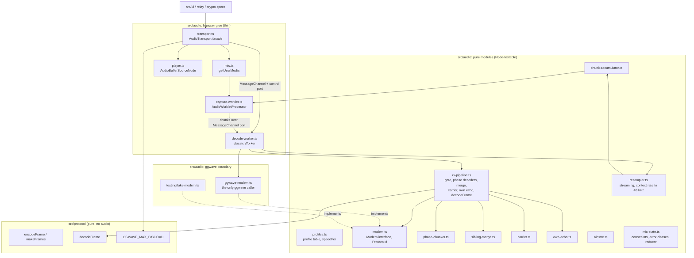
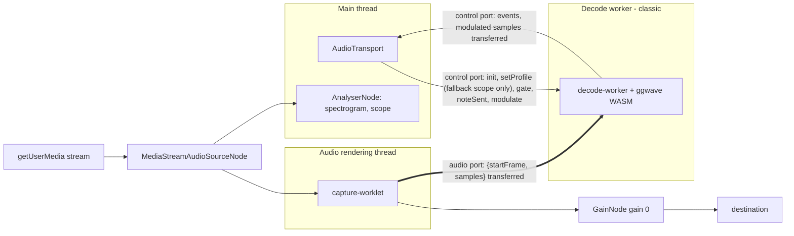
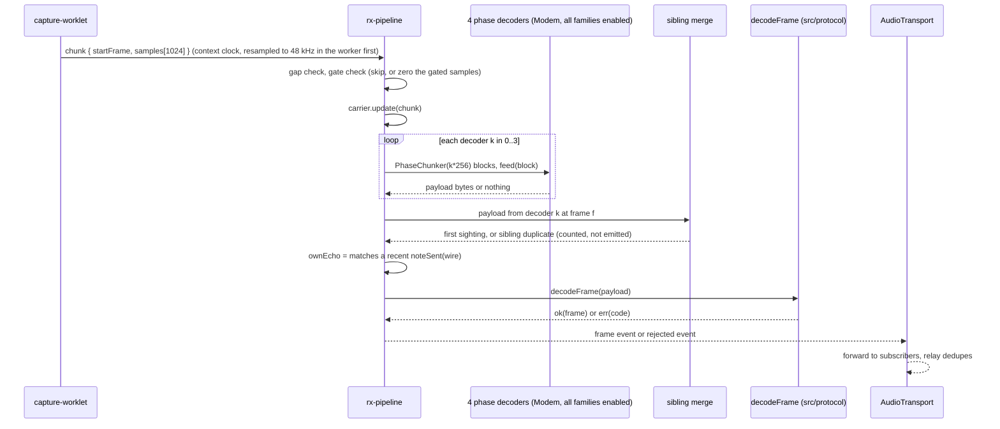
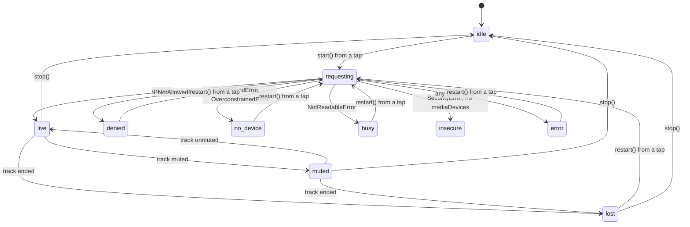

# Design Document: audio-transport

## Overview

The audio transport is the layer in `src/audio` between frames as bytes (`src/protocol`) and the device's speaker and microphone. On the send side it takes the wire bytes of one frame, runs them through ggwave in the active channel profile (Room, Call or Quiet) and plays the result. On the receive side it captures microphone audio, runs several ggwave decoders at different sample alignments, and hands each decoded byte array to `decodeFrame`. It never reads a frame field. The only things it does with wire bytes are check the length, copy them, and compare them for equality (own-echo detection).

Five problems shape the design.

1. **ggwave FASTEST modes sometimes return wrong bytes.** The frame CRC catches this, but the sender never learns that a frame was dropped, and the recorded failures are deterministic (each failing payload was wrong in 20 of 20 replays). The "Speed decision" section compares airtime and reliability and picks a first-send speed and a retry speed for each profile.
2. **A single decoder alignment can miss a frame.** A 140-byte DT frame decoded at sample offsets 0, 256 and 512 but not at 768. The receiver runs four decoders at offsets 0, 256, 512 and 768 and merges their results.
3. **The phone hears itself.** In Room mode the microphone hears our own speaker. The transport mutes the decoders for the duration of our own transmission plus a tail, and flags late exact repeats of our own bytes.
4. **The listener cannot know which mode the sender chose.** In an emergency nobody can coordinate modes first. The receiver therefore listens to every family (AUDIBLE, DT and ULTRASOUND), each at its first and retry speed, whatever channel is selected. The channel switch (Room, Call, Quiet) chooses only how this phone sends. The cost is more decode work per chunk, which task 13.2 measures. If it is too slow on a mid-range phone, the fallback is to listen to the active family only (see "Receive scope decision").
5. **ggwave's protocol toggles are global, not per instance.** Verified on vendored ggwave 0.4.0: `rxToggleProtocol(protocolId, state)` takes no instance argument and only affects decoders created after the call. A decoder created before AUDIBLE_FAST was toggled off still decoded an AUDIBLE_FAST frame, and one created after did not. So the enabled set is fixed when a decoder is created, changing it means recreating the decoders, and toggle plus create must run as one serialized step so two pipelines never interleave.

Everything that can run without a browser is a pure module tested in Node. The browser-only parts (AudioWorklet, Worker, `getUserMedia`, `AudioContext`) are thin glue around those modules. Every ggwave call sits behind one small interface, `Modem`, with one real implementation (`ggwave-modem.ts`) and one fake for tests.

Assumption: the spec uses TypeScript, as the stack in `tech.md` requires. Design parameters that are not measurements are marked "design parameter" in the tables below. The first field test or sweep that contradicts one changes the constant, not the architecture.

## Architecture



Dependency rules (an extension of `structure.md`):
- `src/audio` imports from `src/protocol` only through `src/protocol/index.ts`: `decodeFrame`, `GGWAVE_MAX_PAYLOAD`, and the types `Frame`, `DecodeError`, `DecodeErrorCode`, `Result`.
- The pure modules import no browser global (`window`, `document`, `navigator`, `AudioContext`, `AudioWorkletNode`, `Worker`, `MediaStream`, `importScripts`) and import neither `vendor/ggwave.js` nor the browser glue.
- Only `ggwave-modem.ts` mentions ggwave's API (`ProtocolId`, `rxToggleProtocol`, `encode`, `decode`, `init`, `free`, `getDefaultParameters`) or the global `ggwave_factory`.
- `src/protocol` never imports from `src/audio` (already enforced by `layering.test.ts`).
- `ok` and `err` helpers are not exported by `src/protocol/index.ts`, so `src/audio/result.ts` defines its own two-line copies and reuses the exported `Result` type.

### Threads and ports



- Receive data flow inside the worker: the worker receives a chunk on the context clock, passes it through the resampler (a copy when the context already runs at 48 kHz), the chunk accumulator re-forms 1024-sample chunks on the 48 kHz clock, and the pipeline consumes those. Gate ranges and `noteSent` frames arrive on the context clock and the worker converts them first (see "Sample rates").
- The audio port is a `MessageChannel`. `port1` goes to the worklet through `node.port.postMessage({ port }, [port])`, and `port2` goes to the worker. Audio never touches the main thread.
- Main thread to worker uses a second port, the control port. It carries small messages and the modulated samples going back to the main thread.
- No `SharedArrayBuffer`. Every sample buffer is a transferred `ArrayBuffer`.
- The worklet node is also connected through a `GainNode` with gain 0 to the destination, so the browser keeps pulling the node even though it has no audible output. Playwright confirms this on Chromium (task 12.2).
- The spectrogram and scope read an `AnalyserNode` on the main thread from the same source node. That path is independent of decoding.
- Open risk: transferring a `MessagePort` into an `AudioWorkletGlobalScope` is confirmed only on Chromium by the e2e test. WebKit and iOS need a real-phone check. Fallback if it fails: the main thread forwards the transferred chunks to the worker (still no `SharedArrayBuffer`, one extra hop). The `AudioTransport` public interface does not change.

### Send sequence

```mermaid
sequenceDiagram
    participant App as Caller (ui-flows, relay)
    participant TR as AudioTransport
    participant DW as decode-worker (Modem)
    participant PL as player (AudioContext)
    participant RX as rx-pipeline (worker)

    App->>TR: send(wire, { attempt })
    TR->>TR: length guard (1..140), state checks
    TR->>TR: protocol = send profile family + speedFor(profile, attempt) (send only, receive is unaffected)
    TR->>DW: modulate(id, wire, protocol, volume)
    DW-->>TR: samples (Float32Array, transferred)
    TR->>TR: when = ctx.currentTime + lead; startFrame, endFrame
    TR->>DW: gate(startFrame, endFrame + tail) and noteSent(wire, startFrame)
    TR->>PL: play samples at 'when'
    PL-->>TR: ended
    TR-->>App: ok { airtimeMs, protocol, startFrame, endFrame }
    Note over RX: chunks wholly inside the gate range are skipped,<br/>partly overlapping chunks have only the gated samples zeroed,<br/>decoders and carrier reset at both gate edges
```

### Receive sequence



### Microphone state



`denied`, `no_device`, `busy`, `insecure`, `error` and `lost` stop listening only. Sending still works because it needs only the `AudioContext`.

## Speed decision: FAST or FASTEST

### Evidence used (nothing else)

| Source | What it says |
|---|---|
| `FIELD-FINDINGS.md`, simulation, 24-character message, seconds per message (normal / fast / fastest) | Audible 3.0 / 2.2 / 1.5. Dual-tone 7.4 / 5.2 / 2.9. Ultrasound 3.0 / 2.2 / 1.5. |
| `tech.md` | A full 140-byte payload in DT fastest takes 13.4 s (about 0.096 s per byte). |
| `frame-protocol/design.md`, sweep of 150 random payloads of 1 to 60 bytes per mode, ggwave 0.4.0, 48 kHz, no noise | Wrong bytes: AUDIBLE_FASTEST 3 (2.0%), DT_FASTEST 1 (0.67%), ULTRASOUND_FASTEST 2 (1.33%). AUDIBLE_FAST, DT_FAST and ULTRASOUND_FAST 0 each. Not decoded: 0 in every FASTEST and FAST mode. |
| audio-transport sweep (task 2.3), 1,000 random payloads of 1 to 140 bytes per protocol, ggwave 0.4.0, 48 kHz, no noise, 0.6 s silence each side | Wrong bytes: AUDIBLE_FASTEST 0.2%, ULTRASOUND_FASTEST 0.2%, DT_FASTEST 0. AUDIBLE_FAST, DT_FAST and ULTRASOUND_FAST 0. The three recorded FASTEST failures decode correctly under FAST. ULTRASOUND_FASTEST gave 0 false decodes from silence and low-level noise. |
| `frame-protocol/design.md`, recorded failures | Three payloads that are wrong in FASTEST modes, each wrong in 20 of 20 replays. |
| `FIELD-FINDINGS.md`, Opus voice note, decoder alignments recovered out of 4 at 12 / 16 / 24 / 32 kbps | DT fast 4/4, 4/4, 0/4, 0/4. DT fastest 4/4, 4/4, 2/4, 0/4. Audible fast 4/4, 4/4, 0/4, 0/4. Ultrasound fast 0/4 at all four. |
| `FIELD-FINDINGS.md`, simulated room channel | Ultrasound fast failed in the room simulation ("odd, check live"). Ultrasound fastest and normal passed. |
| `FIELD-FINDINGS.md`, real phones | Room, mobile call and voice note worked. The log does not record which speed was used. |

### How to read the sweep

- Pooled over the three families, FASTEST was wrong in 6 of 450 payloads (1.33%) and FAST in 0 of 450. With 0 of 450 the 95% upper bound is about 3/450, or 0.67% (rule of three). A difference this size would arise by chance about 1.5% of the time if the two speeds were equally reliable (all 6 failures landing in one of two equal groups is about 0.5^6). So FAST probably is more reliable, and the pooled evidence supports that.
- Per profile the samples are 150 each. 0 of 150 for FAST has a 95% upper bound of about 2.0%, which includes every FASTEST point estimate (2.0%, 0.67%, 1.33%). The sweep cannot rank the profiles against each other, and it cannot show that FAST has zero corruption.
- The sweep used payloads of 1 to 60 bytes with no noise. The rate for 140-byte frames and for real channels is unknown. It is a speed-choice input, not a guarantee.

### What a corruption costs

The receiver rejects the frame with `BAD_CRC`, so nothing wrong is ever delivered. The cost is a silent loss: nothing in the protocol tells the sender that a single frame was dropped. For multi-frame messages the receiver can ask again with RESEND_REQUEST, so the cost there is one frame of airtime plus a round trip.

Airtime only: with corruption probability `p`, sending at FASTEST until one frame gets through costs `T_fastest / (1 - p)`. FASTEST stays cheaper than FAST until `p` reaches `1 - T_fastest / T_fast`.

| Profile family | T_fast, T_fastest (24 characters, simulated) | Break-even `p` | Expected FASTEST airtime at the worst observed point estimate |
|---|---|---|---|
| Audible (Room) | 2.2 s, 1.5 s | 1 - 1.5/2.2 = 32% | 1.5 / (1 - 0.02) = 1.53 s |
| Dual-tone (Call) | 5.2 s, 2.9 s | 1 - 2.9/5.2 = 44% | 2.9 / (1 - 0.0067) = 2.92 s |
| Ultrasound (Quiet) | 2.2 s, 1.5 s | 1 - 1.5/2.2 = 32% | 1.5 / (1 - 0.0133) = 1.52 s |

Observed rates are one to two orders of magnitude below break-even, so FASTEST wins on airtime for every profile. The real costs of FASTEST are the silent loss and the fact that a plain resend of the same bytes repeats the same corruption.

For a message of `n` frames at the pooled FASTEST rate of 1.33%, the chance that at least one frame is corrupted is 1.3% for 1 frame, about 5.2% for 4 frames and about 19% for 16 frames. This is a reason to have a different retry speed and to leave recovery of multi-frame messages to RESEND_REQUEST.

### Decision

| Profile | Family | First send | Retry (attempt 1 or later) | Why |
|---|---|---|---|---|
| Room | AUDIBLE | FASTEST | FAST | FASTEST airtime is 1.5 s against 2.2 s (32% less) and the product promise is about 1.5 s. Corruption is caught by the CRC. The retry uses FAST because FAST showed 0 of 150 wrong, and because a different modulation avoids replaying the deterministic corruption. |
| Call | DT | FASTEST | FAST | FASTEST airtime is 2.9 s against 5.2 s (44% less), which matters most on a phone call. FASTEST had the lowest wrong rate of the three (1 of 150). Through Opus at 24 kbps FASTEST recovered 2 of 4 alignments and FAST 0 of 4, so FASTEST is no worse on lossy paths. Same retry as Room. |
| Quiet | ULTRASOUND | FASTEST | FASTEST | FAST failed in the room simulation and is unexplained, so it is not used for Quiet. Quiet has no better retry speed on the evidence, so a retry repeats FASTEST and the caller must change the bytes or accept the repeat. See open question 2. |

Rules that follow from the decision:
- `speedFor(profile, attempt)` returns `firstSpeed` for `attempt` 0 and `retrySpeed` for any larger attempt. The caller owns the attempt counter (user resend taps, RESEND_REQUEST answers). A relay re-broadcast is a new first send of patched bytes (new hop and CRC), so it uses attempt 0.
- The receiver enables the first and retry speed of every profile's family (deduplicated) and nothing else, whatever channel is selected for sending. With the table below that is AUDIBLE_FASTEST, AUDIBLE_FAST, DT_FASTEST, DT_FAST and ULTRASOUND_FASTEST (5 protocols). The set is derived from `PROFILES`, so a changed row changes it. NORMAL modes are never enabled: AUDIBLE_NORMAL had 3 of 150 not decoded in the sweep, and the NORMAL modes are the slowest. A decoder with AUDIBLE_FAST off but AUDIBLE_NORMAL on decoded a 5-byte AUDIBLE_FAST message correctly (a 12-byte one did not), so decoding crosses speeds within a family. This is further evidence for never enabling NORMAL and for toggling every protocol explicitly. ULTRASOUND_FAST is not enabled while Quiet's retry speed is FASTEST.
- The table is data in `profiles.ts`. Changing a decision changes one row and the airtime test, not the pipeline.
- The speed table stands on the audio-transport sweep above. The 2% rule (requirement 12.3) was not triggered: the highest first-speed wrong rate was 0.2%. The sweep is without noise, so real channels can still change this, and a field run is the next check.

### Open questions

1. Resolved: FAST decodes all three recorded FASTEST failures correctly (task 2.3 replay).
2. Whether a Quiet retry should use FAST depends on a live check of the unexplained room-simulation failure. If FAST passes live, change the Quiet retry to FAST. Because the receive set is derived from `PROFILES`, that change also adds ULTRASOUND_FAST to what every phone listens for, and the CPU measurement in task 13.2 must be repeated with 6 protocols.
3. The speeds used in the Nov 13 real-phone tests are not logged. Task 2 asks for a field re-run with the speed written down.
4. Whether the CARRIER light needs a tonality test to ignore speech. The first version uses energy only, and with every band watched (not just the active one) speech can light the Room and Call bands at any time. Revisit after the first field run with talking in the background.
5. Whether decoding 4 offsets x all 5 enabled protocols fits the CPU budget of a mid-range phone. Unmeasured. Task 13.2 measures it. If it is too slow, fall back to the active family only (see "Receive scope decision") and record the measurement that forced it.
6. Partly resolved. In simulation, ULTRASOUND_FASTEST gave no false decodes from silence or low-level noise. Still open: false or wrong decodes from ambient ultrasound in the field, and whether phone microphones capture the Quiet band at all. The field run checks both. The CRC already rejects wrong bytes.

### Receive scope decision

| Option | Listens to | Cost | Status |
|---|---|---|---|
| `all` (chosen) | Every family, first and retry speed (5 protocols) | 4 offsets x 5 protocols of decode work per chunk. Unmeasured. | Default. The listener never needs to know the sender's mode. |
| `active` (fallback) | Only the selected profile's family, first and retry speed (2 protocols, 1 for Quiet) | Lowest. Switching channel recreates the decoders. | Used only if task 13.2 shows `all` is too slow on a mid-range phone. |

The scope is one constant, `RX_LISTEN_SCOPE: "all" | "active"`, in `profiles.ts`. Fallback record (to be filled by task 13.2): device, sample rate, decoders, protocols, worker busy time per chunk, and the budget that was exceeded. Until then the value is `all`.

## Components and Interfaces

### profiles.ts

**Purpose**: The one table of channel profiles, the send-speed rule, and the set of protocols the receiver listens for. A profile decides how this phone sends. It does not decide what this phone hears.

```ts
export type ProfileId = "room" | "call" | "quiet";
export type Family = "AUDIBLE" | "DT" | "ULTRASOUND";
export type Speed = "FASTEST" | "FAST";
/** NORMAL modes are deliberately not representable. */
export type ProtocolId = `${Family}_${Speed}`;

export interface ChannelProfile {
  readonly id: ProfileId;
  readonly family: Family;
  readonly firstSpeed: Speed;
  readonly retrySpeed: Speed;
  /** Inclusive band for this profile's carrier detector, in Hz. A null band has no detector. */
  readonly carrierBandHz: readonly [lowHz: number, highHz: number] | null;
  /** ggwave encode volume, 0..100. */
  readonly volume: number;
}

export const PROFILES: Readonly<Record<ProfileId, ChannelProfile>>;
export function speedFor(profile: ChannelProfile, attempt: number): Speed;
export function protocolFor(profile: ChannelProfile, attempt: number): ProtocolId;
/** Receive scope. "all" is the decision. "active" is the recorded CPU fallback (see "Receive scope decision"). */
export const RX_LISTEN_SCOPE: "all" | "active";
/** The deduplicated first and retry protocols of every profile in PROFILES. The default receive set. */
export function allRxProtocols(): readonly ProtocolId[];
/** The deduplicated first and retry protocols of one profile. Used only when RX_LISTEN_SCOPE is "active". */
export function rxProtocols(profile: ChannelProfile): readonly ProtocolId[];
/** What a pipeline listens for: allRxProtocols() when scope is "all", else rxProtocols(profile). */
export function rxSet(scope: "all" | "active", profile: ChannelProfile): readonly ProtocolId[];
```

| Profile | Family | First / retry | Carrier band | Volume |
|---|---|---|---|---|
| room | AUDIBLE | FASTEST / FAST | 1,900 to 6,400 Hz (about 1.9 to 6.4 kHz, `BRIEF.md`) | 25 |
| call | DT | FASTEST / FAST | 1,120 to 2,580 Hz (measured, `field-findings.md`) | 25 |
| quiet | ULTRASOUND | FASTEST / FASTEST | 15,000 to 19,400 Hz, measured by task 3.1 from ggwave's own output spectrum (central 95% of energy at 48 kHz, rounded outward to 100 Hz). | 25 |

Receive set with the table above: AUDIBLE_FASTEST, AUDIBLE_FAST, DT_FASTEST, DT_FAST, ULTRASOUND_FASTEST. Every profile's carrier band is watched at all times (a profile with a null band has no detector), so a Call burst can light the Room detector too, because the bands overlap from 1,900 to 2,580 Hz (see carrier.ts).

- The Room and Call bands and the volume are initial values. A unit test (task 3) encodes sample payloads in Node and requires at least 90% of the signal energy to fall inside each profile's band (the 90% is a design parameter). The test, not this table, is the authority, and a failing band changes the table row.
- Volume 25 is the value used in the recorded sweep. Tuning it on real speakers is a field task, and the table row is the only place it lives.
- `speedFor` throws nothing and treats a negative or non-integer `attempt` as 0.
- Changing the selected profile never changes the receive set while `RX_LISTEN_SCOPE` is `"all"`.

### modem.ts

**Purpose**: The only interface the rest of `src/audio` knows about ggwave. No import from `vendor/` or from any ggwave type.

```ts
export interface Modem {
  /** The AudioContext's rate. Used for modulate and for airtime. */
  readonly txSampleRate: number;
  /** Always RX_SAMPLE_RATE (48,000). Used by the pipeline, the carrier bank and own-echo. */
  readonly rxSampleRate: number;
  /** Returns a copy of the waveform. Never a view into WASM memory. */
  modulate(payload: Uint8Array, protocol: ProtocolId, volume: number): Float32Array;
  /**
   * Create `count` decoders that all listen for exactly `protocols`. Resolves after the toggles and
   * the creations ran as one serialized step (see ggwave-modem.ts). The enabled set is fixed for the
   * life of each decoder. To change it, dispose the decoders and call this again.
   */
  createDecoders(protocols: readonly ProtocolId[], count: number): Promise<ModemDecoder[]>;
  dispose(): void;
}

export interface ModemDecoder {
  /** Feed one block of exactly CHUNK_SAMPLES samples. Returns a copy of the decoded payload, or null. */
  feed(block: Float32Array): Uint8Array | null;
  /** Drop partial reception state (free and re-init the ggwave instance, with this decoder's own protocol set re-applied first). */
  reset(): void;
  /** The protocols this decoder was created with. Read-only. */
  readonly protocols: readonly ProtocolId[];
  dispose(): void;
}
```

Guarantees: `modulate` never mutates `payload`. `feed` never returns a view into WASM memory and never returns an empty array (it returns `null`). Neither function throws on data. A failure inside ggwave becomes `null` (decode) or a thrown `ModemError` (modulate), because a modulate failure is a defect, not a data error.

### ggwave-modem.ts

**Purpose**: The real `Modem`, and the only file that touches ggwave.

```ts
export interface GgwaveFactoryResult { /* opaque, mirrors the vendored build's API */ }
export function createGgwaveModem(
  factory: () => Promise<GgwaveFactoryResult>,
  opts: { txSampleRate: number },
): Promise<Modem>;
/** The one decode rate. ggwave 0.4.0 does not decode at 44,100 Hz (see "Sample rates"). */
export const RX_SAMPLE_RATE = 48000;
```

Responsibilities, all taken from the calls in `ggwave.slow.test.ts`:
- Call `getDefaultParameters` and `init` for every instance. Encoder instances set `sampleRateOut` (and `sampleRateInp`) to `txSampleRate`, the `AudioContext`'s actual rate. Decoder instances set `sampleRateInp` (and `sampleRateOut`) to `RX_SAMPLE_RATE`.
- Map `ProtocolId` to `ProtocolId.GGWAVE_PROTOCOL_<id>`. `rxToggleProtocol(protocolId, state)` is global to the loaded ggwave module (verified on 0.4.0: no instance argument, and it only affects decoders created after the call). So a decoder's protocol set is decided by the toggles in force at the moment it is created, and nothing else.
- Own the full list of ggwave protocols, including the NORMAL modes and any family or speed the app does not use (`ALL_GGWAVE_PROTOCOLS`, inside this file only). Before creating decoders, set the toggle of every one of them explicitly: on for the requested set, off for all others. Never rely on ggwave's defaults or on what an earlier setup left behind.
- Create decoders only through one function, `setupDecoders(protocols, count)`, which runs these steps with no `await` between them: toggle all protocols, then create `count` ggwave instances. `ModemDecoder.reset()` goes through the same two steps for its own protocol set (toggle all, then free and re-init), because re-init is a creation and would otherwise pick up whatever set another pipeline left global.
- Serialize setups with a promise queue (a mutex) keyed per decode module: `createDecoders` appends its `setupDecoders` call to the queue, so two pipelines starting concurrently run one after the other and never interleave toggles with creations. The critical section itself is synchronous, so `reset()` (also synchronous) cannot interleave with it either, because JavaScript in one worker runs to completion. The queue belongs to the decode module, so it also covers several `Modem` objects built on one ggwave module. The encode module has no toggle state that matters (Property 15 (e)), so it needs no mutex.
- Changing the enabled set means recreating: `dispose` the old decoders, then `createDecoders` again. There is no call that changes the set of a live decoder. `encode` is not expected to depend on the rx toggles. The slow test asserts that, and the design does not rely on it until the test has passed.
- Copy the encode result out of WASM memory before any other call allocates, and copy the decode result the same way.
- Call `disableLog()` once. Free instances in `dispose`.
- Re-check the payload length (1 to 140 bytes) and throw `ModemError("BAD_LENGTH")` as a last-line guard, because ggwave truncates silently.

In the worker, the factory is the global `ggwave_factory` that `importScripts` defines from `vendor/ggwave.js` (a UMD build with inlined WASM). In Node tests the factory is the one `ggwave.slow.test.ts` already loads with `createRequire`.

#### Instance budget

ggwave 0.4.0 allows at most 4 live instances per loaded module. Verified: of 12 `init()` calls, the first 4 returned ids 0 to 3 and the rest returned -1. A -1 instance decodes nothing, and encoding with one crashed. `MAX_INSTANCES_PER_MODULE = 4` is a constant in `ggwave-modem.ts`.

**Two modules per Modem.** `createGgwaveModem` calls the factory twice.
- The decode module holds the decoders only, up to 4. It owns the `rxToggleProtocol` state and the Setup_Mutex, which is keyed per decode module.
- The encode module holds no long-lived instance. `modulate` runs init, encode, copy and free on it, so it uses at most 1 slot at a time.

| Option | Verdict | Reason |
|---|---|---|
| 3 decoders plus 1 encoder slot on one module | Rejected | It drops an alignment offset. The field findings show one Opus message decoded at only 1 of 4 offsets. |
| Free a decoder while sending | Rejected | `airtimeMs` calls `modulate` while the user types, so a decoder would be torn down and rebuilt through the mutex on keystrokes. |
| Separate encode module | Chosen | The cost is one extra WASM instance. Toggles cannot affect encoding (Property 15 (e)). |

**Memory.** Node baseline (vendored ggwave 0.4.0 in Node, measured by the user):
- Two factory calls give separate heaps and separate budgets.
- With 4 decoders live on the decode module (ids 0 to 3), the encode module still got id 0, encoded, and all 4 decoders decoded the result.
- Heap after setup: decode module 88.3 MB peak with 4 decoders, encode module 31.1 MB idle. At the end of the Property 15 (f) slow test the decode module was logged at 25.9 MB and the encode module at 31.1 MB.
- Load time is a few ms per module in Node.
- Mobile risk: the worker footprint is about 120 MB. Task 13.2 checks it on a real phone, together with startup time with two modules. Real-phone numbers come from task 13.2.

**Negative ids are errors.** A new `ModemError` code `NO_INSTANCE` covers every case where ggwave returns a negative instance id. Rule: a negative id is never encoded with, decoded with or freed.
- `setupDecoders(protocols, count)` checks `live + count > MAX_INSTANCES_PER_MODULE` before any toggle or `init`, and throws `NO_INSTANCE` with nothing created. If an `init` still returns a negative id, the setup frees the instances it already created (never the negative id) and throws.
- `createDecoders` rejects with that error. `createRxPipeline` then rejects, and the transport reports `StartError("MODEM_LOAD_FAILED")` with the code in the message.
- `modulate` throws `NO_INSTANCE` on a negative id. The transport maps it to `MODEM_FAILED`.
- `reset()` frees, then re-inits. If the new id is negative, the decoder is marked dead and `reset` throws `NO_INSTANCE`. `feed` on a dead decoder returns `null`, so `feed` still never throws. `dispose` on a dead decoder frees nothing.

**Budget rules.**
- One pipeline uses 4 decoders, which is the whole decode budget. Two pipelines on the same Modem fail loudly with `NO_INSTANCE`.
- In the `"active"` fallback, `setProfile` must dispose the old decoders before creating new ones.
- Task 13.2 cannot choose more than 4 decoder offsets without a third module.
- Fake_Modem takes an optional `maxDecoders` (default 4). `createDecoders` rejects with `NO_INSTANCE` when the live count would exceed it.

### testing/fake-modem.ts

**Purpose**: A deterministic `Modem` for Node tests that run no WASM. It records the protocol of every packet it writes, and a fake decoder decodes a packet only when its protocol is in the set the decoder was created with. That lets fast tests check receive coverage across families.

```ts
export interface FakeModemOptions {
  txSampleRate: number;
  /** Defaults to RX_SAMPLE_RATE (48,000). */
  rxSampleRate?: number;
  /** Start phases (sample index mod CHUNK_SAMPLES of the packet start, relative to the decoder's block grid) at which decoding fails. */
  blockedPhases?: (phase: number) => boolean;
  /** Called on every modulate and feed, so tests can count ggwave calls. */
  onCall?: (name: "modulate" | "feed" | "reset") => void;
  /** Flip one payload byte on decode, to model silent ggwave corruption. */
  corrupt?: (payload: Uint8Array) => Uint8Array;
  /** Live decoder limit, default 4 (MAX_INSTANCES_PER_MODULE). createDecoders rejects with ModemError("NO_INSTANCE") when exceeded. */
  maxDecoders?: number;
}
export function createFakeModem(opts: FakeModemOptions): Modem;
```

The fake writes a recognizable block (marker samples, length, payload as sample values, end marker) so a decoder can find the packet at any position in the stream, and fails when the packet's phase against the decoder's block grid is blocked. It is a model of alignment dependence, not a model of ggwave. Real behaviour is checked by the slow tests.

### phase-chunker.ts

**Purpose**: Turn the continuous sample stream into blocks of `CHUNK_SAMPLES` whose boundaries sit at absolute frames congruent to `offset` modulo `CHUNK_SAMPLES`.

```ts
export const CHUNK_SAMPLES = 1024;
export const DECODER_OFFSET_STEP = 256;
export const DECODER_OFFSETS = [0, 256, 512, 768] as const;

export interface PhaseChunker {
  /** Returns zero or more full blocks. Input may be any length. */
  push(startFrame: number, samples: Float32Array): Float32Array[];
  /** Forget buffered samples. The next block starts at the next frame congruent to offset. */
  reset(): void;
}
export function createPhaseChunker(offset: number): PhaseChunker;
```

The phase is tied to the absolute stream frame, not to the moment of reset, so a decoder keeps the same alignment after every gate.

### chunk-accumulator.ts

**Purpose**: Used inside the worklet. Collects the 128-sample render quanta into 1024-sample chunks.

```ts
export interface ChunkAccumulator {
  /** quantum: channel 0 of one render quantum. frame: AudioWorkletGlobalScope currentFrame. */
  push(quantum: Float32Array, frame: number): { startFrame: number; samples: Float32Array } | null;
}
export function createChunkAccumulator(chunkSamples: number): ChunkAccumulator;
```

Each returned chunk owns a fresh buffer (so it can be transferred). If `frame` is not equal to the expected next frame (a gap), the accumulator drops the partial chunk and restarts at `frame`.

### resampler.ts

**Purpose**: Convert capture at the context rate to 48,000 Hz, so the decoders always run at the one rate where ggwave 0.4.0 decodes. A pure module with no browser global. It is the fallback path, used when the context cannot run at 48 kHz.

```ts
export interface Resampler {
  /** Streaming. Returns the output samples that the input so far completes. */
  process(samples: Float32Array): Float32Array;
  /** Forget filter history and the phase. */
  reset(): void;
}
export function createResampler(fromRate: number, toRate: number): Resampler;
```

- Stateful and streaming. The total output frame count after n input frames is exact and does not depend on how the input is split into `process` calls.
- 44,100 to 48,000 is the ratio 160/147, done with a polyphase windowed-sinc filter.
- The tap count (modest, a design parameter, for example 16 to 32 taps per phase) and the window (a design parameter, for example Kaiser) are named constants.
- Linear interpolation is ruled out because of the Quiet band (15 to 19.4 kHz against a 22.05 kHz Nyquist).
- When `fromRate === toRate` the samples pass through unchanged (a copy).
- Data flow: the worker receives a chunk on the context clock, the resampler converts it, the chunk accumulator re-forms 1024-sample chunks at 48 kHz, and the pipeline consumes them.

### rx-pipeline.ts

**Purpose**: All receive logic that does not need a browser. The worker owns one instance and forwards messages to it.

```ts
export interface RxPipelineOptions {
  modem: Modem;
  /** The pipeline, the carrier bank and own-echo use modem.rxSampleRate (48,000 Hz), never txSampleRate. */
  /** Read only when rxScope is "active" (the CPU fallback). With "all" it plays no part in receiving. */
  profile: ChannelProfile;
  rxScope?: "all" | "active";                // default RX_LISTEN_SCOPE
  decoderOffsets?: readonly number[];        // default DECODER_OFFSETS
  tailGuardMs?: number;                      // default TX_TAIL_GUARD_MS. Time is the stream clock only.
}

export type RxEvent =
  | { kind: "frame"; wire: Uint8Array; frame: Frame; atFrame: number; ownEcho: boolean }
  | { kind: "rejected"; code: DecodeErrorCode; byteLength: number; atFrame: number }
  /** One detector per profile band. `profile` names the band, not the sender's mode. */
  | { kind: "carrier"; profile: ProfileId; active: boolean; atFrame: number }
  | { kind: "discontinuity"; atFrame: number; missingFrames: number };

export interface RxPipeline {
  push(chunk: { startFrame: number; samples: Float32Array }): RxEvent[];
  /**
   * Gate the Stream_Frames [fromFrame, untilFrame). A chunk wholly inside is skipped. A chunk that partly overlaps
   * is copied and only the samples whose frame is in the range are zeroed before normal processing.
   * Decoders and carrier reset at both edges.
   */
  gate(fromFrame: number, untilFrame: number): void;
  /** Remember our own transmission for echo detection. */
  noteSent(wire: Uint8Array, atFrame: number): void;
  /**
   * Fallback scope only. With rxScope "all" this is a no-op, because the receive set does not depend on the profile.
   * With "active" it disposes the decoders and creates new ones for rxProtocols(profile) through createDecoders.
   */
  setProfile(profile: ChannelProfile): Promise<void>;
  stats(): RxStats;
  dispose(): void;
}

export interface RxStats {
  chunks: number;
  /** Chunks wholly inside a gate range, skipped. */
  gatedChunks: number;
  /** Chunks that partly overlapped a gate range, zeroed in the overlap and processed. */
  partlyGatedChunks: number;
  discontinuities: number;
  /** Frames emitted. */
  frames: number;
  /** Rejections by DecodeErrorCode. */
  rejected: Readonly<Record<string, number>>;
  /** Index k counts payloads first or additionally decoded by the decoder at offset k. */
  decoderHits: readonly number[];
  /** Payloads that sibling decoders repeated and the merge swallowed. */
  siblingDuplicates: number;
}
/** Async because decoders come from modem.createDecoders(rxSet(scope, profile), decoderOffsets.length). */
export function createRxPipeline(opts: RxPipelineOptions): Promise<RxPipeline>;
```

`push` is the only place that calls `decodeFrame`. It never inspects a field of the result: it copies `frame` and `wire` into the event. All decoders of one pipeline share one protocol set, so one pipeline setup is one `createDecoders` call (one serialized toggle-then-create step). Decoders do not report which protocol decoded a payload (ggwave returns bytes only), so events carry no family and nothing downstream may depend on one. The fallback `setProfile` replaces the decoders and resets the chunkers and carrier detectors. Any partly received frame is dropped.

### sibling-merge.ts

**Purpose**: Collapse the same physical reception seen by several decoders into one event, without touching message identity.

```ts
export const SIBLING_MERGE_FRAMES = 2 * CHUNK_SAMPLES;  // design parameter
export interface SiblingMerge {
  /** Returns true when this payload is new and must be emitted. */
  offer(decoder: number, payload: Uint8Array, atFrame: number): boolean;
}
export function createSiblingMerge(windowFrames: number): SiblingMerge;
```

A payload is a sibling duplicate when its bytes equal a payload offered earlier by a different decoder, and the new `atFrame` is within `windowFrames` of that earlier payload's first sighting. Byte equality is the only test. The same decoder offering the same bytes twice, or any sighting after the window, counts as a new reception. Different bytes are never merged. This is not message dedupe. Two real transmissions of one message are two receptions, and the `relay` spec drops the second by `frameKey`.

Why 2048 frames: sibling decoders see the same end-of-packet within one block of each other (1024 frames at most apart), plus the one-block processing delay. Design parameter, about 43 ms at 48 kHz.

### carrier.ts

**Purpose**: Tell the UI "there is energy in the band of profile P" without decoding, for every profile that has a measured band. Because the receiver listens to every family, the bands are watched all the time, whichever channel is selected for sending. The UI combines them (any band active lights CARRIER) and may show which band.

```ts
export interface CarrierDetector {
  /** Feed one chunk's power spectrum. Returns a new state only when it changes, else null. */
  update(spectrum: Float32Array, atFrame: number): boolean | null;
  reset(): void;
}
export function powerSpectrum(samples: Float32Array): Float32Array;   // Hann window + FFT, computed once per chunk
export function bandPower(spectrum: Float32Array, sampleRate: number, band: readonly [number, number]): number;
export function createCarrierDetector(opts: { sampleRate: number; band: readonly [number, number] }): CarrierDetector;
/** One detector per profile whose carrierBandHz is not null. */
export interface CarrierBank {
  update(samples: Float32Array, atFrame: number): { profile: ProfileId; active: boolean }[];
  reset(): void;
}
/** sampleRate is modem.rxSampleRate (48,000 Hz). */
export function createCarrierBank(sampleRate: number, profiles: Readonly<Record<ProfileId, ChannelProfile>>): CarrierBank;
```

Algorithm (see "Algorithmic Pseudocode"): Hann-windowed radix-2 FFT of each 1024-sample chunk (once, shared by all detectors), power summed over the bins inside each band, compared with that band's adaptive noise floor by ratio, with hysteresis. The Room band (1,900 to 6,400 Hz) and the Call band (1,120 to 2,580 Hz) overlap from 1,900 to 2,580 Hz, so one transmission can light both. A band light therefore means "energy in this band", not "a sender in this mode". Because it compares a ratio, scaling the whole signal by any gain gives the same decisions. This follows the rule that noise is measured against level, not at an absolute value.

| Constant | Value | Basis |
|---|---|---|
| `CARRIER_ON_RATIO` | 8 (9 dB) | design parameter |
| `CARRIER_OFF_RATIO` | 4 (6 dB) | design parameter |
| `CARRIER_ON_CHUNKS` | 2 | design parameter, about 43 ms |
| `CARRIER_OFF_CHUNKS` | 6 | design parameter, about 128 ms, bridges the gaps between ggwave tones |
| `FLOOR_WINDOW_CHUNKS` | 96 | design parameter, about 2 s |
| `MAX_CARRIER_MS` | 20,000 | design parameter, longer than the 13.4 s full-frame airtime. On expiry the floor is re-baselined, so a constant noise source cannot hold the light on forever. |

Known limit: speech has energy in the Room and Call bands, so CARRIER can light during talking. The light means "something is in the band", not "a modem is sending". UI copy must not say "modem detected". Open question 4.

### own-echo.ts

**Purpose**: Recognise our own transmission coming back after the gate.

```ts
export const OWN_ECHO_RING = 8;              // design parameter
export const OWN_ECHO_WINDOW_MS = 30_000;    // design parameter
export interface OwnEcho {
  note(wire: Uint8Array, atFrame: number): void;
  /** True when payload equals one of the last OWN_ECHO_RING sent wires and atFrame is within the window. */
  isEcho(payload: Uint8Array, atFrame: number): boolean;
}
/** sampleRate is modem.rxSampleRate: atFrame values are Stream_Frames on the 48 kHz clock. */
export function createOwnEcho(sampleRate: number): OwnEcho;
```

Stores copies. Byte equality only. The check is independent of family and speed: the decoder does not report which protocol it heard, and the sent wire is the same bytes in any mode. Since we now hear every family, our own frame can also return through a different path than the one we sent on (for example a Call-mode frame heard acoustically in the room). It is still flagged, because the bytes are equal. A relayed copy with a patched hop differs in bytes and is not flagged, which is correct: it is another node's transmission, and the relay spec dedupes it by `frameKey`.

### mic-state.ts

**Purpose**: The pure parts of microphone setup.

```ts
export const MIC_CONSTRAINTS: MediaStreamConstraints;   // { audio: { echoCancellation: false, noiseSuppression: false, autoGainControl: false, channelCount: 1 }, video: false }
export type MicErrorCode = "DENIED" | "NO_DEVICE" | "BUSY" | "INSECURE" | "UNKNOWN";
export function classifyMicError(name: string | undefined): MicErrorCode;
export function processingDisabled(s: { echoCancellation?: boolean; noiseSuppression?: boolean; autoGainControl?: boolean }): boolean;
export type MicState = "idle" | "requesting" | "live" | "muted" | "lost" | "denied" | "no_device" | "busy" | "insecure" | "error";
export type MicEvent =
  | { type: "request" } | { type: "granted" } | { type: "failed"; code: MicErrorCode }
  | { type: "track-ended" } | { type: "track-muted" } | { type: "track-unmuted" } | { type: "stop" };
export function micReducer(state: MicState, event: MicEvent): MicState;
```

`MIC_CONSTRAINTS` omits `sampleRate`, so the browser uses the context's rate. `classifyMicError` maps `NotAllowedError` to DENIED, `NotFoundError` and `OverconstrainedError` to NO_DEVICE, `NotReadableError` to BUSY, `SecurityError` to INSECURE, and everything else (including `undefined`) to UNKNOWN. `processingDisabled` is true only when all three settings are exactly `false`. A browser that ignores a constraint reports `true` for it, and the transport then emits a `mic-processing` warning but keeps listening.

### airtime.ts

**Purpose**: Real airtime for the byte meter, from the real encoder.

```ts
export function airtimeMs(modem: Modem, profile: ChannelProfile, attempt: number, byteLength: number): number;
```

It modulates a zero-filled payload of `byteLength` bytes and returns `samples.length / modem.txSampleRate * 1000` (airtime uses the transmit rate), cached by `(protocol, byteLength)`. It exists because `tech.md` says airtime is about 0.1 s per byte, and the exact figure depends on mode and rate. It makes no claim that airtime depends only on length: the slow test asserts that on real ggwave (task 10.3) before the cache is trusted.

### Browser glue (thin, no logic worth a unit test)

| File | Job | Logic it holds |
|---|---|---|
| `capture-worklet.ts` | `AudioWorkletProcessor` named `capture`. Calls `createChunkAccumulator(1024)` on channel 0 of each quantum and posts `{ startFrame, samples }` with the buffer in the transfer list over the audio port. Returns `true`. | None beyond the accumulator. |
| `decode-worker.ts` | Classic worker. `importScripts(ggwaveUrl)`, builds `createGgwaveModem` with `txSampleRate` set to the context's rate, runs the resampler and a chunk accumulator in front of one `RxPipeline`, converts gate and `noteSent` frames to the 48 kHz clock, forwards `RxEvent`s, answers `modulate`. | Message switch only. |
| `mic.ts` | Calls `getUserMedia(MIC_CONSTRAINTS)`, wires `ended`, `mute`, `unmute` and `devicechange` to `micReducer`. | None. |
| `player.ts` | Copies samples into an `AudioBuffer`, starts an `AudioBufferSourceNode` at a scheduled time, resolves on `ended`. | None. |
| `transport.ts` | The `AudioTransport` facade below. Creates the channels, owns the state, validates calls. | Length guard, scheduling arithmetic, state checks. |

### transport.ts: the public interface

```ts
export type TransportEvent =
  | RxEvent
  | { kind: "mic"; state: MicState; processingDisabled?: boolean }
  | { kind: "context"; state: "running" | "suspended" | "interrupted" | "closed" }
  | { kind: "foreground"; visible: boolean }
  | { kind: "tx"; phase: "start" | "end"; protocol: ProtocolId; airtimeMs: number }
  | { kind: "airtime"; profile: ProfileId; byteLength: number; attempt: number; ms: number } // amendment from ui-shell
  | { kind: "listening"; on: boolean }                                                      // amendment from ui-shell
  | { kind: "overrun"; droppedChunks: number };

/** Amendment from ui-shell: lets src/ui read a spectrum without the DOM AnalyserNode type. */
export interface SpectrumSource {
  readonly fftSize: number;
  readonly frequencyBinCount: number;
  readonly sampleRate: number;
  getByteFrequencyData(out: Uint8Array): void;
}

export type SendErrorCode =
  | "EMPTY" | "TOO_LONG" | "NOT_STARTED" | "NOT_RUNNING" | "BUSY" | "MODEM_FAILED";

export interface SendReport {
  readonly protocol: ProtocolId;
  readonly airtimeMs: number;
  readonly startFrame: number;
  readonly endFrame: number;
}

export interface SendOptions {
  /** 0 for a first send, 1 or more for a resend. Default 0. */
  readonly attempt?: number;
}

export interface AudioTransport {
  /** Must be called from a user tap. Creates the AudioContext, loads the worker and worklet, asks for the mic. */
  start(): Promise<Result<{ sampleRate: number; mic: MicState }, StartError>>; // amendment from ui-shell: ok whenever sending works, including when only the mic failed
  /** Re-ask for the mic after denied, lost or busy. Must be called from a user tap. */
  restartMic(): Promise<Result<void, MicError>>;
  stop(): Promise<void>;
  /** Chooses how this phone sends. Receiving covers every family regardless (unless RX_LISTEN_SCOPE is "active"). */
  setProfile(id: ProfileId): Result<void, { code: "BUSY" | "NOT_STARTED" }>;
  send(wire: Uint8Array, opts?: SendOptions): Promise<Result<SendReport, { code: SendErrorCode }>>;
  /** Frames in order, with a gap in seconds between them. */
  sendSequence(wires: readonly Uint8Array[], opts?: SendOptions & { gapMs?: number }): Promise<Result<readonly SendReport[], { code: SendErrorCode; sent: number }>>;
  airtimeMs(byteLength: number, attempt?: number): number | null; // amendment: null on a miss, the answer arrives as an "airtime" event, then it is cached
  /** Amendment from ui-shell. false: the worker stops feeding the pipeline and forwarding frame, rejected and carrier events. The mic stays open. */
  setListening(on: boolean): Result<void, { code: "NOT_STARTED" | "NO_MIC" }>;
  subscribe(listener: (event: TransportEvent) => void): () => void;
  readonly profile: ProfileId;
  readonly sampleRate: number | null;
  /** Amendment from ui-shell. null before start() and after stop(). */
  readonly analyser: SpectrumSource | null;
}
```

**Amendments from ui-shell** (four items, folded in without renumbering anything; implemented in tasks 11.1 and 11.2):

1. `analyser`: a `SpectrumSource` wrapping the `AnalyserNode`, `null` before `start()` and after `stop()`.
2. `airtime` event: `airtimeMs` returns the cached value or `null`, and on a miss asks the worker. The answer arrives as `{ kind: "airtime", profile, byteLength, attempt, ms }`. The cache is per profile and byte length.
3. `setListening(on)`: `false` stops chunk feeding and the forwarding of `frame`, `rejected` and `carrier` events, keeps the mic stream open, and emits `{ kind: "listening", on }`. Sending is unaffected. Before `start()` it returns `NOT_STARTED`.
4. `start()` returns `ok({ sampleRate, mic })` only when sending works, including when only the microphone failed. It returns an error whenever sending does not work, whatever the cause: `MODEM_LOAD_FAILED`, `NO_AUDIO_CONTEXT`, or a worker crash or codec initialisation failure, the last two as the new `StartError` code `SEND_UNAVAILABLE`.

- `send` does not read the frame. It rejects `wire.length === 0` (`EMPTY`) and `wire.length > GGWAVE_MAX_PAYLOAD` (`TOO_LONG`) before any modem call. It does not check the CRC or parse the header.
- One transmission at a time. A second `send` while one is in flight returns `BUSY`. Ordering and queuing of frames belongs to the caller, and `sendSequence` is the only convenience.
- `sendSequence` waits `gapMs` (default `INTER_FRAME_GAP_MS` = 600, the silence padding of the recorded evidence, a design parameter) between frames and stops on the first error, reporting how many frames were sent.
- Listen-before-talk is not enforced. The UI can read the last `carrier` event to warn that the channel is busy.
- `start` is idempotent. Its `StartError` code is `MODEM_LOAD_FAILED`, `NO_AUDIO_CONTEXT` or (amendment from ui-shell) `SEND_UNAVAILABLE`. A mic failure leaves the transport usable for sending, so `start` returns ok with `mic` set to the failed state and no `StartError` (this replaces the earlier rule that a `MicErrorCode` could be the `StartError` code).

### Constants

| Constant | Value | Basis |
|---|---|---|
| `GGWAVE_MAX_PAYLOAD` | 140 | Imported from `src/protocol`. Never redefined. |
| `CHUNK_SAMPLES` | 1024 | Chunk size of the recorded evidence. |
| `DECODER_OFFSETS` | 0, 256, 512, 768 | `field-findings.md` (parallel decoders offset by 256 samples). `tech.md` says 3 to 4. Task 13.2 measures CPU on a mid-range phone before settling. |
| `RX_LISTEN_SCOPE` | `"all"` | Receivers listen to every family. Fallback `"active"` only if task 13.2 shows `"all"` is too slow. See "Receive scope decision". |
| `TX_TAIL_GUARD_MS` | 600 | Design parameter. Equals the silence padding of the recorded evidence. Covers input latency and room reverb. |
| `TX_SCHEDULE_LEAD_MS` | 100 | Design parameter. The gate message must reach the worker before the first affected chunk. |
| `MAX_QUEUE_CHUNKS` | 64 | Design parameter. About 1.4 s of audio at 48 kHz. |
| `INTER_FRAME_GAP_MS` | 600 | Design parameter, see above. |

## Data Models

### Audio port message (worklet to worker)

```ts
interface AudioChunkMessage {
  startFrame: number;       // AudioWorkletGlobalScope currentFrame of samples[0], the context clock
  samples: Float32Array;    // CHUNK_SAMPLES, channel 0, transferred
}
```

Validation: `samples.length === CHUNK_SAMPLES`, `startFrame` an integer 0 or more. A chunk that fails validation is counted and dropped.

### Control messages

```ts
type ToWorker =
  | { type: "init"; ggwaveUrl: string; contextRate: number; profile: ProfileId; rxScope: "all" | "active"; audioPort: MessagePort }
  | { type: "setProfile"; profile: ProfileId }   // processed only when rxScope is "active"; otherwise ignored
  | { type: "modulate"; id: number; wire: Uint8Array; protocol: ProtocolId; volume: number }
  | { type: "gate"; fromFrame: number; untilFrame: number }   // Context_Frames, converted by the worker
  | { type: "noteSent"; wire: Uint8Array; atFrame: number }    // Context_Frames, converted by the worker
  | { type: "dispose" };

type FromWorker =
  | { type: "ready" }
  | { type: "event"; event: RxEvent | { kind: "overrun"; droppedChunks: number } }
  | { type: "modulated"; id: number; samples: Float32Array }       // transferred
  | { type: "failed"; id?: number; code: "MODEM_LOAD_FAILED" | "MODEM_FAILED" };
```

The `init` message carries `audioPort` in its transfer list. `wire` in `modulate` and `noteSent` is a copy made by the transport, so the caller's array is never detached.

### Stream clock

There are two clocks. Context_Frames count at the `AudioContext` rate: `AudioWorkletGlobalScope.currentFrame` and `AudioContext.currentTime * contextRate` count the same frames, so the main thread computes `startFrame = round(when * contextRate)` for a scheduled playback. Stream_Frames count at 48,000 Hz after the resampler, and the pipeline works only on them. The worker converts gate ranges and `noteSent` frames with `frame48 = round(frame * 48000 / contextRate)`, rounding gate starts down and gate ends up (see "Sample rates"). When the context runs at 48 kHz the conversion is the identity.

### Profile table

See `profiles.ts` above. It is the only place that names a family, a speed, a band or a volume.

## Algorithmic Pseudocode

### send

```ts
async function send(wire, opts) {
  if (state !== "started")                 return err("NOT_STARTED");
  if (ctx.state !== "running")             return err("NOT_RUNNING");
  if (wire.length === 0)                   return err("EMPTY");
  if (wire.length > GGWAVE_MAX_PAYLOAD)    return err("TOO_LONG");      // before any modem call
  if (inFlight)                            return err("BUSY");
  inFlight = true;
  try {
    const attempt  = sanitizeAttempt(opts?.attempt);                    // negative or non-integer -> 0
    const protocol = protocolFor(profile, attempt);
    const samples  = await worker.modulate(copyOf(wire), protocol, profile.volume);   // Float32Array
    const when       = ctx.currentTime + TX_SCHEDULE_LEAD_MS / 1000;
    const startFrame = Math.round(when * ctx.sampleRate);
    const endFrame   = startFrame + samples.length;
    const tailFrames = Math.round(TX_TAIL_GUARD_MS / 1000 * ctx.sampleRate);
    worker.gate(startFrame, endFrame + tailFrames);
    worker.noteSent(copyOf(wire), startFrame);
    emit({ kind: "tx", phase: "start", protocol, airtimeMs });
    await player.playAt(samples, when);                                 // resolves on 'ended'
    emit({ kind: "tx", phase: "end", protocol, airtimeMs });
    return ok({ protocol, airtimeMs: samples.length / ctx.sampleRate * 1000, startFrame, endFrame });
  } catch { return err("MODEM_FAILED"); }
  finally { inFlight = false; }
}
```

**Preconditions:** transport started, `AudioContext` running.
**Postconditions:** on `ok`, the samples were scheduled and played exactly once. On any `err`, nothing was played, and `err("EMPTY")` or `err("TOO_LONG")` happened with zero modem calls. `wire` is not mutated or detached. `inFlight` is false afterwards.

### receive: RxPipeline.push

```ts
function push(chunk): RxEvent[] {
  const events = [];
  validate(chunk)                                 // wrong length or bad startFrame: count and return []
  if (expectedNext !== null && chunk.startFrame !== expectedNext) {
    resetAll();                                   // decoders, chunkers, carrier
    events.push({ kind: "discontinuity", atFrame: chunk.startFrame, missingFrames: chunk.startFrame - expectedNext });
  }
  expectedNext = chunk.startFrame + CHUNK_SAMPLES;

  const end = chunk.startFrame + CHUNK_SAMPLES;
  if (whollyInsideGate(chunk.startFrame, end)) {
    if (!wasGated) { resetAll(); }                // first gated chunk
    wasGated = true; stats.gatedChunks++;
    return events;                                // decoders and carrier see nothing
  }
  if (wasGated) { resetAll(); wasGated = false; } // first chunk after the gate
  let samples = chunk.samples;
  if (overlapsGate(chunk.startFrame, end)) {      // partly overlapping: copy, zero only frames in [from, until)
    samples = samples.slice();
    for (const [from, until] of gateRanges) zeroRange(samples, chunk.startFrame, from, until);
    stats.partlyGatedChunks++;
  }

  for (change of carrierBank.update(samples, chunk.startFrame))           // one FFT, one detector per profile band
    events.push({ kind: "carrier", profile: change.profile, active: change.active, atFrame: chunk.startFrame });

  for (k in 0 .. decoders.length - 1) {
    for (block of chunkers[k].push(chunk.startFrame, samples)) {
      const payload = decoders[k].feed(block);
      if (payload === null) continue;
      const atFrame = chunk.startFrame + CHUNK_SAMPLES;
      stats.decoderHits[k]++;
      if (!merge.offer(k, payload, atFrame)) { stats.siblingDuplicates++; continue; }
      const decoded = decodeFrame(payload);       // the only inspection of the bytes
      if (decoded.ok) events.push({ kind: "frame", wire: payload, frame: decoded.value, atFrame, ownEcho: echo.isEcho(payload, atFrame) });
      else            events.push({ kind: "rejected", code: decoded.error.code, byteLength: payload.length, atFrame });
    }
  }
  return events;
}
```

**Preconditions:** the pipeline was created with a modem and a profile.
**Postconditions:** never throws on any chunk contents. Every emitted `frame` event carries a `frame` for which `decodeFrame(event.wire)` returns an equal frame. A chunk wholly inside a gate range produces no `frame` or `rejected` event and no `carrier` change. A chunk that partly overlaps a range is processed with only its gated samples zeroed, and the caller's chunk is not modified. `wire` is a copy owned by the event.
**Loop invariant (decoders loop):** for every decoder `j < k`, all blocks of this chunk have been fed in order, and each non-null payload has been offered to the merge exactly once.

`resetAll` resets every decoder (`reset()`), every chunker, and the carrier detector.

### PhaseChunker.push

```ts
function push(startFrame, samples): Float32Array[] {
  // buffer holds samples from frame bufStart on, contiguous
  if (buffer.length > 0 && startFrame !== bufStart + buffer.length) { reset(); }
  if (buffer.length === 0) {
    // discard samples before the first frame congruent to offset
    const skip = mod(offset - startFrame, CHUNK_SAMPLES);
    if (skip >= samples.length) return [];             // the whole input is before the first block start
    samples = samples.subarray(skip); startFrame += skip; bufStart = startFrame;
  }
  buffer = concat(buffer, samples);
  const out = [];
  while (buffer.length >= CHUNK_SAMPLES) { out.push(buffer.slice(0, CHUNK_SAMPLES)); buffer = buffer.subarray(CHUNK_SAMPLES); bufStart += CHUNK_SAMPLES; }
  return out;
}
```

**Postconditions:** with input chunks starting at frame 0 and no gaps, the concatenated output equals `stream.slice(offset)` truncated to a multiple of `CHUNK_SAMPLES`, for every partition of the stream into input chunks. Every output block starts at a frame congruent to `offset` modulo `CHUNK_SAMPLES`.
**Loop invariant:** `bufStart + buffer.length` is the next frame expected, and `buffer.length < CHUNK_SAMPLES` after the loop.

### SiblingMerge.offer

```ts
function offer(decoder, payload, atFrame): boolean {
  drop entries with atFrame - entry.firstFrame > windowFrames
  for entry in entries:
    if bytesEqual(entry.payload, payload) and !entry.decoders.has(decoder):
      entry.decoders.add(decoder); return false          // sibling duplicate
  entries.push({ payload: copy(payload), firstFrame: atFrame, decoders: new Set([decoder]) });
  return true;
}
```

**Postconditions:** the first offer of a byte string is emitted. A byte-equal offer from a different decoder inside the window is not. A byte-equal offer from the same decoder, or after the window, is emitted again. Offers with different bytes are always emitted.

### Carrier detection

```ts
function update(spectrum, atFrame): boolean | null {                // one instance per profile band
  const p = bandPower(spectrum, sampleRate, band);                 // spectrum = Hann window + FFT of the chunk, shared; sum of |X|^2 over this band's bins
  if (!active) pushFloor(p);                                       // floor window: min of last FLOOR_WINDOW_CHUNKS
  const floor = max(minFloor(), EPSILON);
  const ratio = p / floor;
  if (!active) { onCount = ratio >= CARRIER_ON_RATIO ? onCount + 1 : 0; if (onCount >= CARRIER_ON_CHUNKS) { active = true; onSince = atFrame; offCount = 0; return true; } }
  else         { offCount = ratio < CARRIER_OFF_RATIO ? offCount + 1 : 0;
                 if (offCount >= CARRIER_OFF_CHUNKS || atFrame - onSince > MAX_CARRIER_MS * sampleRate / 1000) {
                   active = false; onCount = 0; clearFloor(); return false; } }
  return null;
}
```

**Postconditions:** returns a value only on a change. The floor is frozen while the light is on, so a long transmission cannot raise its own floor. Scaling every sample by a positive constant does not change any decision (apart from the `EPSILON` guard, which sits far below any microphone noise).

### Mic reducer (transition table)

| From | Event | To |
|---|---|---|
| any except `requesting` | `request` | `requesting` |
| `requesting` | `granted` | `live` |
| `requesting` | `failed(DENIED)` | `denied` |
| `requesting` | `failed(NO_DEVICE)` | `no_device` |
| `requesting` | `failed(BUSY)` | `busy` |
| `requesting` | `failed(INSECURE)` | `insecure` |
| `requesting` | `failed(UNKNOWN)` | `error` |
| `live` | `track-muted` | `muted` |
| `muted` | `track-unmuted` | `live` |
| `live`, `muted` | `track-ended` | `lost` |
| any | `stop` | `idle` |
| any other pair | any other event | unchanged |

**Postconditions:** total (every state and event pair returns a state). `live` is reachable only from `requesting` by `granted`, or from `muted` by `track-unmuted`.

## Key Behaviours in Detail

### Microphone setup and failure

- `getUserMedia` is called only from `start()` or `restartMic()`, which the caller invokes from a tap. The `AudioContext` is created or resumed in the same tap.
- Constraints turn `echoCancellation`, `noiseSuppression` and `autoGainControl` off, because they damage modem tones. After the stream opens, `track.getSettings()` is read and `processingDisabled` is reported. Constraints are requests, so a browser that ignores them is reported, not trusted.
- Permission denied: the state becomes `denied`, the transport emits the event once, and sending keeps working. There is no automatic re-ask, because a prompt needs a tap and iOS may have reset the permission since last time. `restartMic()` is the only way back.
- The mic disappearing (unplugged headset, call took the mic): `track.ended` gives `lost`. `track.mute` gives `muted` and `unmute` restores `live`. A `devicechange` while `lost` emits the state again with a hint that a retry may now work, but does not retry by itself.
- The `AudioContext` can go `suspended` or `interrupted` (iOS during a call). The transport emits `context` events and tries `resume()` when the page becomes visible. Resuming without a tap can fail, and the UI then asks for a tap.
- Listening works only in the foreground. When `document.visibilityState` is `hidden` the transport emits `foreground: false` whether or not the browser actually suspended capture, and the UI must say listening has stopped.

### Hearing ourselves

Three layers, in order:
1. **Gate (primary).** During `[startFrame, endFrame + tail)` the pipeline skips every chunk wholly inside the range. A chunk that partly overlaps the range is copied, and only the samples whose frame is in `[from, until)` are zeroed before normal processing. Decoders and carrier reset at both edges. Our own transmission is therefore never decoded and never lights CARRIER, and a frame that starts inside the last partly gated chunk is still received. A partly received frame cut by the start of our own transmission is dropped. While we transmit we cannot receive, and a 13.4 s frame is a 13.4 s deaf period (half duplex). The UI shows this state through the `tx` events.
2. **Tail guard.** The gate extends 600 ms past the end of playback to cover input latency and room reverb. That value is a design parameter and a field-test item.
3. **Own-echo flag (backstop).** A frame decoded after the gate whose bytes equal one of our last 8 sent frames within 30 s carries `ownEcho: true`. It is still delivered, because dropping would hide what the microphone heard. Consumers treat `ownEcho` as "already known": the UI does not flash RING, and the relay does not count it as a new reception.

Obligation on the `relay` spec: ignore `ownEcho: true` frames for rebroadcast decisions, and keep deduping by `frameKey`. The transport does not replace relay dedupe.

### Sample rates

- Finding: ggwave 0.4.0 does not decode with `sampleRateInp` 44,100. Verified: a decoder at 44,100 Hz decoded nothing in AUDIBLE_FAST, DT_FAST or ULTRASOUND_FASTEST, with 1024- or 940-sample chunks. Encoding at 44,100 Hz works: the same wave resampled to 48 kHz decodes.
- Evidence: in that check the resampling was plain linear interpolation, on a clean signal with no noise, and ULTRASOUND_FASTEST, AUDIBLE_FAST and DT_FAST all decoded. Linear interpolation loses about 6 dB around 19 kHz, which costs margin in a real room, so the design uses windowed-sinc (see `resampler.ts`).
- Decoders always run at 48,000 Hz (`RX_SAMPLE_RATE = 48000`, one exported constant). The whole receive pipeline uses the 48 kHz clock: chunk accumulator, phase chunkers, carrier bank, sibling merge, own-echo window and gate ranges.
- Encoder instances use `sampleRateOut` equal to the AudioContext's actual rate. Playback is never resampled.
- The transport requests `new AudioContext({ sampleRate: 48000 })`. If the browser refuses or the context rate differs, the decode worker resamples capture to 48 kHz with the pure `resampler.ts`. The resampler is the fallback.
- Some Firefox versions refuse to connect a mic stream to a context whose rate differs from the device rate. If `createMediaStreamSource` throws, the transport recreates the context at the default rate and uses the resampler.
- Gate ranges and `noteSent` frames arrive on the context clock. The worker converts them with `frame48 = round(frame × 48000 / contextRate)`, rounding gate starts down and gate ends up, before they reach the pipeline.
- The 256-sample offset step is on the 48 kHz clock, which is 5.3 ms.
- The resampler's CPU cost on a 44.1 kHz device is part of the task 13.2 measurement.

## Error Handling

### Send

| Condition | Response | Recovery |
|---|---|---|
| Empty or over-140-byte wire | `err("EMPTY")` or `err("TOO_LONG")`, zero modem calls | Caller fixes the frame. `encodeFrame` already rejects over-length frames, so this is a defence in depth. |
| Not started, or context not running | `NOT_STARTED` or `NOT_RUNNING` | Caller calls `start()` from a tap. |
| Another send in flight | `BUSY` | Caller waits for the `tx end` event. |
| ggwave throws or the worker fails | `MODEM_FAILED`, nothing played | Caller may retry with `attempt + 1`. |
| `modulate` throws `NO_INSTANCE` (negative instance id) | Mapped to `MODEM_FAILED`, nothing played | Caller may retry. The encode module uses one slot at a time, so this signals a defect. |

### Receive

| Condition | Response | Recovery |
|---|---|---|
| ggwave returns wrong bytes (the sweep's silent corruption) | `decodeFrame` returns `BAD_CRC`, `rejected` event | Nothing delivered. Sender resends at `attempt + 1`. |
| ggwave returns nothing | No event | None needed. |
| Worker overloaded (queue over `MAX_QUEUE_CHUNKS`) | Oldest chunks dropped, decoders reset, `overrun` event | Lower decoder count or fall back to `rxScope: "active"` (task 13.2). |
| Missing chunk (`startFrame` jumps) | Decoders and chunkers reset, `discontinuity` event | Continues from the next chunk. |
| Chunk of wrong length | Counted, dropped | None. |

### Start

| Condition | Response |
|---|---|
| `ggwave.js` fails to load or WASM init fails | `StartError("MODEM_LOAD_FAILED")`, no audio at all |
| `createDecoders` rejects with `NO_INSTANCE` (decoder budget exceeded or a negative instance id), so `createRxPipeline` rejects | `StartError("MODEM_LOAD_FAILED")` with the code `NO_INSTANCE` in the message |
| No `AudioContext` or no `AudioWorklet` | `StartError("NO_AUDIO_CONTEXT")` |
| Mic errors | Mic state event, and `start()` returns ok with `mic` set to that state (amendment from ui-shell). Sending stays available. |
| Worker crash or codec initialisation failure at start | `StartError("SEND_UNAVAILABLE")` (amendment from ui-shell) |

## Correctness Properties

Fast pure properties live in `src/audio/*.prop.test.ts` and run in Node with `environment: node`. Slow properties call real ggwave WASM and a simulated channel, run fewer cases, and live in `*.slow.test.ts` under `vitest.slow.config.ts`. Property tests print the fast-check seed on failure.

### Property 1: Phase chunker partition independence
For every stream, every partition of it into input chunks, and every offset in `{0, 256, 512, 768}`, the concatenated output blocks equal `stream.slice(offset)` truncated to a multiple of 1024, and every block starts at a frame congruent to the offset modulo 1024.
**Validates: Requirements 4.2, 4.3**

### Property 2: Chunk accumulator is lossless
For every sequence of 128-sample quanta with contiguous frame numbers, the concatenated chunks equal the input prefix of whole chunks, `startFrame` values are contiguous, and each chunk owns a distinct buffer. For a sequence with a gap, no chunk spans the gap.
**Validates: Requirements 3.2, 3.3**

### Property 3: Alignment coverage
With the fake modem (every protocol of the packet enabled) blocking any one quarter of start phases per decoder, for every start frame of the packet, the four-decoder pipeline emits the frame exactly once, and a one-decoder pipeline misses it for the blocked quarter of start frames.
**Validates: Requirements 4.1, 4.4, 5.2**

### Property 4: Sibling merge
For any payload offered by `n` distinct decoders within the window, exactly one is emitted. The same payload outside the window is emitted again. Different payloads are never merged. The payload bytes of an emitted offer are unchanged.
**Validates: Requirements 5.2, 5.3**

### Property 5: Frames are the frames decodeFrame accepts
For every payload the fake modem returns, a `frame` event is emitted if and only if `decodeFrame(payload).ok`, and a `rejected` event with the same code otherwise. The `wire` of a frame event equals the payload. The pipeline never throws, for every payload including empty and 140-plus-byte arrays.
**Validates: Requirements 5.1, 5.4, 5.5**

### Property 6: Gate silences self-hearing
For every gate range and every packet placed wholly or partly inside it, no `frame` or `rejected` event and no carrier change comes from chunks wholly inside the range. A packet that overlaps the range does not produce a frame. A packet that starts at any frame after `untilFrame`, including inside the last partly gated chunk, is received exactly once.
**Validates: Requirements 7.1, 7.2, 7.3**

### Property 7: Own-echo flag is exact
For every sent wire, a received payload that is byte-equal to it within the window is flagged `ownEcho`, and a payload that differs in any byte, or arrives after the window, is not. Flagging never changes `wire`.
**Validates: Requirements 7.4, 7.5**

### Property 8: Length guard before the modem
For every wire length 0, 1 to 140 and 141 or more (including arrays built from multi-byte UTF-8), `send` returns `EMPTY`, a report, or `TOO_LONG` respectively, and for `EMPTY` and `TOO_LONG` the fake modem's `modulate` call count is 0.
**Validates: Requirements 2.1, 2.2**

### Property 9: Speed rule and receive set
For every profile and every integer `attempt`, `speedFor` returns `firstSpeed` for 0 or less and `retrySpeed` for 1 or more, never a NORMAL mode. For the table: every profile's family matches its mode (Room AUDIBLE, Call DT, Quiet ULTRASOUND). `allRxProtocols()` contains `protocolFor(p, a)` for every profile `p` and every attempt `a`, contains no NORMAL mode, has no duplicates, and contains nothing that no profile can send. `rxProtocols(p)` is a subset of `allRxProtocols()` for every profile.
**Validates: Requirements 1.1, 1.2, 1.3, 1.4, 1.5**

### Property 10: Carrier detection
For a synthetic tone burst inside a profile's band (any profile with a measured band, whichever profile is selected for sending), at least 12 dB above a stationary noise floor, that band's detector turns on within `CARRIER_ON_CHUNKS` chunks and turns off within `CARRIER_OFF_CHUNKS` plus one chunks after the burst ends. A burst wholly outside every band turns on no detector. A profile with `carrierBandHz` null has no detector and emits nothing. Detector decisions are the same when computed from a shared spectrum or from samples alone. The paragraph below states the same property for the single-band case.

For a synthetic tone burst inside the profile's band at least 12 dB above a stationary noise floor, the detector turns on within `CARRIER_ON_CHUNKS` chunks and turns off within `CARRIER_OFF_CHUNKS` plus one chunks after the burst ends. For noise alone, or a tone outside the band, it never turns on. Scaling every sample by any gain in 0.01 to 1 gives the same sequence of on and off decisions.
**Validates: Requirements 8.1, 8.2, 8.3, 8.4**

### Property 11: Mic setup
`MIC_CONSTRAINTS` has the three processing flags exactly `false`. `classifyMicError` is total over any string and returns a code in the closed set. `micReducer` is total, reaches `live` only through `granted` or `track-unmuted`, and `stop` always gives `idle`.
**Validates: Requirements 6.1, 6.2, 6.3, 6.4**

### Property 12: ggwave isolation
No file in `src/audio` other than `ggwave-modem.ts` contains the tokens `ggwave_factory`, `rxToggleProtocol`, `GGWAVE_PROTOCOL` or an import of `vendor/`. No pure module contains a browser global from the forbidden list.
**Validates: Requirements 9.1, 9.2, 10.2**

### Property 13: Real modem round trip (slow)
Per protocol and per rate, the payloads are fixed and deterministic: 3 valid frames from `encodeFrame` and 2 raw payloads. At 44,100 Hz the wave is modulated at 44.1 kHz, resampled to 48 kHz with `resampler.ts`, then decoded. At 48,000 Hz it is decoded directly. For every case, sent through a four-decoder pipeline with the default receive set (the sending profile is not told to it) and a leading silence of 0 to 1023 samples:
- No `frame` event has a `wire` different from the payload sent.
- Minimum delivery: all 3 of 3 valid frames for FAST protocols, and at least 2 of 3 for FASTEST protocols (allowing one known corruption). Every FASTEST miss is logged.
- Raw payloads never give a `frame` event.
- Whatever any single-offset pipeline delivers, the four-decoder pipeline delivers.
- The log reports valid-frame cases, valid frames delivered, raw cases and raw rejected, per rate.

Note: the earlier run's "frame delivered 7 of 15" at 48 kHz came from the coin-flip payload mix. Raw payloads are always rejected on the CRC, so a mixed set cannot deliver every case. Decoder hits also include decodes that `decodeFrame` later rejects, so decoder hits and delivered frames are different counts.
**Validates: Requirements 2.8, 3.10, 4.1, 5.1, 5.8, 9.6**

### Property 14: Receive covers every family
With the fake modem, for every profile `p` and every attempt `a`, a packet modulated at `protocolFor(p, a)` is delivered by a default pipeline (`rxScope: "all"`) whichever profile was passed in `RxPipelineOptions.profile`. A packet in a NORMAL mode, or in any protocol not in `allRxProtocols()`, is not delivered. With `rxScope: "active"`, a packet is delivered if and only if its protocol is in `rxProtocols(profile)`, and after `setProfile(q)` it is delivered if and only if its protocol is in `rxProtocols(q)`.
**Validates: Requirements 1.4, 1.5, 1.9, 1.10, 2.12**

### Property 15: Toggle isolation and serialization (slow)
On vendored ggwave 0.4.0, in `ggwave-modem.slow.test.ts`, a decoder's protocol set is fixed at creation, and concurrent setups never mix sets.
**Validates: Requirements 9.3, 9.7, 9.8, 9.9, 9.10, 9.11, 9.12, 9.13**

The test cases:
- (a) A decoder created before the whole AUDIBLE family (FASTEST, FAST and NORMAL) is toggled off still decodes an AUDIBLE_FAST frame, and a decoder created after that toggle decodes nothing. Switching off only AUDIBLE_FAST is not enough, because AUDIBLE_NORMAL decodes short AUDIBLE_FAST frames. This is a raw ggwave test that documents the behaviour the design depends on, and fails loudly if a ggwave upgrade changes it.
- (b) For two `createDecoders` calls started in the same tick with different sets A and B (for example A = AUDIBLE only, B = DT only), every decoder of A decodes frames of A's protocols and none of B's, and every decoder of B the reverse, for every order of the two calls.
- (c) After both setups, calling `reset()` on a decoder of A and then feeding it frames still decodes only A's protocols, even though B was set up last.
- For (b) and (c), each set uses 2 decoders. The decoders are freed before the next setup, so two concurrent setups hold at most 4 live decoders. The diagnostic log stays: on any miss, the same stream is fed to fresh decoders of the same set at the other Decoder_Offsets, and the result is logged. The earlier misses came from the instance budget (12 decoders held), not from alignment. The strict assertion stays: every decoder decodes all of its own set, and the assertion is not weakened.
- (d) Interleaving is observable: a test double that wraps the toggle and create calls shows that for any number of concurrent setups, the call log is a concatenation of whole setups (all toggles of setup 1, its creations, then setup 2), never a mix.
- (e) `modulate` output for every protocol is unchanged by any toggle state.
- (f) Budget. A 5th live decoder on one module rejects with `NO_INSTANCE`, and no negative id is ever freed (a logging test double checks the `free` calls). With 4 live decoders, `modulate` succeeds and all 4 decoders still decode afterwards. The two modules have separate heaps (different `HEAP8.buffer`), and their sizes are logged.
- The (a-probe) run confirmed that with AUDIBLE_FAST off and AUDIBLE_NORMAL on, a 5-byte AUDIBLE_FAST payload decoded and a 12-byte one did not.

### Property 16: Real modem airtime (slow)
For each protocol and each payload length from 1 to 140 bytes, `airtimeMs` is the same for two payloads of equal length with different contents, and is non-decreasing in length.
**Validates: Requirements 2.5, 9.6**

### Property 17: Resampler
For every partition of an input signal into `process` calls, the concatenated output is identical and its length matches the exact frame count. With equal rates the output equals the input. For a sine from 100 Hz to 19,400 Hz, the amplitude after 44.1 to 48 kHz stays within a tolerance (a design parameter), measured away from the start-up transient.
**Validates: Requirements 3.10**

## Testing Strategy

### Layers

| Layer | Runs in | What it covers |
|---|---|---|
| Pure unit and property tests | Node, Vitest, no DOM, fake modem | Chunking, merge, gate, own echo, carrier, profiles, mic reducer, length guard, ggwave isolation, layering |
| Slow tests | Node, real `vendor/ggwave.js`, simulated channel | Toggle behaviour and setup serialization (Property 15), real modem round trip (encode at 44.1 and 48 kHz, decode at 48 kHz only, 44.1 kHz waves resampled first), the resampler, all four alignments, airtime, the speed sweep, replay of the three recorded failures under FAST |
| Playwright e2e | Chromium with `--use-fake-device-for-media-stream --use-file-for-fake-audio-capture` | Worklet to worker wiring, offline precache, mic denied path, a WAV decoded end to end |
| Real phones | Manual | WebKit and iOS capture, MessagePort into the worklet, Quiet range, speaker volume, tail guard |

### Pure tests need no browser

All timing is in stream frames, so there is no clock to fake. Recorded audio enters through `RxPipeline.push` as chunks. Synthetic audio comes from the fake modem and from tone generators in `src/audio/testing/`. A helper `wavToChunks(wav)` splits a WAV into 1024-sample chunks, so the same file can feed the Node tests, the Playwright fake mic and a future Ears MCP tool `decode_wav`.

### Playwright e2e

- Fixture WAV: built in Node by modulating a known frame with the real modem and wrapping it in silence. The test asserts that the frame event's `wire` equals the known bytes.
- Denied path: the browser context does not grant the microphone, and the test asserts the `denied` mic state and a successful `send` (the context records playback through the transport's `tx end` event).
- Offline path: the built app (`npm run preview`, not `vite dev`) loads, then the network is cut, then the transport starts and decodes. This proves the worklet, the worker and `vendor/ggwave.js` are in the precache.

### Verification of design parameters

Every "design parameter" constant has a test that pins its behaviour, so a change to the constant shows up as a failed test and a deliberate edit, not as drift: the 90% band test, the carrier property, and the merge-window property.

## Performance Considerations

- Four decoders mean four `ggwave.decode` calls per 1024-sample chunk, about 47 chunks per second at 48 kHz. Each decoder now has all 5 receive protocols enabled, which makes each call do more work than a one-family decoder. How much more is unmeasured. `tech.md` requires measuring CPU on a phone before settling on the count. Task 13.2 records the worker's busy time per chunk on a mid-range phone for 1, 2, 3 and 4 decoders, each with all enabled protocols, and the same with the active family only. If `all` is too slow, set `RX_LISTEN_SCOPE` to `"active"` and write the measurement into the "Receive scope decision" record. `decoderHits` shows how often each decoder was the first to decode. If offset 768 never wins, 3 decoders is acceptable. Task 13.2 cannot choose more than 4 decoder offsets without a third module, because the decode module holds at most 4 instances (see "Instance budget").
- Samples are transferred, not copied. One allocation per chunk (a 4 KB `Float32Array`) is acceptable.
- Carrier detection costs one 1024-point FFT per chunk, and runs in the worker next to the decoders. The FFT is shared by every band detector, so watching all bands adds only a few band sums. Its cost is small next to four decodes.
- Modulation runs in the worker, so the main thread never loads the WASM and the UI thread stays free for the scope.
- Backpressure: if the worker falls behind by `MAX_QUEUE_CHUNKS`, it drops the oldest chunks and reports `overrun`. A dropped chunk costs a frame, not a crash.

## Security Considerations

- The transport handles ciphertext and plaintext bytes alike and never logs them. Event payloads go only to subscribers.
- `decodeFrame` treats every byte array from ggwave as untrusted, and `ggwave.decode` output is treated the same way: copied out of WASM memory and length-checked before use.
- The microphone stream is never recorded or stored. Chunks live only until the pipeline consumes them. The worker has no network access in use, and the only fetch is the service worker's own update check.
- The key screech (KEY_OFFER) is audible to everyone in earshot. That warning belongs to `ui-flows`. The transport plays it like any frame.
- Audio and mic start only from a tap. `start()` and `restartMic()` document and assert that they run inside a user gesture handler where the browser exposes that signal, and otherwise report the browser's own error.

## Obligations on other specs

- `channel-modes` and `ui-flows`: the channel switch (Room, Call, Quiet) selects only the send profile. Do not describe it as the listening mode. Carrier events name a band (`profile`), not the sender's mode, and the UI combines them.
- `relay`: ignore `ownEcho: true` frames when deciding to rebroadcast. Dedupe by `frameKey`. Send a relay copy with `attempt` 0.
- `ui-flows`: keep the attempt counter and pass it to `send`. Show the byte meter's airtime from `airtimeMs`. Show a "listening stopped" state when `foreground.visible` is false or the mic state is not `live`. Show the Quiet fallback hint. CARRIER copy must not say "modem detected". Give every `tx`, `frame` and `carrier` event a visual and haptic cue.
- `channel-modes`: if it ever adds a profile, add a row to `profiles.ts` and a measured carrier band. A Radio profile is not added until radios are tested.
- `ui-shell` (amendments): `src/ui` reads the spectrum only through `analyser`, shows airtime from the `airtime` event, uses `setListening` for the Listen latch, and treats an `err` from `start()` as "sending does not work" and an `ok` with a non-`live` `mic` as "sending works, microphone failed".
- `crypto`: no obligation. The transport carries bytes.
- Build scaffold (no spec yet): emit the worklet and the worker as classic scripts, expose their URLs and the URL of `vendor/ggwave.js` to `transport.ts`, and put all three in the service worker precache.

## Dependencies

- `src/protocol`: `decodeFrame`, `GGWAVE_MAX_PAYLOAD`, and the types `Frame`, `DecodeErrorCode`, `Result`.
- `vendor/ggwave.js` 0.4.0 (MIT, vendored unmodified, UMD with inlined WASM). Loaded only by `ggwave-modem.ts` through the worker's `importScripts`.
- Browser APIs: Web Audio (`AudioContext`, `AudioWorklet`, `AudioBufferSourceNode`, `AnalyserNode`), `MediaDevices.getUserMedia`, `MessageChannel`, `Worker`.
- Dev: Vitest, fast-check, Playwright (not yet installed; added by the scaffold task). No new runtime dependency.
