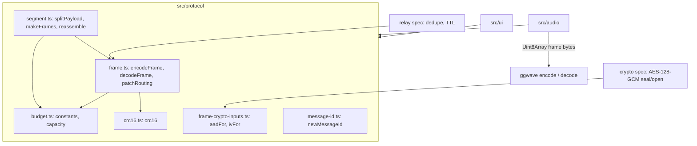
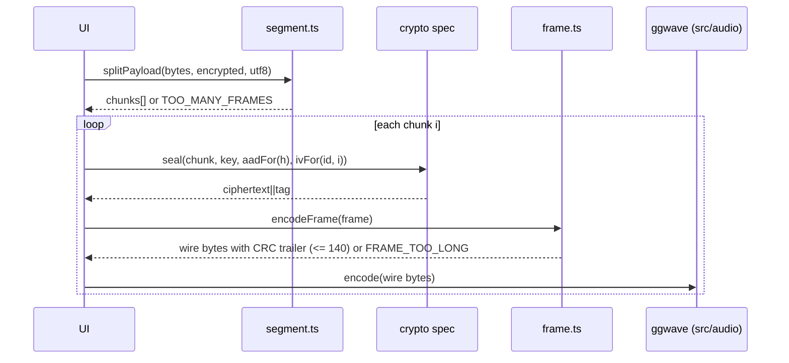
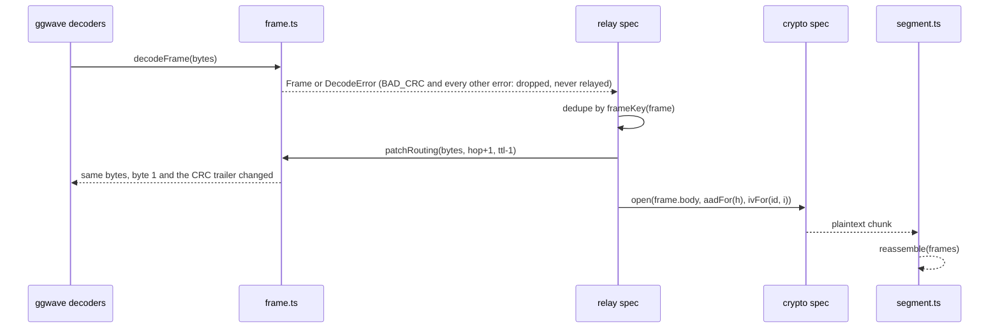

# Design Document: frame-protocol

## Overview

The frame protocol defines the bytes that Dial Tone hands to ggwave for one transmission. A frame carries a message ID for dedupe, hop count and TTL for relaying, a frame index and total for long messages, an encryption flag, a message type, a body, and a 2-byte CRC-16 trailer that detects corruption. The whole frame must fit ggwave's 140-byte payload cap, so every header and trailer byte is justified in the size table below.

The module lives in `src/protocol/` as pure TypeScript. It has no UI, audio or DOM imports and runs in Node under Vitest. It does not perform encryption. It defines what the `crypto` spec needs from a frame: the additional authenticated data (AAD) bytes and the derived IV. It also defines the one operation relays are allowed to perform on a frame, which is patching the routing byte (and recomputing the CRC that covers it).

The wire format is raw binary, not text. ggwave's C header documents the payload buffer as "any binary data", and in variable-length mode the length travels in the audio itself, so the frame needs no length field and no terminator. "Wire representation" records the test evidence from the vendored ggwave 0.4.0 build, including the finding that ggwave's FASTEST modes sometimes return wrong bytes without any error. "Integrity check" records the decision that follows from it.

Decisions in this design:

| Decision | Choice | Why |
|---|---|---|
| Header size | 10 bytes single-frame, 11 bytes multi-frame | The frame-index byte exists only when the message has more than one frame. Most messages are single-frame. |
| Integrity trailer | 2-byte CRC-16/CCITT-FALSE at the end of every frame | ggwave FASTEST modes silently return wrong bytes for some payloads. Plaintext and KEY_OFFER frames carry no GCM tag, so without a CRC a wrong decode is shown as real. Costs 2 bytes (about 0.2 s). |
| Message ID | 8 random bytes | Needed for dedupe and as the IV base. Collision math below. |
| Hop and TTL | 4 bits each, one byte | Values 0 to 15 are enough for a hand-relayed network. |
| IV | Derived, not transmitted | IV = message ID (8 bytes) plus frame index (4 bytes). Saves 12 bytes (about 1.2 s) per frame. |
| Encryption of multi-frame messages | Each frame sealed separately | Each frame is independently verifiable and displayable. Costs 16 bytes per frame. |
| Frame length | Implicit | ggwave variable-length mode returns the exact payload length. |

## Architecture



Layering rules:
- `src/protocol` never imports from `src/audio` or `src/ui`.
- `src/audio` passes `Uint8Array` bytes between this module and ggwave. It never inspects frame fields.
- The `crypto` spec calls `aadFor` and `ivFor`. The `relay` spec calls `decodeFrame`, `patchRouting` and `frameKey`.
- `crc16` is an internal helper of `frame.ts`. Only the frame codec computes or checks the CRC.

### Send pipeline



### Receive and relay pipeline



## Wire representation

Frames are sent as raw bytes: a `Uint8Array` of at most 140 bytes, ending with the 2-byte CRC trailer.

Evidence (verified):
- ggwave's public header documents `ggwave_encode`'s payload as binary data that "can be any sequence of bytes".
- In variable-length mode (`payloadLength <= 0`) ggwave emits sound markers and carries the length in the transmission. A 0x00 byte is therefore not a terminator.
- A 141-byte payload is silently truncated to 140 bytes. The encode guard (`FRAME_TOO_LONG`) is therefore mandatory, not a convenience.
- A 140-byte DT frame decoded when streamed in 1024-sample chunks at offsets 0, 256 and 512, but not at offset 768. This matches the multiple-alignment rule: several decoders offset by 256 samples are needed.

Corrected evidence (supersedes the earlier "exact round trip" claim):
- The earlier test of raw `Uint8Array` round trips covered only a handful of payloads (a 12-byte payload containing 0x00 and 0xFF, a 140-byte payload covering all byte values, and a 140-byte invalid UTF-8 payload). That sample was too small to support the claim that ggwave returns exact bytes. The claim is withdrawn.
- The slow ggwave test then found that ggwave 0.4.0 FASTEST modes silently return wrong bytes for some payloads, even with no noise. Setup: vendored ggwave 0.4.0 in Node, 48 kHz, payload padded with 0.6 s of silence on each side, decoded in 1024-sample chunks. The failures are deterministic: each one was wrong in 20 of 20 replays.

| Mode | Payload sent (bytes) | Payload decoded (bytes) |
|---|---|---|
| ULTRASOUND_FASTEST | `[192,128,128,226,40,36,0,255]` | `[192,136,111,0,255,196,86,146]` |
| AUDIBLE_FASTEST | `[255,192,128,128,226,40,253,0]` | `[255,192,128,141,0,27,233,86]` |
| ULTRASOUND_FASTEST | `[122,88,2,3,253,54,200,250,7,3,3,128,226,40,0,25,201,0,0,17,17,16,181,8,0,255,192,128]` (28 bytes) | `[226,200,0]` (20 of 20 replays) |

- Sweep of 150 random payloads (1 to 60 bytes) per mode:

| Mode | Wrong results | Not decoded |
|---|---|---|
| AUDIBLE_FASTEST | 3 | 0 |
| DT_FASTEST | 1 | 0 |
| ULTRASOUND_FASTEST | 2 | 0 |
| AUDIBLE_FAST | 0 | 0 |
| DT_FAST | 0 | 0 |
| ULTRASOUND_FAST | 0 | 0 |
| AUDIBLE_NORMAL | 0 | 3 |

- "Wrong" means ggwave returned bytes that differ from the payload sent. "Not decoded" means ggwave returned nothing.
- The FAST modes showed no corruption in this sweep. That is a data point for the later `audio-transport` spec when it picks a speed, not a guarantee. 150 payloads per mode cannot rule out a low corruption rate.
- Reed-Solomon coding inside ggwave does not make the output exact. The frame must carry its own integrity check.

The decode side therefore does not return exactly the bytes that were encoded. `decodeFrame` treats every input as untrusted and checks the CRC trailer before reading any field. Property 14 (slow) tests the consequence: a frame sent through ggwave is received as the same frame or not accepted at all.

## Integrity check (CRC-16 trailer)

This is a header-growth change under Requirement 15 (every header change needs a size justification, an updated size table, and a stated airtime cost). The size table below is updated for it, and the table comes before any change to the codec.

Decision: every frame ends with a 2-byte CRC.

| Parameter | Value |
|---|---|
| Algorithm | CRC-16/CCITT-FALSE |
| Polynomial | 0x1021 |
| Initial value | 0xFFFF |
| Input and output reflection | none |
| Final XOR | 0x0000 |
| Check value | `crc16("123456789")` = 0x29B1 |
| Size | 2 bytes, big-endian (high byte first) |
| Position | Trailer: the last two bytes of the frame |
| Coverage | Every byte before it: header (and FRAME byte when present) and body |

Why a CRC and why this one:
- A wrong ggwave decode of a plaintext or KEY_OFFER frame has no other check. A corrupted KEY_OFFER would hand the user a wrong group key. A corrupted TEXT frame would show wrong text as if it were real.
- Encrypted frames have a GCM tag, but the tag is checked only after the `crypto` spec opens the frame. The CRC lets the relay and the receiver discard a corrupted frame before dedupe, relaying and decryption, and it is the only check available to a relay, which holds no key.
- CRC-16 detects every single-bit error and every burst of up to 16 bits. For other corruption the chance that a corrupted frame still passes is about 1 in 65,536 (1.5e-5).
- Placing it at the end lets `decodeFrame` run a single pass over `bytes.subarray(0, length - 2)` and compare it with the last two bytes.

Alternatives considered:

| Alternative | Cost | Rejected because |
|---|---|---|
| No integrity check, rely on `field-findings.md` channel choice | 0 | The corruption occurs in clean conditions, in three of the profiles (see the sweep). |
| 1-byte checksum | 1 byte | A random wrong decode passes with probability 1/256 and no burst guarantee. |
| CRC-32 | 4 bytes (about 0.4 s) | The extra 2 bytes buy a lower miss rate than the channel needs. |
| Switch ggwave to a FAST mode only | 0 bytes, slower airtime | The sweep does not prove FAST is safe. The audio-transport spec may still choose it. The CRC applies to every mode. |

What the CRC does not do:
- It is not authentication. Anyone can compute it. Relays recompute it after changing hop and ttl, so a relay can never be told apart from a forger by the CRC.
- It is outside the AAD. `aadFor` and `ivFor` are unaffected (see their sections). The CRC is not part of the `Frame` object: `Frame` holds header fields and body only, and the CRC exists only in wire bytes. `encodeFrame` computes it and `decodeFrame` verifies and strips it.

## Frame layout

All multi-bit fields are most-significant-bit first. All frame bytes are in the order below.

```
offset   size  field
0        1     B0      ver[7:6] | E[5] | M[4] | type[3:1] | rsv[0]
1        1     ROUTING hop[7:4] | ttl[3:0]
2        8     ID      message ID, random
10       1     FRAME   idx[7:4] | totalMinus1[3:0]     present only if M = 1
10|11    n     BODY    plaintext payload, or ciphertext || 16-byte tag if E = 1
len-2    2     CRC     CRC-16/CCITT-FALSE over bytes 0 .. len-3, big-endian
```

Field meanings:
- `ver`: protocol version, 2 bits. Current value is 1. Value 0 is invalid, so an all-zero buffer never parses.
- `E`: 1 if the body is AES-128-GCM ciphertext followed by a 16-byte tag.
- `M`: 1 if the message has more than one frame. When 0, the frame is frame 0 of 1 and the FRAME byte is absent.
- `type`: message type, 3 bits. See the table below.
- `rsv`: reserved, must be 0. A decoder rejects frames with `rsv = 1`.
- `hop`: hops travelled so far. The origin sends 0. Range 0 to 15.
- `ttl`: remaining hops allowed. Range 0 to 15. A relay rebroadcasts only when `ttl >= 1` and `hop < 15`. A relay never forwards a frame with `hop = 15`, even if `ttl >= 1`, because `hop + 1` would not fit in 4 bits. The relay spec owns the relay rule. This spec guarantees that hop and ttl live in one mutable byte and that `patchRouting` refuses a hop above 15.
- `idx`, `totalMinus1`: frame index 0 to 15, and total frames minus 1 (so total is 1 to 16). `idx < total` is required.
- `CRC`: see "Integrity check". The body ends two bytes before the end of the frame.

Message types:

| Value | Name | Body format owned by |
|---|---|---|
| 0 | TEXT | UTF-8 text, this spec treats it as bytes |
| 1 | LOCATION | `channel-modes` or `ui-flows` spec |
| 2 | SAFE | `ui-flows` spec |
| 3 | SOS | `ui-flows` spec |
| 4 | KEY_OFFER | this spec (see below) |
| 5 | RESEND_REQUEST | reserved for multi-frame re-requests, not implemented here |
| 6 to 7 | reserved | decoder rejects with `UNKNOWN_TYPE` |

KEY_OFFER carries the group key for the "key screech" (BRIEF section 4):
- Always plaintext (`E = 0`). A frame with type KEY_OFFER and `E = 1` is rejected on encode and decode with `KEY_OFFER_ENCRYPTED`.
- Single frame only (`M = 0`, `total = 1`). A multi-frame KEY_OFFER is rejected with `KEY_OFFER_MULTIFRAME`.
- Body is the 16-byte group key followed by the group name in UTF-8. The body therefore holds 16 plus name bytes and must fit the 128-byte single-frame wire body capacity, which leaves up to 112 bytes for the name. A body under 16 bytes is rejected with `BODY_TOO_SHORT`.
- The CRC trailer matters most here: a key that ggwave corrupted would otherwise be offered to the user as the group key. The check words (crypto spec) are a second line of defense.
- Never relayed. A receiver must not rebroadcast a KEY_OFFER whatever its `ttl` or `hop`. This is a requirement on the relay spec (see Dependencies and Security Considerations).
- The receiver must show the check words and get the user's confirmation before joining the group. The check-word derivation belongs to the `crypto` spec and the confirmation flow to the `ui-flows` spec.

### Size table

Airtime uses about 0.1 s per byte. A full 140-byte frame takes about 13.4 s in DT fastest, so the exact rate is about 0.096 s per byte. The CRC trailer adds 2 bytes to every frame, which is about 0.2 s per frame. A full frame still takes about 13.4 s, because the 140-byte cap is unchanged. The CRC takes its 2 bytes out of the body capacity.

| Field | Bytes | Reason |
|---|---|---|
| B0: ver (2 bits), E (1), M (1), type (3), rsv (1) | 1 | Version lets a future layout change be detected instead of misparsed. E tells receivers whether to open the body. M lets single-frame messages skip the FRAME byte. Type drives UI and relay priority (SOS) and is authenticated as AAD. The reserved bit has no job yet and stays 0 so a stray frame is rejected. |
| ROUTING: hop (4), ttl (4) | 1 | Both change in transit, so they must be outside the AAD. One byte makes the relay edit a single-byte patch. Hop is shown in the UI ("hop 2"). TTL bounds spread. |
| ID | 8 | Dedupe key and the base of the derived IV. 8 bytes keeps the collision risk of GCM nonce reuse near 2.7e-8 at one million messages. |
| Header total, single frame (M = 0) | 10 | Meets the ~10 byte target. |
| FRAME: idx (4), totalMinus1 (4) | 1 | Only for M = 1. Without it a receiver cannot order or complete a long message. |
| Header total, multi-frame (M = 1) | 11 | One extra byte, about 0.1 s, paid only by long messages. |
| CRC trailer: CRC-16/CCITT-FALSE, big-endian | 2 | Detects ggwave FASTEST corruption (3, 1 and 2 wrong results in 150 payloads in AUDIBLE, DT and ULTRASOUND FASTEST). About 0.2 s per frame. Added under Requirement 15. |
| Header plus trailer, single frame | 12 | 10 + 2. |
| Header plus trailer, multi-frame | 13 | 11 + 2. |
| Crypto overhead (E = 1) | 16 | GCM tag. The IV is derived and costs 0 bytes on the wire. |

Remaining body bytes per frame (cap 140):

| Mode | Header plus trailer | Crypto | Body capacity | Airtime of a full frame |
|---|---|---|---|---|
| Single, plaintext | 12 | 0 | 128 | about 13.4 s |
| Single, encrypted | 12 | 16 | 112 | about 13.4 s |
| Multi, plaintext (per frame) | 13 | 0 | 127 | about 13.4 s |
| Multi, encrypted (per frame) | 13 | 16 | 111 | about 13.4 s |

Reading the table:
- Before the CRC the capacities were 130, 114, 129 and 113. Each frame now holds 2 fewer plaintext bytes and costs 2 more bytes (about 0.2 s) for the same text.
- Encrypted single-frame text holds 112 bytes. Product copy now says "~110 bytes of text per encrypted message", a round figure because the `crypto` spec may still change the tag length. The older "~100 bytes" figure assumed a transmitted IV (102 bytes).
- Note for the UI spec: the message meter's limit is `plaintextCapacity`, so 128 bytes on an open channel and 112 when locked to a group (with TAG_LEN = 16). Never a fixed number. `encodeFrame` itself only enforces the wire boundary, `wireBodyCapacity` (128 single, 127 multi), whatever the encrypted flag.
- Maximum message size is 16 frames: 2032 bytes plaintext or 1776 bytes encrypted. Sending 16 full frames takes about 3.5 minutes, so the UI spec should set a lower practical limit.
- In a multi-frame message, every frame repeats the 8-byte ID and carries its own CRC. Relays can forward frames in any order and receivers can join mid-message, so each frame must stand alone.
- Per-frame GCM tags cost 16 bytes (about 1.6 s) per extra frame. A single tag over the whole message would save that, but then no frame can be verified or shown until the last one arrives. Rejected for now.

Alternatives considered:

| Alternative | Saves | Rejected because |
|---|---|---|
| 6-byte ID | 2 bytes (0.2 s) | Collision probability at 1e6 messages is about 1.8e-3. Too high when a collision reuses a GCM nonce. |
| Transmit 12-byte IV with a 4-byte ID | 0 net | The IV would cost 12 bytes anyway. |
| 12-byte GCM tag instead of 16 (WebCrypto allows `tagLength` 96) | 4 bytes (about 0.4 s) per frame | Deferred to the `crypto` spec. If adopted, encrypted capacities become 116 (single) and 115 (multi) and `TAG_LEN` becomes 12. A shorter tag weakens forgery resistance, so the choice belongs with the crypto threat model. |
| Drop `hop`, derive from a fixed starting TTL | 4 bits | Removes per-message TTL (SOS wants a larger one than Quiet mode) and the user asked for both fields. Kept. |
| Always include the FRAME byte | none | Costs every single-frame message 1 byte (0.1 s) for nothing. |
| Length field | none | ggwave already carries length in-band. |
| 16-byte ID | none | Adds 8 bytes (0.8 s) per frame for a risk we can already bound. |
| Omit the CRC | 2 bytes (0.2 s) per frame | Rejected, see "Integrity check". |

## Message ID collision math

Let IDs be uniform random over N = 2^64 values and n be the number of messages sent under one group key. The birthday bound gives

p(n) = 1 - exp(-n(n-1) / 2^65), which is about n^2 / 2^65 for small p.

| Messages n | Probability of any two sharing an ID |
|---|---|
| 1,000 | 2.7e-14 |
| 10,000 | 2.7e-12 |
| 100,000 | 2.7e-10 |
| 1,000,000 | 2.7e-8 |
| 1,000,000,000 | 2.7e-2 |
| 2^32 (about 4.3e9) | 0.39 |

What a collision causes:
- Dedupe: a relay with a live cache of C IDs drops a new message with probability about C / 2^64 per message. For C = 10,000 that is about 5.4e-16. Negligible.
- Encryption: two messages with the same ID and frame index under the same key reuse a GCM nonce. That leaks the XOR of the plaintexts and exposes the authentication key. This is the real risk.

Mitigations:
1. Never reuse an ID for new content. A user tapping Send again creates a new ID. Re-broadcast sends the stored wire bytes unchanged.
2. The sender keeps its own recent IDs and re-rolls on a local match. This catches only the sender's own collisions.
3. The `crypto` spec should rotate the group key before 1,000,000 messages (p about 2.7e-8). A group of shelters sending a message every 30 seconds around the clock reaches that in about 1 year.
4. IDs must come from a CSPRNG (`crypto.getRandomValues`). `newMessageId` accepts an injected RNG so tests are deterministic.

## Components and Interfaces

### Component: frame.ts

**Purpose**: Convert between `Frame` objects and wire bytes. Add and verify the CRC trailer. Enforce the 140-byte cap.

```ts
export type MessageType = 0 | 1 | 2 | 3 | 4 | 5; // TEXT, LOCATION, SAFE, SOS, KEY_OFFER, RESEND_REQUEST

export interface FrameHeader {
  readonly version: 1;
  readonly type: MessageType;
  readonly encrypted: boolean;
  readonly hop: number;          // 0..15
  readonly ttl: number;          // 0..15
  readonly messageId: Uint8Array; // exactly 8 bytes
  readonly index: number;        // 0..total-1
  readonly total: number;        // 1..16
}

/** The CRC is a wire-only trailer. It is not a field of Frame. */
export interface Frame {
  readonly header: FrameHeader;
  /** Plaintext payload, or ciphertext followed by the 16-byte tag when header.encrypted. */
  readonly body: Uint8Array;
}

export type Result<T, E> = { ok: true; value: T } | { ok: false; error: E };

export function encodeFrame(frame: Frame): Result<Uint8Array, EncodeError>;
export function decodeFrame(bytes: Uint8Array): Result<Frame, DecodeError>;
export function patchRouting(wire: Uint8Array, hop: number, ttl: number): Result<Uint8Array, EncodeError | DecodeError>;
export function frameKey(frame: Frame): string; // hex(messageId) + ":" + index
```

**Responsibilities**:
- Reject any frame whose encoded length (header, body and CRC) exceeds 140 bytes before it can reach ggwave.
- Produce the canonical encoding. `M = 1` if and only if `total > 1`. The CRC is a function of the preceding bytes, so the encoding stays unique.
- Verify the CRC in `decodeFrame` before reading any field.
- Never throw on untrusted bytes. All data errors are returned as `Result` errors.

### Component: crc16.ts

**Purpose**: One pure function for the trailer. Internal to `src/protocol`.

```ts
/** CRC-16/CCITT-FALSE: poly 0x1021, init 0xFFFF, no reflection, no final XOR. Returns 0..0xFFFF. */
export function crc16(bytes: Uint8Array): number;
```

`crc16(utf8("123456789"))` is 0x29B1. `crc16(empty)` is 0xFFFF. For any `m`, `crc16(m || bigEndian(crc16(m)))` is 0x0000. `crc16` does not mutate its input and never throws.

### Component: budget.ts

**Purpose**: One place for the byte constants, so no other file hard-codes a size.

```ts
export const GGWAVE_MAX_PAYLOAD = 140;
export const VERSION = 1;
export const MESSAGE_ID_LEN = 8;
export const TAG_LEN = 16;
export const IV_LEN = 12;
export const HEADER_LEN_SINGLE = 10;
export const HEADER_LEN_MULTI = 11;
export const CRC_LEN = 2;
export const MAX_FRAMES = 16;
export const MAX_HOP = 15;
export const MAX_TTL = 15;

export function headerLength(total: number): 10 | 11;
/** headerLength(total) + CRC_LEN. 12 single, 13 multi. */
export function frameOverhead(total: number): 12 | 13;
/** Max Body bytes on the wire: 140 - frameOverhead. 128 single, 127 multi. Encrypted flag is irrelevant. */
export function wireBodyCapacity(opts: { multi: boolean }): number;
/** wireBodyCapacity minus TAG_LEN when encrypted. With TAG_LEN = 16: 128, 112, 127, 111. Chunk size and UI meter limit. */
export function plaintextCapacity(opts: { encrypted: boolean; multi: boolean }): number;
/** Equals TextEncoder.encode(text).length. Unpaired surrogates count as 3 bytes (U+FFFD). */
export function utf8ByteLength(text: string): number; // bytes, never characters
```

Both capacity functions are derived from `GGWAVE_MAX_PAYLOAD`, `headerLength`, `CRC_LEN` and `TAG_LEN`. No capacity number is hard-coded. The current `budget.ts` computes `GGWAVE_MAX_PAYLOAD - header` (130, 129); subtracting `CRC_LEN` gives 128 and 127, and subtracting `TAG_LEN` after that gives 112 and 111.

### Component: segment.ts

**Purpose**: Split a payload into per-frame chunks, build frames, and reassemble.

```ts
export interface SplitOptions {
  readonly encrypted: boolean;
  /** true for TEXT: never cut inside a UTF-8 sequence, so each chunk is valid UTF-8. */
  readonly utf8Boundaries: boolean;
}

export function splitPayload(
  payload: Uint8Array,
  opts: SplitOptions,
): Result<Uint8Array[], SegmentError>; // 'TOO_MANY_FRAMES' | 'INVALID_UTF8' (utf8Boundaries only)

export interface FrameTemplate {
  readonly type: MessageType;
  readonly encrypted: boolean;
  readonly hop: number;
  readonly ttl: number;
  readonly messageId: Uint8Array;
}

/**
 * bodies[i] is the final body for frame i (already sealed when encrypted).
 * Errors, first failing check wins: EMPTY_SET (0 bodies), TOO_MANY_FRAMES (>16), template checks
 * (BAD_ID_LENGTH, BAD_ROUTING, BAD_TYPE, KEY_OFFER_ENCRYPTED), KEY_OFFER_MULTIFRAME (KEY_OFFER with >1 body),
 * then per body in index order BODY_TOO_SHORT and FRAME_TOO_LONG (body over wireBodyCapacity for total n).
 */
export function makeFrames(
  template: FrameTemplate,
  bodies: readonly Uint8Array[],
): Result<Frame[], EncodeError | SegmentError | 'EMPTY_SET'>;

/** Message-level fields only. No hop or ttl, so the result does not depend on arrival order. */
export interface MessageInfo {
  readonly messageId: Uint8Array;
  readonly type: MessageType;
  readonly encrypted: boolean;
  readonly total: number;
}
export type Reassembly =
  | { complete: true; payload: Uint8Array; message: MessageInfo }
  | { complete: false; missing: number[]; total: number };

/** Byte-agnostic, never decrypts. For encrypted messages the caller passes frames whose body is the opened plaintext chunk. */
export function reassemble(frames: readonly Frame[]): Result<Reassembly, ReassembleError>;
```

`segment.ts` takes every size from `budget.ts`. The CRC trailer changes the capacities it sees, not its code.

### Component: frame-crypto-inputs.ts

**Purpose**: Define, in one place, which bytes are authenticated and how the IV is derived. The `crypto` spec calls these. This module does not touch WebCrypto.

```ts
/** AAD = messageId (8) || type (1) || totalMinus1 (1). 10 bytes. Excludes hop, ttl, idx, E, M, body, CRC. */
export function aadFor(h: Pick<FrameHeader, 'messageId' | 'type' | 'total'>): Result<Uint8Array, CryptoInputError>;
// errors, in order: BAD_ID_LENGTH, BAD_TYPE (outside 0..5), BAD_FRAME_INDEX (total not an integer 1..16)
// PROVISIONAL: the 10-byte layout including total awaits the crypto spec (open item 1).

/** IV = messageId (8) || index as uint32 big-endian (4). 12 bytes. */
export function ivFor(messageId: Uint8Array, index: number): Result<Uint8Array, CryptoInputError>;
// errors, in order: BAD_ID_LENGTH, BAD_FRAME_INDEX (index not an integer 0..15)
```

The CRC trailer does not affect these functions. The AAD stays message ID, type and `total - 1`. The CRC is outside the authenticated data, because it changes whenever a relay patches hop or ttl. The IV stays message ID plus frame index. A relay can therefore re-broadcast the original ciphertext with a recomputed CRC and the receiver still opens it.

### Component: message-id.ts

```ts
export function newMessageId(rng?: (n: number) => Uint8Array): Result<Uint8Array, 'BAD_RNG'>; // 8 bytes
```
`BAD_RNG` is returned when an injected RNG returns an array whose length is not 8.
The default RNG is `globalThis.crypto.getRandomValues`, available in Node and browsers.

## Data Models

### Wire examples

All examples use the message ID `01 02 03 04 05 06 07 08`. The CRC values were computed by hand with the table method (`crc = ((crc << 8) & 0xFFFF) ^ T[(crc >> 8) ^ byte]`) and each step was checked twice. Task 12.4 asserts them in a unit test.

Single plaintext TEXT frame, hop 0, ttl 7, text "hi" (2 bytes):

```
B0      = 01 0 0 000 0 = 0x40   (ver=1, E=0, M=0, type=TEXT, rsv=0)
ROUTING = 0x07                  (hop=0, ttl=7)
ID      = 01 02 03 04 05 06 07 08
BODY    = 68 69
CRC     = D9 91                 (crc16 of the 12 bytes before it = 0xD991, big-endian)
wire    = 40 07 01 02 03 04 05 06 07 08 68 69 D9 91
total   = 10 + 2 + 2 = 14 bytes
```

Frame 1 of 3 of a plaintext SOS message, hop 1, ttl 6, body 0x41 (one byte):

```
B0      = 01 0 1 011 0 = 0x56   (ver=1, E=0, M=1, type=SOS, rsv=0)
ROUTING = 0x16                  (hop=1, ttl=6)
ID      = 01 02 03 04 05 06 07 08
FRAME   = 0x12                  (idx=1, totalMinus1=2)
BODY    = 41
CRC     = 2A 73                 (crc16 of the 12 bytes before it = 0x2A73)
wire    = 56 16 01 02 03 04 05 06 07 08 12 41 2A 73
total   = 11 + 1 + 2 = 14 bytes
```

The same frame after a relay patches hop to 2 and ttl to 5 (`ROUTING = 0x25`) has a different CRC. The relay does not need a key to compute it.

Second frame of an encrypted three-frame SOS message (layout only, the body bytes come from the `crypto` spec):

```
B0      = 01 1 1 011 0 = 0x76   (E=1, M=1, type=SOS)
ROUTING = hop<<4 | ttl
ID      = same 8 bytes as the other frames
FRAME   = 0x12                  (idx=1, totalMinus1=2)
BODY    = ciphertext || 16-byte tag
CRC     = crc16(all bytes above), big-endian
```

CRC check value: `crc16` of the ASCII bytes "123456789" is 0x29B1.

### Validation rules

Encode:
- `messageId.length === 8`
- `0 <= hop <= 15`, `0 <= ttl <= 15`, both integers
- `1 <= total <= 16`, `0 <= index < total`, both integers
- `type` is 0 to 5
- `version === 1`
- If `encrypted`, `body.length >= 16`
- If `type` is KEY_OFFER (4): `encrypted` is false, `total === 1`, and `body.length >= 16`
- Encoded length (header, body and CRC) `<= 140`

Decode:
- Length at least 12, at most 140
- CRC trailer equals `crc16` of all earlier bytes (checked immediately after the length checks, before any field)
- `ver === 1`, `rsv === 0`
- `type` is 0 to 5
- If `type` is KEY_OFFER (4): `E = 0`, `M = 0`, and body length at least 16
- If `M = 1`: length at least 13, `total = totalMinus1 + 1`, `total >= 2`, `idx < total`
- If `M = 0`: `index = 0`, `total = 1`
- If `E = 1`: body length at least 16

Because decode rejects non-canonical forms (`M = 1` with `total = 1`) and a frame is accepted only when its CRC matches, `encodeFrame(decodeFrame(b)) == b` for every accepted `b`.

## Key Functions with Formal Specifications

### encodeFrame()

```ts
function encodeFrame(frame: Frame): Result<Uint8Array, EncodeError>
```

**Preconditions:** none. Any input is accepted and validated.

**Postconditions:**
- If `ok`: `value.length === headerLength(total) + body.length + 2` and `value.length <= 140`.
- If `ok`: the last two bytes are `crc16` of the preceding bytes, high byte first.
- If `ok`: `decodeFrame(value)` returns a frame deeply equal to the input.
- If the encoded length would exceed 140: `error.code === 'FRAME_TOO_LONG'`. ggwave is never called. The limit counts the CRC.
- Does not mutate `frame`. The returned array does not alias `frame.body` or `frame.header.messageId`.

### decodeFrame()

```ts
function decodeFrame(bytes: Uint8Array): Result<Frame, DecodeError>
```

**Preconditions:** none. `bytes` may be any length and content.

**Postconditions:**
- Never throws.
- If `ok`: `encodeFrame(value)` returns exactly `bytes`.
- If error: `error.code` is one of the `DecodeError` codes.
- Check order: length (`TOO_SHORT` under 12, `TOO_LONG` over 140), then `BAD_CRC`, then every field check. A frame with a wrong CRC never reaches a field check, so its other defects are never reported.
- The returned frame does not alias `bytes`, and `value.body` excludes the two CRC bytes.

### patchRouting()

```ts
function patchRouting(wire: Uint8Array, hop: number, ttl: number): Result<Uint8Array, EncodeError | DecodeError>
```

**Preconditions:** none. `patchRouting` runs `decodeFrame(wire)` first and returns its error unchanged (an input under 12 bytes, including under 2, gives `TOO_SHORT`, and a wrong CRC gives `BAD_CRC`). A relay passes `hop + 1`, so a frame received with `hop = 15` can never be patched forward.

**Postconditions:**
- If `decodeFrame(wire)` fails: that `DecodeError` is returned, even when `hop` or `ttl` is also invalid. `BAD_CRC` passes through.
- If `hop` or `ttl` is not an integer in 0 to 15 (including `hop = 16`, the result of `15 + 1`): `error.code === 'BAD_ROUTING'` and no bytes are produced.
- Otherwise the result has the same length as `wire`, byte 1 holds the new routing byte, and the last two bytes hold `crc16` of the preceding bytes of the result. No other byte differs from `wire`. A key is not needed.
- `decodeFrame(result)` succeeds and equals `decodeFrame(wire)` except for `hop` and `ttl`.
- `aadFor` and `ivFor` computed from the decoded header fields give identical output for `wire` and `result`.
- Idempotent for equal arguments.
- Does not mutate `wire`.

**Relay rule for the `relay` spec:** a relay drops every frame for which `decodeFrame` fails, including `BAD_CRC`, instead of forwarding it. `patchRouting` makes this safe: it never turns a corrupted frame into a valid one, because it refuses to patch when the input CRC is wrong.

### splitPayload()

```ts
function splitPayload(payload: Uint8Array, opts: SplitOptions): Result<Uint8Array[], SegmentError>
```

**Preconditions:** none. The payload is bytes. Callers convert text with `TextEncoder` (unpaired surrogates become U+FFFD, 3 bytes).

**Postconditions:**
- With `utf8Boundaries` and a payload that is not valid UTF-8: `error.code === 'INVALID_UTF8'`.
- Concatenating the chunks gives `payload`.
- If `payload.length <= plaintextCapacity({ encrypted, multi: false })`: exactly one chunk.
- Otherwise every chunk has length `<= plaintextCapacity({ encrypted, multi: true })`.
- The split is greedy: each chunk is as long as the capacity and the allowed cut points permit. Every chunk is non-empty except the single chunk of an empty payload.
- With `utf8Boundaries`, every chunk is valid UTF-8 on its own.
- If no split into at most 16 chunks exists under the capacity and the cut points: `error.code === 'TOO_MANY_FRAMES'`.
- An empty payload yields one empty chunk.

**Loop invariant** (greedy cut loop): the chunks emitted so far, joined, equal `payload[0..pos)`, and every emitted chunk is within capacity.

### reassemble()

```ts
function reassemble(frames: readonly Frame[]): Result<Reassembly, ReassembleError>
```

**Preconditions:** none. Bodies are opaque bytes. `reassemble` never decrypts.

**Postconditions:**
- Frames may arrive in any order, with duplicates, and with different hop and ttl.
- Identical duplicates are ignored. Two frames with the same index and different bodies give `CONFLICTING_DUPLICATE`.
- Frames that disagree on message ID, type, `encrypted` or `total` give `MISMATCHED_FRAMES`.
- When errors compete, frames are evaluated in ascending index order (equal indexes ordered lexicographically by message ID, type, encrypted, total, body). The first frame that mismatches the first frame of that order, or repeats an earlier index with a different body, decides the error.
- If all indexes `0..total-1` are present: `complete: true`, `payload` is the bodies joined in index order, and `message` holds messageId, type, encrypted and total only. The result does not depend on arrival order.
- Otherwise `complete: false` and `missing` lists the absent indexes in ascending order.
- An empty input gives `EMPTY_SET`.

### aadFor() and ivFor()

```ts
function aadFor(h: Pick<FrameHeader, 'messageId' | 'type' | 'total'>): Uint8Array
function ivFor(messageId: Uint8Array, index: number): Uint8Array
```

**Preconditions:** `aadFor` and `ivFor` are only called for encrypted frames. KEY_OFFER is never encrypted, so `aadFor` is never called with type 4. Invalid input returns an error (see the signatures above) and never throws.

**Postconditions:**
- On success, `aadFor` returns 10 bytes: ID, then type, then `total - 1`. It does not depend on hop, ttl, index, E, M, body or the CRC.
- On success, `ivFor` returns 12 bytes: ID, then `index` as a 4-byte big-endian integer.
- `ivFor(a, i) = ivFor(b, j)` if and only if `a` equals `b` and `i = j`.

Design note on AAD: the steering rule requires message ID and type. This design also authenticates `total`. It costs no wire bytes and stops an attacker from truncating or extending a multi-frame message by editing the FRAME byte. `index` needs no entry because it is bound through the IV. If the `crypto` spec prefers the narrower AAD, drop the last byte and the property for `total` below.

## Algorithmic Pseudocode

### crc16

```ts
function crc16(bytes: Uint8Array): number {
  let crc = 0xffff;
  for (const b of bytes) {
    crc ^= b << 8;
    for (let i = 0; i < 8; i++) {
      crc = (crc & 0x8000) !== 0 ? ((crc << 1) ^ 0x1021) & 0xffff : (crc << 1) & 0xffff;
    }
  }
  return crc;   // no reflection, no final XOR
}
```

A 256-entry table built at module load gives the same result. Either is acceptable. The unit tests pin the check value.

### encodeFrame

```ts
function encodeFrame(f: Frame): Result<Uint8Array, EncodeError> {
  const h = f.header;
  if (h.version !== 1) return err('BAD_VERSION');
  if (h.messageId.length !== 8) return err('BAD_ID_LENGTH');
  if (!isInt(h.hop, 0, 15) || !isInt(h.ttl, 0, 15)) return err('BAD_ROUTING');
  if (!isInt(h.total, 1, 16) || !isInt(h.index, 0, h.total - 1)) return err('BAD_FRAME_INDEX');
  if (!isInt(h.type, 0, 5)) return err('BAD_TYPE');
  if (h.encrypted && f.body.length < 16) return err('BODY_TOO_SHORT');
  if (h.type === 4) {                                   // KEY_OFFER
    if (h.encrypted) return err('KEY_OFFER_ENCRYPTED');
    if (h.total !== 1) return err('KEY_OFFER_MULTIFRAME');
    if (f.body.length < 16) return err('BODY_TOO_SHORT');
  }

  const multi = h.total > 1;
  const len = (multi ? 11 : 10) + f.body.length + 2;   // header + body + CRC
  if (len > 140) return err('FRAME_TOO_LONG');          // length guard, before ggwave

  const out = new Uint8Array(len);
  out[0] = (1 << 6) | ((h.encrypted ? 1 : 0) << 5) | ((multi ? 1 : 0) << 4) | (h.type << 1);
  out[1] = (h.hop << 4) | h.ttl;
  out.set(h.messageId, 2);
  let off = 10;
  if (multi) out[off++] = (h.index << 4) | (h.total - 1);
  out.set(f.body, off);
  const crc = crc16(out.subarray(0, len - 2));
  out[len - 2] = crc >> 8;
  out[len - 1] = crc & 0xff;
  return ok(out);
}
```

### decodeFrame

```ts
function decodeFrame(b: Uint8Array): Result<Frame, DecodeError> {
  if (b.length < 12) return err('TOO_SHORT');
  if (b.length > 140) return err('TOO_LONG');
  const crc = crc16(b.subarray(0, b.length - 2));
  if (((b[b.length - 2]! << 8) | b[b.length - 1]!) !== crc) return err('BAD_CRC');
  // From here on the bytes are intact, so every field check below reports a sender defect or a foreign frame.
  const b0 = b[0]!;
  if ((b0 >> 6) !== 1) return err('BAD_VERSION');
  if ((b0 & 1) !== 0) return err('RESERVED_BITS');
  const encrypted = ((b0 >> 5) & 1) === 1;
  const multi = ((b0 >> 4) & 1) === 1;
  const type = (b0 >> 1) & 7;
  if (type > 5) return err('UNKNOWN_TYPE');
  if (type === 4 && encrypted) return err('KEY_OFFER_ENCRYPTED');
  if (type === 4 && multi) return err('KEY_OFFER_MULTIFRAME');

  const hop = b[1]! >> 4, ttl = b[1]! & 15;
  const messageId = b.slice(2, 10);
  let index = 0, total = 1, off = 10;
  if (multi) {
    if (b.length < 13) return err('TOO_SHORT');
    index = b[10]! >> 4;
    total = (b[10]! & 15) + 1;
    off = 11;
    if (total < 2) return err('NON_CANONICAL');
    if (index >= total) return err('BAD_FRAME_INDEX');
  }
  const body = b.slice(off, b.length - 2);               // excludes the CRC
  if (encrypted && body.length < 16) return err('BODY_TOO_SHORT');
  if (type === 4 && body.length < 16) return err('BODY_TOO_SHORT');
  return ok({ header: { version: 1, type, encrypted, hop, ttl, messageId, index, total }, body });
}
```

### patchRouting

```ts
function patchRouting(wire: Uint8Array, hop: number, ttl: number): Result<Uint8Array, EncodeError | DecodeError> {
  const d = decodeFrame(wire);                         // BAD_CRC and every other decode error pass through
  if (!d.ok) return d;
  if (!isInt(hop, 0, 15) || !isInt(ttl, 0, 15)) return err('BAD_ROUTING');
  const out = wire.slice();
  out[1] = (hop << 4) | ttl;
  const crc = crc16(out.subarray(0, out.length - 2));  // recompute: byte 1 changed
  out[out.length - 2] = crc >> 8;
  out[out.length - 1] = crc & 0xff;
  return ok(out);
}
```

### splitPayload

```ts
function splitPayload(p: Uint8Array, o: SplitOptions): Result<Uint8Array[], SegmentError> {
  if (o.utf8Boundaries && !isValidUtf8(p)) return err('INVALID_UTF8');
  const single = plaintextCapacity({ encrypted: o.encrypted, multi: false });
  if (p.length <= single) return ok([p.slice()]);

  const cap = plaintextCapacity({ encrypted: o.encrypted, multi: true });
  const chunks: Uint8Array[] = [];
  let pos = 0;
  while (pos < p.length) {
    // invariant: chunks joined === p[0..pos), each chunk.length <= cap
    let end = Math.min(pos + cap, p.length);
    if (o.utf8Boundaries && end < p.length) {
      while (end > pos && (p[end]! & 0xc0) === 0x80) end--;  // p[end] is a continuation byte: back up
    }
    chunks.push(p.slice(pos, end));
    pos = end;
    if (chunks.length > 16) return err('TOO_MANY_FRAMES');
  }
  return ok(chunks);
}
```

With valid UTF-8 and `cap >= 111`, the back-up loop always stops after at most 3 steps, so `end > pos` and the loop advances.

### reassemble

```ts
function reassemble(input: readonly Frame[]): Result<Reassembly, ReassembleError> {
  if (input.length === 0) return err('EMPTY_SET');
  // ascending index; equal indexes ordered by (messageId, type, encrypted, total, body)
  const frames = sortCanonical(input);
  const first = frames[0]!.header;
  const byIndex = new Map<number, Uint8Array>();
  for (const f of frames) {
    const h = f.header;
    if (!sameBytes(h.messageId, first.messageId) || h.type !== first.type
        || h.encrypted !== first.encrypted || h.total !== first.total) return err('MISMATCHED_FRAMES');
    const prev = byIndex.get(h.index);
    if (prev && !sameBytes(prev, f.body)) return err('CONFLICTING_DUPLICATE');
    byIndex.set(h.index, f.body);
  }
  const missing = range(first.total).filter((i) => !byIndex.has(i));
  if (missing.length > 0) return ok({ complete: false, missing, total: first.total });
  const message = { messageId: first.messageId, type: first.type, encrypted: first.encrypted, total: first.total };
  return ok({ complete: true, payload: concat(range(first.total).map((i) => byIndex.get(i)!)), message });
}
```

## Example Usage

```ts
// Send an encrypted TEXT message, possibly multi-frame
const bytes = new TextEncoder().encode(text);               // count bytes, not characters
const split = splitPayload(bytes, { encrypted: true, utf8Boundaries: true });
if (!split.ok) return showError(split.error.code);          // TOO_MANY_FRAMES

// aadFor, ivFor and newMessageId return Result. The calls below show .value after an ok check was made.
const idr = newMessageId();
if (!idr.ok) return showError(idr.error.code);
const id = idr.value;
const total = split.value.length;
const bodies: Uint8Array[] = [];
for (const [i, chunk] of split.value.entries()) {
  bodies.push(await seal(chunk, key, aadFor({ messageId: id, type: 0, total }), ivFor(id, i)));
}
const frames = makeFrames({ type: 0, encrypted: true, hop: 0, ttl: 7, messageId: id }, bodies);
if (!frames.ok) return showError(frames.error.code);

for (const f of frames.value) {
  const wire = encodeFrame(f);
  if (!wire.ok) return showError(wire.error.code);          // FRAME_TOO_LONG never reaches ggwave
  await transmit(wire.value);                               // wire.value ends with the CRC trailer
}

// Receive and relay
const parsed = decodeFrame(heardBytes);
if (!parsed.ok) { count(parsed.error.code); return; }       // BAD_CRC and all other errors: drop, count, never relay
if (relay.seen(frameKey(parsed.value))) return;
const hd = parsed.value.header;
if (hd.type !== 4 && hd.hop < 15 && hd.ttl >= 1) {          // KEY_OFFER is never relayed; hop 15 cannot be incremented
  const fwd = patchRouting(heardBytes, hd.hop + 1, hd.ttl - 1);
  if (fwd.ok) rebroadcast(fwd.value);                       // same ciphertext, byte 1 and the CRC recomputed
}
```

## Correctness Properties

The tests use fast-check. Fast pure properties live in `src/protocol/*.prop.test.ts`. The slow test for number 14 calls real ggwave WASM and runs fewer cases. On failure, print the fast-check seed.

### Property 1: Wire round trip

For every valid frame `f` (any body bytes, any valid header), `decodeFrame(encodeFrame(f)) == f`. The wire bytes end with the CRC of the preceding bytes, and the decoded frame carries no CRC.

**Validates: Requirements 2.9, 17.3**

### Property 2: Canonical encoding

For every byte array `b` of length 0 to 200, if `decodeFrame(b)` succeeds with value `f`, then `encodeFrame(f) == b`. Because acceptance requires a matching CRC, the generator must produce a good share of inputs whose CRC is correct (for example, mutate valid header patterns and then append the correct CRC).

**Validates: Requirements 3.12, 17.1**

### Property 3: Decoder is total

For every byte array of length 0 to 200, `decodeFrame` returns without throwing, and a failure code is in the closed `DecodeError` set (which includes `BAD_CRC`).

**Validates: Requirements 12.1, 12.2**

### Property 4: Length guard

For every otherwise valid frame, `encodeFrame` fails with `FRAME_TOO_LONG` if and only if `headerLength(total) + body.length + 2 > 140`. Every successful output has length `<= 140`. A body of exactly `wireBodyCapacity` bytes (128 when `total = 1`, 127 when `total > 1`) is accepted and one byte more is rejected. The encrypted flag does not move this boundary. `plaintextCapacity` (128, 112, 127, 111 with TAG_LEN = 16) is the `splitPayload` chunk size, not the encode boundary.

**Validates: Requirements 4.1, 4.2, 4.6**

### Property 5: Length guard counts bytes

For every Unicode string `s` (including 2-, 3- and 4-byte code points and unpaired surrogates, which count as U+FFFD) whose `TextEncoder` byte length exceeds 128 while its character count is at most 128, the single-frame path rejects it or `splitPayload` produces multiple frames. No frame exceeds 140 bytes. The guard uses `utf8ByteLength`, never `s.length`.

**Validates: Requirements 4.4, 4.5**

### Property 6: Multi-frame round trip

For every payload that `splitPayload` accepts (up to 16 chunks of `plaintextCapacity`), `reassemble(makeFrames(splitPayload(p)))` returns `p`, for any arrival order and with arbitrary duplicated frames. All frames share one ID and total, indexes are `0..n-1`, and each encoded frame is at most 140 bytes.

**Validates: Requirements 8.3, 9.2, 9.7**

### Property 7: UTF-8 round trip

For every Unicode string `s`, decoding the reassembled TEXT payload as UTF-8 returns `s`. With `utf8Boundaries`, each chunk is valid UTF-8 by itself.

**Validates: Requirements 8.4, 8.10**

### Property 8: Split bound

`splitPayload` fails with `TOO_MANY_FRAMES` only when no split into at most 16 chunks of at most the multi-frame `plaintextCapacity` exists, given the UTF-8 cut points when `utf8Boundaries` is set. It never produces more than 16 chunks, and every chunk is non-empty except the one chunk of an empty payload. With `utf8Boundaries`, invalid UTF-8 input returns `INVALID_UTF8`.

**Validates: Requirements 8.5, 8.6**

### Property 9: Routing patch is the only relay edit

For every wire frame `w` accepted by `decodeFrame` and valid `hop`, `ttl` (each 0 to 15): `patchRouting(w, hop, ttl)` differs from `w` only at byte 1 and in the two CRC trailer bytes. The result passes `decodeFrame` (its CRC is correct) and decodes to the same frame except for `hop` and `ttl`. It is idempotent, and `frameKey`, `aadFor` and `ivFor` are unchanged. For any `hop` or `ttl` outside 0 to 15 (in particular `hop = 16`, the result of incrementing 15), it fails with `BAD_ROUTING`. For wire bytes rejected by `decodeFrame`, including `BAD_CRC`, it returns that decode error, even when `hop` is also invalid. The relay rules "never forward at `hop = 15`" and "drop BAD_CRC frames" are requirements on the relay spec, which this property makes enforceable.

**Validates: Requirements 10.1, 10.2, 10.3, 10.4, 10.6, 10.9, 10.10**

### Property 10: Relay can't forge the AAD

`aadFor` ignores hop, ttl, index, E, M, body and the CRC. It changes when message ID, type or total changes.

**Validates: Requirements 11.2, 11.3**

### Property 11: IVs never repeat

For distinct pairs `(id, index)`, `ivFor` gives distinct 12-byte values. Equal pairs give equal values.

**Validates: Requirements 11.5**

### Property 12: Reassembly rejects inconsistency

Frames with differing ID, type, E or total give `MISMATCHED_FRAMES`. Same index with different bodies gives `CONFLICTING_DUPLICATE`. A missing index yields `complete: false` with exactly the missing indexes.

**Validates: Requirements 9.3, 9.4, 9.5**

### Property 13: Message IDs

`newMessageId(rng)` returns exactly 8 bytes taken from `rng`, or `BAD_RNG` when `rng` returns another length. With the default RNG, 1,000 calls produce no duplicates (a sanity check, not a statistical test).

**Validates: Requirements 7.1, 7.2, 7.4, 7.6**

### Property 14: A frame survives the modem or is rejected (slow)

For every frame `f` that `encodeFrame` accepts, sent through ggwave encode and decode under each channel profile in `field-findings.md` (including the FASTEST modes, in which ggwave is known to return wrong bytes), the received bytes `r` satisfy one of two outcomes: `decodeFrame(r)` returns a frame equal to `f`, or `decodeFrame(r)` fails (`BAD_CRC` or another decode error), or ggwave returns nothing. `decodeFrame(r)` never returns a frame different from `f`. The generators are not narrowed to avoid known failing payloads: bodies include 0x00 and 0xFF bytes and invalid UTF-8 sequences, with lengths up to the wire capacity. Few runs.

The raw-bytes ggwave test stays as evidence, not as a pass or fail claim of identity. It sends raw payloads (the three recorded failing payloads, used as fixed regression cases, and a random sweep of 1 to 60 bytes) through each profile and logs, per profile, how many results were equal, wrong and not decoded. It asserts only that the counts are logged. The 141-byte truncation test and the alignment evidence (offsets 0, 256, 512) stay unchanged. The truncation test cannot become flaky: ggwave corruption is deterministic per payload, and that test uses a fixed payload that has passed on every run.

Limit of the claim: a corrupted frame passes the CRC with probability about 2^-16 per corrupted frame (1.5e-5). In a sweep of the recorded size (6 wrong results in 450 payloads) the chance that one passes is about 9e-5. A failure of Property 14 therefore needs investigation, and the printed seed lets the run be replayed. Agreed: a rare Property 14 failure (a CRC false accept) means investigate, not auto-fix.

**Validates: Requirements 13.1, 13.5**

### Property 15: KEY_OFFER is plaintext and single-frame

For every frame with type KEY_OFFER: `encodeFrame` fails with `KEY_OFFER_ENCRYPTED` when `encrypted` is true, and with `KEY_OFFER_MULTIFRAME` when `total > 1`. For every byte array with a correct CRC whose type bits are 4 and whose E bit is set, `decodeFrame` fails with `KEY_OFFER_ENCRYPTED`. A valid KEY_OFFER with a 16-byte key and a name of 0 to 112 UTF-8 bytes round-trips, and one with a name of 113 bytes fails with `FRAME_TOO_LONG`. Frames of types 6 and 7 with a correct CRC always fail with `UNKNOWN_TYPE`.

**Validates: Requirements 6.1, 6.2, 6.3, 6.4, 6.6, 6.7**

### Property 16: The CRC detects every single-bit and burst error

For every valid frame `f`, with `w = encodeFrame(f)`, and for every error pattern that is non-zero and confined to a window of at most 16 consecutive bits (the bit order is the transmission order: most significant bit of byte 0 first), `decodeFrame(w XOR pattern)` fails. This covers every single-bit flip (window of 1 bit) and every burst of up to 16 consecutive bits, wherever the window sits in the frame, including across the body and the CRC bytes. Because a flip never changes the length, the failure code is `BAD_CRC`. The test samples flips and bursts with fast-check (window start, window length 1 to 16, pattern with its first and last bit set), and also checks all single-bit flips of a few frames exhaustively.

**Validates: Requirements 17.4, 3.15**

## Error Handling

Errors are returned as `{ ok: false, error: { code } }`. Nothing here throws on data.

| Code | Where | Cause | Response |
|---|---|---|---|
| `FRAME_TOO_LONG` | encode | Header, body and CRC over 140 bytes | The UI shows the over-limit state. Nothing is sent. |
| `BAD_ID_LENGTH`, `BAD_ROUTING`, `BAD_FRAME_INDEX`, `BAD_TYPE`, `BAD_VERSION`, `BODY_TOO_SHORT` | encode | Programmer error or invalid input. `BAD_ROUTING` also comes from `patchRouting` when `hop + 1` would be 16. | Surface as a bug in tests and logs. Nothing is sent. A relay that gets `BAD_ROUTING` from `patchRouting` drops the frame. |
| `KEY_OFFER_ENCRYPTED`, `KEY_OFFER_MULTIFRAME` | encode, decode | A KEY_OFFER with E set, or with M set (total above 1) | Encode: nothing is sent. Decode: drop the frame and never relay it. |
| `TOO_SHORT`, `TOO_LONG` | decode | Fewer than 12 bytes (13 when the multi-frame flag is set), or more than 140 | Drop the frame. |
| `BAD_CRC` | decode, patchRouting | The CRC trailer does not match the preceding bytes: corruption in the modem or the channel, or a foreign frame | Drop the frame and never relay it. Count it in a diagnostic counter so a noisy line is noticed. |
| `BAD_VERSION`, `RESERVED_BITS`, `UNKNOWN_TYPE` | decode | Another protocol version, reserved bit set, or a type above 5 (6 and 7 are reserved), on a frame whose CRC is correct | Drop the frame. Count it in a diagnostic counter so a future-version network is noticed. |
| `BAD_FRAME_INDEX`, `NON_CANONICAL` | decode | Index not below total, or M set with total 1 | Drop the frame. |
| `BODY_TOO_SHORT` | decode | E set but fewer than 16 body bytes, or a KEY_OFFER with fewer than 16 body bytes | Drop the frame. |
| `TOO_MANY_FRAMES` | split, makeFrames | Payload needs more than 16 frames | The UI shows the message as too long. |
| `INVALID_UTF8` | split | `utf8Boundaries` set and the payload is not valid UTF-8 | Programmer error. Nothing is sent. |
| `BAD_RNG` | newMessageId | Injected RNG returned a length other than 8 | Programmer error (tests only). |
| `EMPTY_SET` (also from makeFrames), `MISMATCHED_FRAMES`, `CONFLICTING_DUPLICATE` | reassemble | Mixed or contradictory frames | Keep the frames already held. Do not deliver a payload. The relay or UI spec decides whether to discard the set. |

Dropped frames are never relayed. ggwave's Reed-Solomon coding does not guarantee exact output (see "Wire representation"), so the CRC is the primary defense against a corrupted frame, ahead of the field checks. These checks are not a replacement for authentication.

## Testing Strategy

### Unit testing

`*.test.ts` next to the code, run in Node with Vitest.
- Byte-exact wire examples from "Wire examples", including the CRC bytes `D9 91` and `2A 73`.
- `crc16`: the check value 0x29B1 for "123456789", 0xFFFF for empty input, the two wire examples, and the residue property (`crc16(m || bigEndian(crc16(m)))` is 0).
- Capacity functions: `wireBodyCapacity` gives 128 and 127. `plaintextCapacity` gives 128, 112, 127, 111 with TAG_LEN = 16. `frameOverhead` gives 12 and 13.
- Boundary cases: empty body, body of exactly `wireBodyCapacity`, plus 1 (encrypted and plaintext alike), `total = 16`, `idx = 15`, hop and ttl at 0 and 15.
- Each decode error code with a hand-built input. Because `BAD_CRC` is checked before every field, each hand-built input for a field error must carry a correct CRC (build the bytes, then append `crc16` big-endian). Include KEY_OFFER with E set, KEY_OFFER with M set, and types 6 and 7. Include one input with a wrong CRC and an additional field defect, which must return `BAD_CRC`.
- Routing boundary: `patchRouting` accepts `hop = 15` and rejects `hop = 16` with `BAD_ROUTING`. `patchRouting` on a frame with a corrupted CRC returns `BAD_CRC`.
- KEY_OFFER capacity: a 16-byte key plus a 112-byte name encodes to 140 bytes, and 113 bytes is rejected.
- UTF-8 boundary: a string of 4-byte code points placed so a cut lands inside one.

### Property-based testing

**Library**: fast-check, with Vitest. Files are `frame.prop.test.ts`, `segment.prop.test.ts`, `frame-crc.prop.test.ts` and `frame-crypto-inputs.prop.test.ts`. Arbitraries: valid headers, `Uint8Array` bodies up to capacity, arbitrary bytes of length 0 to 200 (with a variant that appends a correct CRC), and Unicode strings that include astral code points.

Fast properties (1 to 13, 15 and 16) use the default run count. Property 14 uses a small run count and needs the vendored `ggwave.js`, so it goes in a separate `*.slow.test.ts` file. Each run prints its seed on failure.

### Integration testing

Out of scope for this spec. The Playwright test with a fake microphone covers the full audio path.

## Performance Considerations

- Encode and decode are single passes over at most 140 bytes. The CRC adds one more pass over at most 138 bytes. Cost is negligible next to ggwave.
- With 3 to 4 parallel decoders, the same frame arrives several times. `decodeFrame` is cheap enough to call per arrival, and the CRC check discards corrupted copies first. Dedupe is the relay spec's job, keyed by `frameKey`.
- Airtime is the real cost: about 0.1 s per byte. Each header and trailer byte is a row in the size table. Header growth needs a table update that states the new airtime and remaining body bytes (Requirement 15).

## Security Considerations

- Relays hold no key. They see everything outside the body: type, ID, hop, ttl, frame index and total, and whether the message is encrypted. They can show "sealed message" and prioritize SOS, but they learn message sizes and timing. This is accepted.
- Hop, ttl and the routing byte are not authenticated by design, because they change in transit. A malicious node can raise ttl to extend a flood. The dedupe cache bounds the effect, since the same `(id, index)` is forwarded once per node. A node can also lower hop to extend a flood, and the 4-bit field only stops honest relays at `hop = 15`.
- The CRC is an error-detecting code, not authentication. An attacker can compute a valid CRC for any bytes, and every honest relay recomputes it after patching. The CRC defends against noise and modem faults only.
- KEY_OFFER sends the group key in plaintext, so anyone in earshot hears the key. The UI must warn the user to use the key screech only among trusted people nearby. QR stays the default way to share the key.
- Relay spec requirement: a node must never rebroadcast a KEY_OFFER, whatever its `ttl` or `hop`, so the key does not spread beyond the sender's immediate audible range. A node must also never forward any frame with `hop = 15`, and must drop every frame that fails `decodeFrame`, including `BAD_CRC`.
- The receiver must show the check words and wait for the user's confirmation before joining a group from a KEY_OFFER. Without that step, a nearby attacker could push a key of their choosing.
- The E flag is unauthenticated. Clearing it makes a receiver show ciphertext as text. Setting it on a plaintext frame fails the tag check. No key material is exposed either way. Anyone in earshot can forge a plaintext frame, since plaintext messages have no authentication. The UI should mark them as unverified.
- Nonce safety rests on the ID rules above: random 64-bit IDs, never reused, re-broadcast without re-encryption, a distinct index per frame. Group key rotation before 1,000,000 messages is a requirement for the `crypto` spec.
- Replays of old frames are possible. Dedupe handles short-term replays. Long-term replay protection is not in scope.
- `decodeFrame` treats all bytes as untrusted and never throws, so a hostile audio source cannot crash the app through the parser.

## Dependencies

- None at runtime. Uses `TextEncoder` and `crypto.getRandomValues` (global in Node and browsers).
- Dev: Vitest and fast-check, versions pinned in `package.json` at scaffold time.
- ggwave 0.4.0 (vendored, `vendor/ggwave.js`) is used only by the slow tests and by `src/audio`. It is the only place in this spec that depends on it.
- Other specs: `crypto` (seal and open, key rotation, GCM tag length, check words), `relay` (dedupe, TTL rule, must never rebroadcast KEY_OFFER, must never forward at `hop = 15`, must drop frames that fail `decodeFrame` including `BAD_CRC`), `audio-transport` (decoder alignment, speed profile choice given the FASTEST evidence), `ui-flows` (practical message length limit, meter limit from `plaintextCapacity`, key screech confirmation and warning, payload formats for LOCATION, SAFE and SOS).

## Open items

The earlier claim that raw bytes round-trip exactly through ggwave is withdrawn (see "Wire representation"). The CRC trailer and Property 14 replace it.

1. (PROVISIONAL AAD) `crypto` spec to confirm the 10-byte AAD that includes `total`, or narrow it to the steering minimum (ID and type). The CRC does not change this.
2. (SETTLED) Product copy says "~110 bytes of text per encrypted message" (a round figure, since the `crypto` spec may still change the tag length). The exact capacities stay 128, 112, 127 and 111, and the KEY_OFFER name limit stays 112.
3. Choose the default TTL (the relay spec) and the UI limit on frames per message.
4. `crypto` spec to decide between a 16-byte and a 12-byte GCM tag. If 12 is adopted, update `TAG_LEN`, the capacity tables (116 and 115) and the tests.
5. `relay` spec to state the rules this design relies on: never rebroadcast KEY_OFFER, never forward at `hop = 15`, and drop every frame that fails `decodeFrame`, including `BAD_CRC`.
6. `audio-transport` spec to choose the ggwave speed per channel profile. The FAST modes showed no corruption in a 150-payload sweep per mode. That is a speed choice input, not a guarantee, and the CRC applies in every mode.
7. (SETTLED) `crc16` stays internal to `src/protocol` and is not exported from `src/protocol/index.ts`.
