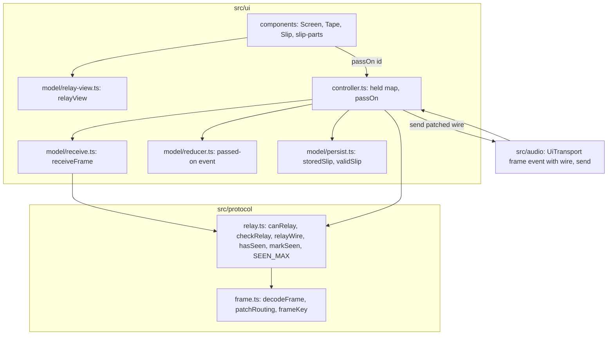
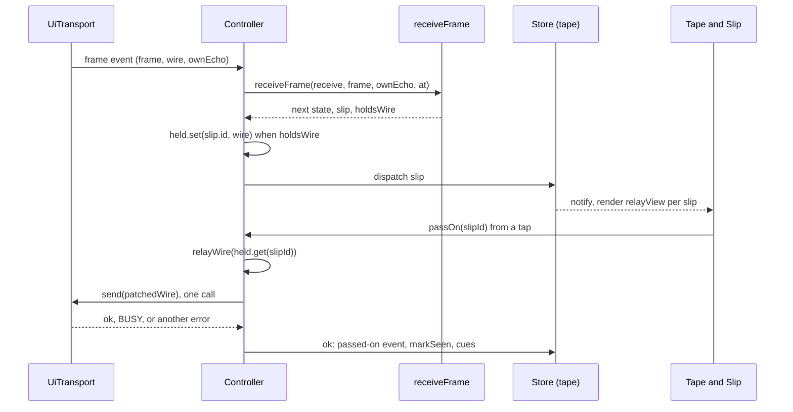

# Design Document: relay

## Overview

Relay lets a person pass a heard message on to the next phone. The pass-on is one tap, and the phone replays the exact frame it heard with the hop count raised by one and the hops left lowered by one. Nothing is relayed unless a person taps.

The design has two layers.

- `src/protocol/relay.ts` is pure and runs in Node. It holds the rules: `checkRelay`, `canRelay`, `relayWire`, and the Relay_State functions `hasSeen` and `markSeen` with the cap `SEEN_MAX = 256`. It is body-blind. Its inputs are four header numbers, `type`, `hop`, `ttl` and `total`, plus wire bytes that it hands to `decodeFrame` and `patchRouting`. It reads `type` for one purpose only: to refuse KEY_OFFER. It never reads `encrypted` or the body.
- `src/ui` wires the rules to the Tape. The Controller keeps the Held_Wire of each heard slip in a memory-only `Map`. A pure decision function, `relayView`, tells each Heard slip what to show: the "Pass it on → hop N" action, an End_Of_Line_Reason, or "Passed on".

Relay adds no header byte, no field and no airtime beyond the frame that was heard. The `frame-protocol` size table is unchanged: a Patched_Wire has the length of its Held_Wire, and `patchRouting` rewrites byte 1 and the 2-byte CRC trailer in place.

Decisions in this design:

| Decision | Choice | Why |
|---|---|---|
| Relay input type | `canRelay` takes `Pick<FrameHeader, "type" \| "hop" \| "ttl" \| "total">` | The type system keeps `encrypted` and the body out of reach. A full `Frame` is still assignable. Requirements 1.7, 2.8. |
| KEY_OFFER | Refused by header `type` with reason `NOT_RELAYED_TYPE`, whatever hop and ttl are | `frame-protocol` hands a group key over only between phones in the same room. The check reads the header type, never the body. Requirements 1.3, 1.8. |
| Byte editing | `relayWire` calls `decodeFrame`, then the rule, then `patchRouting` | `decodeFrame` is the single source of truth for validity. `patchRouting` recomputes the CRC without a key. A bad CRC is never re-sealed (2.6). |
| Relay_State | A `readonly string[]` of Message_Keys, newest last, `SEEN_MAX` = 256 | This is the shape `receive.ts` already uses for `seen`. The cap and the drop-oldest rule move into `src/protocol` so they are tested as a pure unit and `receive.ts` stops owning a second copy. Memory only. |
| Held_Wire storage | A `Map<slipId, Uint8Array>` inside the Controller, never in a Slip | `persist.ts` writes slips with `JSON.stringify`. A `Uint8Array` in a Slip would reach storage, which `ui-shell` 16.5 forbids. A map outside the tape cannot leak. |
| Slip id as map key | The slip id of a single-frame slip is already `frameKey` | `receive.ts` sets `id: key`. The Message_Key, the slip id and the Held_Wire key are one string. |
| Relay metadata on a slip | Optional `relay?: { hop, ttl, multi, keyOffer }`, in memory only | Lets the Tape decide without the wire (4.12, 4.14). Stripped by `persist.ts` on write, so a reloaded un-passed slip shows no action and no reason line (4.6). |
| Restart outcome | `relayView` returns `{ kind: "none" }` when the slip has no `relay` meta or no Held_Wire. The `restart` reason key and the `copy.relay.endRestart` string are removed. | Smallest change: `none` already renders nothing, so `Slip.tsx` needs no new branch, and the reason union loses one member instead of gaining a `hidden` kind. An unreadable notice with `none` prints `copy.relay.unreadable.text` ("Can’t read this message.") with no reason line. `endRestart` has no other user, so it is deleted (4.6). |
| Slip button hit area | `.slip-button::after` carries `min-width: 44px` and `min-height: 44px` and is centred on the button | The current overlay uses `inset: -7px -4px`, so its width follows the label. A minimum on the overlay gives every slip action button a 44 by 44 px hit area whatever the label length, without changing the look (4.9). |
| `passedOn` on a slip | Optional persisted boolean `passedOn?: true` on Heard and System slips | The only relay datum that is stored (3.10, 3.11). A reloaded slip with `passedOn: true` shows "Passed on" only if `relayView` treats it as relayable, that is a `heard` slip or a System slip with `noticeKey: "unreadable"` (4.17). Every other System slip (for example `mic-again`) shows nothing, because `relayView` returns `none` for it whatever `passedOn` is. It is not binary data, so `ui-shell` 16.5 holds. |
| Pass-on channel | The channel selected at tap time | `UiTransport.send` already plays on `transport.profile`, which the Controller keeps equal to `state.channel`. |
| "You can still pass it on" | Chosen from the `relayView` result, not from the frame | The text is shown if and only if the Pass_On_Action is shown (4.16). One source of truth makes a contradiction impossible. |

## Architecture



Layering rules, unchanged:
- `src/protocol/relay.ts` imports only `./frame`, `./types` and `./budget`. The existing `layering.test.ts` already forbids audio, ui, DOM, `TextDecoder` and network facilities in every file of that folder, so it covers `relay.ts` without change.
- `src/ui` imports the relay only through `src/protocol/index.ts`.
- `src/audio` is untouched. The `frame` event already carries `wire: Uint8Array` (a copy made in `rx-pipeline.ts`), so the Controller receives the Held_Wire without any audio change.

### Hear and pass-on flow



A Transmit takes the same send helper. When it returns ok, the Controller also calls `markSeen` with the Message_Key of every frame it sent (3.12), so a copy of its own message that another phone passes on is ignored as a duplicate.

Hearing never calls `send`. Only the `passOn` handler does. A KEY_OFFER is never in `held`, so `passOn` has nothing to send for it.

## Components and Interfaces

### `src/protocol/relay.ts`

```ts
import type { DecodeErrorCode, FrameHeader, Result } from "./types";

/** Design parameter (carried over from receive.ts). */
export const SEEN_MAX = 256;

/** Message type value of KEY_OFFER, read from the header only. */
const KEY_OFFER_TYPE = 4;

export type RelayRefusal =
  | "MULTI_FRAME"
  | "NOT_RELAYED_TYPE"
  | "NO_HOPS_LEFT"
  | "HOP_LIMIT";
export type RelayErrorCode = RelayRefusal | DecodeErrorCode | "BAD_ROUTING";
export type RelayError = { readonly code: RelayErrorCode };

/** The only header fields the relay may read. A Frame is assignable. */
export type RelayView = Pick<FrameHeader, "type" | "hop" | "ttl" | "total">;

/**
 * Result form of the rule. Reason order: MULTI_FRAME, NOT_RELAYED_TYPE,
 * NO_HOPS_LEFT, HOP_LIMIT. `type` is compared with KEY_OFFER and used for nothing else.
 */
export function checkRelay(view: RelayView): Result<true, { code: RelayRefusal }>;

/** true iff total = 1, type is not KEY_OFFER, ttl >= 1 and hop < 15. */
export function canRelay(view: RelayView): boolean;

/**
 * decodeFrame, then checkRelay, then patchRouting(wire, hop + 1, ttl - 1).
 * Returns the Patched_Wire, a refusal, or the decode error (including BAD_CRC).
 * Never throws. Never calls encodeFrame, splitPayload, makeFrames or newMessageId.
 */
export function relayWire(wire: Uint8Array): Result<Uint8Array, RelayError>;

/** Relay_State functions. The state is the key list itself, newest last. */
export function hasSeen(seen: readonly string[], key: string): boolean;
/** Appends a new key and drops the oldest beyond SEEN_MAX. A key already held leaves the list unchanged. */
export function markSeen(seen: readonly string[], key: string): readonly string[];
```

Notes:
- The reason order is MULTI_FRAME, NOT_RELAYED_TYPE, NO_HOPS_LEFT, HOP_LIMIT (1.9). A valid KEY_OFFER is always single-frame and unencrypted (`decodeFrame` rejects the other shapes with `KEY_OFFER_MULTIFRAME` and `KEY_OFFER_ENCRYPTED`), so through `relayWire` a KEY_OFFER always gets `NOT_RELAYED_TYPE`. `MULTI_FRAME` before `NOT_RELAYED_TYPE` matters only for `checkRelay` called on a bare view.
- The type check is a numeric comparison on the header field. `relay.ts` never names `.body` or `.encrypted`, and never slices bytes. A source scan enforces this (9.9).
- `relayWire` returns the error of `decodeFrame` unchanged for a frame that fails to decode, so `BAD_CRC` surfaces and no bytes are produced (2.6). `patchRouting` can return `BAD_ROUTING` only for values `checkRelay` already excluded, so that code is unreachable here. The function still returns the `patchRouting` error as is, and `RelayErrorCode` therefore also admits `BAD_ROUTING`.
- `canRelay` is a boolean wrapper over `checkRelay`. Requirement 1.10 ("return a Result") is met by `checkRelay`. The no-throw property for arbitrary bytes (9.17) is exercised on `relayWire` and on `decodeFrame` followed by `canRelay`.
- `markSeen` on a key already held does not move it to the newest position. Requirement 3.6 says "oldest first", and refreshing would change which key is oldest for no benefit.
- `src/protocol/index.ts` adds: `canRelay`, `checkRelay`, `relayWire`, `hasSeen`, `markSeen`, `SEEN_MAX`, and the types `RelayError`, `RelayErrorCode`, `RelayRefusal`, `RelayView`. `layering.test.ts` adds `canRelay` and `relayWire` to its function list (8.5).

### `src/ui/model/receive.ts` (changes)

- `SEEN_MAX` is imported from the protocol index and re-exported, so existing imports keep working. `seen` stays a `readonly string[]` and is updated with `markSeen`. The test `rs.seen.includes(key)` becomes `hasSeen`.
- `receiveFrame` receives the frame as today. It returns a third field:

```ts
export function receiveFrame(
  rs: ReceiveState,
  ev: { frame: Frame; ownEcho: boolean; atMs: number },
): {
  next: ReceiveState;
  slip: Slip | null;
  /** true when the Controller should keep the wire of this event next to slip.id (4.1). */
  holdsWire: boolean;
};
```

- Single-frame (`total` = 1) cases:
  - Unencrypted TEXT: the Heard slip gets `relay: { hop, ttl, multi: false, keyOffer: false }`.
  - Any other type or an encrypted frame: a System slip with `noticeKey: "unreadable"` and `relay: { hop, ttl, multi: false, keyOffer: type === KEY_OFFER }`. It carries no text and no type name (4.13). The one use of the type is the `keyOffer` flag, which selects the KEY_OFFER reason (4.14). This replaces the `unsupported` notice for single frames only.
  - `holdsWire` is `canRelay(frame.header)`, so it is false for a KEY_OFFER.
- Multi-frame (`total` > 1) cases keep today's behavior: an unreadable frame still prints `unsupported` and a completed TEXT message prints one Heard slip, now with `relay: { hop, ttl, multi: true, keyOffer: false }`. `holdsWire` is false.
- `ownEcho` and duplicates return `slip: null`, `holdsWire: false`, state unchanged, as today.

### `src/ui/model/tape.ts` (changes)

```ts
export interface RelayMeta {
  readonly hop: number;       // as received, never changed by a pass-on (5.4)
  readonly ttl: number;       // Hops_Left
  readonly multi: boolean;
  readonly keyOffer: boolean; // header type is KEY_OFFER
}
```

- `Slip` kinds `heard` and `system` gain `readonly relay?: RelayMeta` (memory only) and `readonly passedOn?: true` (persisted, written only when true; absent means false). Callers treat absent as false.
- `NoticeKey` gains `"unreadable"` and `"relay-failed"`.

### `src/ui/model/persist.ts` (changes)

The existing `serialize` and `write` pass `s.tape` straight to `JSON.stringify`. With `relay` on a slip, that would write the relay metadata. The design adds one function so the stored shape is explicit:

```ts
/** The stored shape of a slip: drops `relay`, keeps `passedOn` only when true. */
export function storedSlip(slip: Slip): Slip;
```

- `serialize` and `write` map the tape through `storedSlip` before `JSON.stringify`.
- `validSlip` for `heard` and `system` adds `...(v.passedOn === true ? { passedOn: true } : {})`. Any other value of `passedOn` (a string, a number, `false`, `null`) is treated as absent. It never drops the slip, because `passedOn` is optional. The result never carries `relay`, so a stored `relay` field in old or tampered data is ignored.
- `NOTICE_KEYS` adds `"unreadable"` and `"relay-failed"`.
- The `StorageLike` calls stay as they are: tape, draft, channel and flags. No new key, no wire bytes, no Message_Key list (3.8). `Slip` already forbids a byte array by type, and the test below checks the written text.
- A passed-on slip reloads as `passedOn: true` and no `relay`. For a `heard` slip or a System slip with `noticeKey: "unreadable"`, `relayView` returns `passed` before it looks at `relay` or `held`, so it shows "Passed on" (4.17). Any other System slip (for example `mic-again`) gets `none` and shows nothing, whatever `passedOn` is. A slip not passed on reloads with no `relay`, gets `none`, and shows no action and no reason line (4.6).

### `src/ui/model/reducer.ts` (change)

One new event, `{ type: "passed-on"; id: string }`. It returns a new tape in which the slip with that id has `passedOn: true`. An unknown id returns the same state object. The persisted-state subscription already saves on any tape change, so the flag is written through the existing debounce.

### `src/ui/model/relay-view.ts` (new, pure)

```ts
export type SlipRelayView =
  | { kind: "none" }
  | { kind: "action"; hop: number; disabled: boolean }  // hop = N in "Pass it on → hop N"
  | {
      kind: "reason";
      key: "no-hops" | "hop-limit" | "multi" | "key-offer";
    }
  | { kind: "passed" };

export function relayView(
  slip: Slip,
  ctx: {
    held: boolean;        // the Controller holds a wire for slip.id
    canSendNow: boolean;  // power on, no fault, no transmission in flight
  },
): SlipRelayView;
```

Decision order for a `heard` slip or an `unreadable` System slip (anything else returns `none`):

| # | Condition | Result | Requirement |
|---|---|---|---|
| 1 | `passedOn` is true | `passed` | 3.9, 4.10, 4.17 |
| 2 | `relay` is absent | `none` | 4.6 |
| 3 | `relay.multi` | `reason multi` | 4.7 |
| 4 | `relay.keyOffer` | `reason key-offer` | 4.14 |
| 5 | `relay.ttl` is 0 | `reason no-hops` | 4.4, 4.15 |
| 6 | `relay.hop` is 15 | `reason hop-limit` | 4.5 |
| 7 | `held` is false | `none` | 4.6 |
| 8 | otherwise | `action`, `hop: relay.hop + 1`, `disabled: !canSendNow` | 4.2, 4.8 |

Rows 3 to 6 follow the `checkRelay` order (MULTI_FRAME, NOT_RELAYED_TYPE, NO_HOPS_LEFT, HOP_LIMIT). Row 7 comes after rows 3 to 6 so that a KEY_OFFER, which is never held, still shows the KEY_OFFER reason while its relay meta is in memory. Rows 2 and 7 are the restart case: the slip shows no action and no reason line. There is no `restart` reason key and no restart copy string. Reason text lives in `copy.ts`.

`Slip.tsx` picks the text of an unreadable notice from this result: if `kind` is `action` it prints `copy.relay.unreadable.textRelayable` ("Can’t read this message. You can still pass it on."), and in every other case it prints `copy.relay.unreadable.text` ("Can’t read this message.") followed by the reason line. For `none` there is no reason line, so a reloaded unreadable notice shows only "Can’t read this message." (4.6). So "You can still pass it on" appears if and only if the action appears (4.16), and a notice with ttl 0 shows only the no-hops reason (4.15). A disabled action still counts as shown.

### `src/ui/controller.ts` (changes)

New members:

```ts
interface Controller {
  /** Tap on "Pass it on". Sends the patched wire of the slip once. */
  passOn(slipId: string): void;
  /** True while the Controller holds the Held_Wire of this slip (memory only). */
  holdsWire(slipId: string): boolean;
}
```

Internal state: `const held = new Map<string, Uint8Array>()`. It is not part of `UiState` and not part of `savedOf`.

- Hearing (`case "frame"` in `onTransportEvent`): after `receiveFrame`, `if (r.slip && r.holdsWire) held.set(r.slip.id, ev.wire)` runs before `onSlip` dispatches, so the first render already finds the wire. After the dispatch, `pruneHeld()` removes every key whose slip is no longer on the tape (8.4, the 50-slip cap). The heard haptic cue stays on `heard` slips.
- `passOn(slipId)`:
  1. Return if `sendInFlight`, if power is not on, if a fault is set, or if a transmission is in flight (the same condition that disables the action, 4.8).
  2. Find the slip on the tape. Return if it is missing or `passedOn`.
  3. `const wire = held.get(slipId)`. Return if missing.
  4. `const patched = relayWire(wire)`. On a refusal code (`MULTI_FRAME`, `NOT_RELAYED_TYPE`, `NO_HOPS_LEFT`, `HOP_LIMIT`), return without sending and without a notice (6.9). On a decode error, print a `relay-failed` System slip and return. Neither case sends.
  5. Send through the shared send helper below, once. No retry, no queue (6.3).
  6. On ok: dispatch `tx-end` with `ok: true, slip: null` (no Sent slip, 4.10), then `receive = { ...receive, seen: markSeen(receive.seen, slipId) }` (6.7, 3.3), then `dispatch({ type: "passed-on", id: slipId })`, then the sent haptic cue. If the key was dropped by the cap in the meantime, `markSeen` puts it back.
  7. On `BUSY`: dispatch `send-busy` and change nothing else (6.5).
  8. On any other error: dispatch `tx-end` with `ok: false, slip: null` and print a `relay-failed` System slip. The action stays (6.6).
- The existing `runSend` is split into a helper that does the `transport.send` call and the `tx-start`/`tx-end` dispatches, plus a small callback for the success slip. `transmit()` passes the Sent slip. `passOn()` passes none. This keeps the cues of `ui-shell` 6.4 (SD, `ATDT` with airtime, signal-line pulse, haptic) identical for both.
- Sender's own keys (3.12, 9.20). `transmit()` records the Message_Key of every frame it sent once the send outcome is `ok`: for each sent wire, `decodeFrame(wire)` and, when it decodes, `receive = { ...receive, seen: markSeen(receive.seen, frameKey(frame)) }`. Today `buildWire` produces one single-frame wire, so this is one key (`<hex message ID>:0`). A later multi-frame send records one key per frame. The step runs after the `tx-end` success dispatch and uses the same capped, memory-only `seen` list as hearing and `passOn`. On `BUSY` or another error, nothing is recorded, so a failed message that never went on air is not suppressed. The keys come from the wire bytes, not from the Sent slip, so nothing new is stored and the Sent slip shape does not change.
  - Why: the own-echo check in `src/audio/own-echo.ts` compares exact bytes. A Patched_Wire differs at byte 1 and in the CRC, so when phone B passes A's message on, A's pipeline reports `ownEcho: false`. Without this step A prints its own message as a new Heard slip. With it, `receiveFrame` finds the key in `seen` and prints nothing, for any `hop` and `ttl` (3.2, 3.5). `src/audio` is unchanged and still catches the direct echo of A's own transmission.
- `powerOff`, `dispose`: `dispose` clears `held`. `powerOff` keeps it, because the tape stays visible while the power is off (the action is disabled, 4.8).
- The Controller starts no audio or microphone for a pass-on (6.8). It does not call `transport.start`.

### Components

- `Screen.tsx`: replaces `passOn = extras?.passOn ? … : undefined` with
  `relay = (slip) => relayView(slip, { held: actions.holdsWire(slip.id), canSendNow })`, where `canSendNow` is `state.power === "on" && state.fault === null && state.tx.phase !== "sending"`. In the gallery, `extras.passOn` produces `{ kind: "action", hop: slip.hop + 1, disabled: false }` as before. `ScreenActions` adds `passOn` and `holdsWire`. The gallery supplies no-ops (`holdsWire` returns false).
- `Tape.tsx`: the `passOn?: (slip) => number | undefined` prop becomes `relay?: (slip) => SlipRelayView` and gains `onPassOn?: (id: string) => void`. It forwards both to `Slip`.
- `Slip.tsx`: accepts `relay?: SlipRelayView` and `onPassOn?`. It renders, below the body:
  - `action`: the existing `PassOn` button.
  - `reason`: a text line from `copy`. Rendered as text, never HTML (4.11).
  - `passed`: the text "Passed on" in place of the button (4.10).
  - `none`: nothing.
  The Heard meta line replaces `Hop n` with the "via" text: `via 1 hop`, `via n hops`, nothing at 0 (5.1 to 5.3). The `unreadable` System slip uses `relay.hop` for the same line and shows the notice text chosen as described under `relay-view.ts`. Gallery slip kinds (`relayed`, `locked`, `sos`, `location`, `safe`) are untouched.
- `slip-parts.tsx`: `PassOn` gains `disabled?: boolean` and an accessible name, `aria-label` "Pass it on, hop N" built from `copy` (4.9). The button keeps its label while disabled (4.8). `SlipButton` must give keyboard activation and a hit area of at least 44 by 44 px that does not depend on the label length (4.9). The component test checks the size class and the key handler.
- `Slip.css`: the hit area of every `.slip-button` (Pass it on, Later, Restart now) is the `.slip-button::after` overlay. Today it is `inset: -7px -4px`, so its width follows the label. It becomes centred on the button with `min-width: 44px` and `min-height: 44px`, for example `top: 50%; left: 50%; width: calc(100% + 8px); height: calc(100% + 14px); min-width: 44px; min-height: 44px; transform: translate(-50%, -50%)`. The button itself stays `position: relative` and its look does not change. The size test in `Slip.test.ts` reads `min-width` and `min-height` of 44 px or more from the `::after` rule instead of adding the inset to the label size.

### `src/ui/copy.ts` (additions)

All strings live here (5.5):

```ts
relay: {
  via: (n: number) => (n === 1 ? "via 1 hop" : `via ${n} hops`),
  passedOn: "Passed on",
  passOnLabel: (hop: number) => `Pass it on, hop ${hop}`,
  endNoHops: "End of the line. This message has no hops left to pass on.",
  endHopLimit: "End of the line. This message has gone as far as it can.",
  endMulti: "Long messages can’t be passed on yet.",
  endKeyOffer: "Group keys can’t be passed on. Join in the same room.",
  unreadable: {
    title: "Cannot read this",
    text: "Can’t read this message.",
    textRelayable: "Can’t read this message. You can still pass it on.",
  },
  failed: { title: "Could not pass on", text: "The message was not sent. Try again." },
}
```

There is no `endRestart`: the restart case shows no reason line (4.6), so the earlier "Can’t be passed on after the app restarts." string is removed from `copy.ts` and from every test that lists the relay strings. The existing `slip.passOn(hop)` label stays. `slip.notices.unreadable` and `slip.notices.relay-failed` are added. The strings are first drafts that need the copy review listed under "Open items".

### `src/ui/model/send.ts` (change)

The comment on `SEND_TTL` changes from "The relay spec owns the real rule" to a statement that `SEND_TTL` = 3 is the number of pass-ons a sent message can survive (2.10). The value does not change.

## Data Models

| Name | Location | Fields | Lifetime |
|---|---|---|---|
| Relay_State | `ReceiveState.seen` | `readonly string[]` of Message_Keys, newest last, at most 256 | Controller closure, memory only |
| Held_Wire | Controller `held` map | `Map<slipId, Uint8Array>`, at most one entry per slip on the tape (50) | Controller closure, memory only |
| `RelayMeta` | `relay` on `heard` and `system` slips | `hop`, `ttl`, `multi`, `keyOffer` | Tape state in memory. Dropped by `storedSlip`. |
| `passedOn` | on `heard` and `system` slips | `true` or absent | Persisted with the slip, validated on load |

Message_Key format is `frameKey`: lowercase hex of the 8-byte ID, a colon, the frame index in decimal. Copies of one message that differ in hop and ttl share a key (3.5).

### Wire bytes of a pass-on

| Field | Bytes | Reason |
|---|---|---|
| Byte 0 (version, flags, type) | unchanged | Type is read for the KEY_OFFER check only. |
| Byte 1 (hop 4 bits, ttl 4 bits) | rewritten | The only routing edit: hop + 1, ttl - 1. |
| Message ID (8) | unchanged | Dedupe and IV base. |
| Frame byte (0 or 1) | unchanged | Single-frame messages only, so it is absent. |
| Body | unchanged | Ciphertext is never touched. |
| CRC-16 trailer (2) | recomputed | Covers byte 1, so it changes with it. |
| Length | equal to the Held_Wire | No header growth, no extra airtime. The `frame-protocol` size table does not change. |

### Capacity of the Relay_State

Each key is 17 to 18 characters (16 hex, a colon, one or two index digits; single-frame messages use index 0). 256 keys take well under 10 KB. A dropped key (the 257th distinct message) is treated as new again, and a person must tap to pass it on again (3.7). Auto-relay does not exist, so this cannot cause a loop.

## Correctness Properties

*A property is a characteristic or behavior that should hold true across all valid executions of a system-essentially, a formal statement about what the system should do. Properties serve as the bridge between human-readable specifications and machine-verifiable correctness guarantees.*

Reflection on the prework: the checks of 2.3, 2.4, 2.5, 2.11, 8.1 and 9.10 collapse into one "Patched_Wire shape" property. 2.8 and 4.13 are subsumed by the body-blind and Unreadable_Notice properties. 1.3, 1.8, 2.7 and 9.18 form their own property, because KEY_OFFER is the one type the relay may name. 2.2, 2.10, 5.5, 7.4, 8.2 and 9.9 become source-scan and example tests, not properties. 7.2 and 7.5 need no test of their own.

### Property 1: Relayability predicate and reason order

For any `type` in 0..5, any `hop` and `ttl` in 0..15 and any `total` in 1..16, `checkRelay` accepts if and only if `total` = 1, `type` is not KEY_OFFER, `ttl` >= 1 and `hop` < 15, and otherwise it returns the first of `MULTI_FRAME`, `NOT_RELAYED_TYPE`, `NO_HOPS_LEFT`, `HOP_LIMIT` that applies. `canRelay` agrees with `checkRelay`. For any valid wire whose header is refused, `relayWire` returns the same code and no bytes.

**Validates: Requirements 1.1, 1.2, 1.3, 1.4, 1.5, 1.6, 1.9, 2.7, 9.6**

### Property 2: Patched_Wire shape

For any valid single-frame wire of a type other than KEY_OFFER with `ttl` >= 1 and `hop` < 15, `relayWire` returns a wire that (a) has the same length as the input and at most 140 bytes, (b) differs from the input only at byte 1 and in the 2-byte CRC trailer, (c) decodes with `decodeFrame`, (d) has `hop` plus 1 and `ttl` minus 1, and (e) has equal message ID, type, encrypted flag, index, total and body.

**Validates: Requirements 1.6, 2.1, 2.3, 2.4, 2.5, 2.11, 8.1, 9.3, 9.4, 9.10**

### Property 3: Crypto inputs survive a relay

For any valid relayable wire of any type other than KEY_OFFER and any encrypted flag, `frameKey`, `aadFor` and `ivFor` computed from the decoded Held_Wire equal those computed from the decoded Patched_Wire.

**Validates: Requirements 2.9, 3.5, 9.11**

### Property 4: Body-blind relay

For any single-frame wire of a type other than KEY_OFFER with `ttl` >= 1 and `hop` < 15, with any encrypted flag and any body bytes (including bodies that look like ciphertext and bodies that are not valid UTF-8), `relayWire` accepts it. For any two wires with equal `type`, `hop`, `ttl` and `total` and with different encrypted flag or body, `canRelay` and the `relayWire` outcome (accept, or the same refusal code, and the same routing change) are equal.

**Validates: Requirements 1.6, 1.7, 2.8, 9.7, 9.8**

### Property 5: KEY_OFFER is never relayed

For any valid KEY_OFFER wire, any `hop` in 0..15 and any `ttl` in 0..15, `relayWire` returns `NOT_RELAYED_TYPE` and no bytes. For any view with `type` KEY_OFFER, `total` = 1 and any `hop` and `ttl`, `canRelay` is false and `checkRelay` returns `NOT_RELAYED_TYPE`. For any such view with `total` > 1, `checkRelay` returns `MULTI_FRAME`. The result depends on the header `type` only: two KEY_OFFER wires with different bodies give the same result.

**Validates: Requirements 1.3, 1.8, 2.7, 9.18**

### Property 6: Idempotent re-broadcast

For any relayable wire, calling `relayWire` twice on the same Held_Wire returns equal bytes, and the Held_Wire is not mutated.

**Validates: Requirements 9.2**

### Property 7: Chains of passes are monotone and bounded

For any starting `ttl` t in 0..15 and `hop` 0, a chain of `relayWire` applications never lowers `hop`, keeps `hop` plus `ttl` constant, performs at most t passes, and ends on a wire that `canRelay` refuses.

**Validates: Requirements 2.10, 9.3, 9.4, 9.5**

### Property 8: A corrupted frame is never re-sealed

For any valid wire and any change of one or more bytes that breaks the CRC (a changed byte outside the trailer, or any change to the trailer), `relayWire` returns a decode error and no bytes.

**Validates: Requirements 2.6, 9.12**

### Property 9: relayWire is total

For any byte array of length 0 to 200, `relayWire` returns without throwing, and `decodeFrame` followed by `canRelay` returns without throwing.

**Validates: Requirements 1.10, 9.17**

### Property 10: The Relay_State is capped and drops the oldest key

For any sequence of keys of any length with any duplicates, the list after each `markSeen` has at most `SEEN_MAX` keys and no duplicate. Once the cap is reached, a new key removes the oldest key. After 257 distinct inserts the first key is no longer held.

**Validates: Requirements 3.6, 3.7, 9.13**

### Property 11: Each message is shown once

For any sequence of frame events in any order and with any duplicates, `receiveFrame` prints at most one slip per Message_Key while that key is held, copies with other `hop` and `ttl` print nothing, an `ownEcho` event prints nothing and leaves the state unchanged, and every heard key (printed or not) is held in the state.

**Validates: Requirements 3.1, 3.2, 3.4, 3.5, 9.14**

### Property 12: Phones in one room pass a message at most once each

For any set of 2 to 6 simulated phones, any starting `ttl`, and any order of delivery, if each phone applies the Relay_State rule and relays every frame it accepts, the message passes through each phone at most once and the simulation ends.

**Validates: Requirements 3.3, 9.16**

### Property 13: Held wires and unreadable notices

For any single-frame frame of any type, any encrypted flag and any body, `receiveFrame` sets `holdsWire` if and only if `canRelay` accepts the header and a slip is printed, so it is never set for a KEY_OFFER. For any such frame that is not unencrypted TEXT, the printed slip is a System slip with `noticeKey: "unreadable"` that has no `text`, no type name and no body bytes, and its `relay.keyOffer` equals whether the header type is KEY_OFFER.

**Validates: Requirements 4.1, 4.3, 4.13, 4.14**

### Property 14: The decision table of the Pass it on action

For any Heard or unreadable slip with any `relay` meta (or none), any `held` flag, any `passedOn` flag and any `canSendNow` flag, `relayView` returns the first match of: `passed`, `none` (no `relay`), `multi`, `key-offer`, `no-hops`, `hop-limit`, `none` (not held), then `action` with `hop` = `relay.hop` + 1 and `disabled` = not `canSendNow`. A slip that is not Heard or unreadable returns `none`. For any unreadable slip, the rendered notice text contains "You can still pass it on" if and only if `relayView` returns `action`. When `relayView` returns `none`, the rendered slip has no reason line and no action, and an unreadable notice shows only "Can’t read this message.". A slip with `ttl` 0 never shows that text and shows the no-hops reason (unless it is passed on, multi-frame or KEY_OFFER).

**Validates: Requirements 3.9, 4.2, 4.4, 4.5, 4.6, 4.7, 4.8, 4.10, 4.12, 4.14, 4.15, 4.16, 4.17**

### Property 15: Hop text

For any `hop` in 0..15, the "via" text is empty at 0, "via 1 hop" at 1 and "via n hops" for n > 1. A pass-on leaves the `hop` of the slip unchanged.

**Validates: Requirements 5.1, 5.2, 5.3, 5.4**

### Property 16: Hearing never sends, a tap sends once, KEY_OFFER never sends

For any sequence of frame events of any type, `hop` and `ttl`, the fake transport sees zero `send` calls. For any relayable held slip, one call of `passOn` produces exactly one `send` call, and its argument equals `relayWire(heldWire)`. For any KEY_OFFER slip, any number of `passOn` calls produces zero `send` calls.

**Validates: Requirements 6.1, 6.2, 6.4, 6.9**

### Property 17: Held wires never outlive their slip

For any sequence of more than 50 heard relayable frames, the Controller holds a wire for a slip id if and only if that slip is still on the tape, so `held.size` is at most 50.

**Validates: Requirements 8.4**

### Property 18: passedOn survives a save and load, relay data does not

For any tape of Heard and System slips with any `relay` meta and any `passedOn` value, `serialize` followed by `parseSaved` returns, for each valid slip, `passedOn: true` if and only if it was `true`, and no `relay` field. A stored `passedOn` that is not the boolean `true` (a string, a number, `false`, `null`) loads as absent and does not drop the slip. A loaded `heard` slip or System slip with `noticeKey: "unreadable"` that has `passedOn: true` has `relayView` `passed`, whatever `held` is. A loaded `heard` slip or `unreadable` System slip without `passedOn: true` has `relayView` `none` (no reason line), whatever `held` is. A loaded System slip with any other `noticeKey` (for example `mic-again`) has `relayView` `none`, whatever `passedOn` and `held` are.

**Validates: Requirements 3.10, 3.11, 4.6, 4.17**

### Property 19: No wire or key list is ever stored

For any Controller scenario that hears frames and passes messages on, no value written through `StorageLike` (and no call to `localStorage`, `indexedDB` or the Cache API beyond the existing tape, draft, channel and flag writes) contains a Held_Wire, a byte array, a Message_Key or the Relay_State list. The only relay datum written is the boolean `passedOn` of a slip.

**Validates: Requirements 3.8, 3.11, 9.15**

### Property 20: A sender ignores passed-on copies of its own message

For any message text within the Well_Limit, any channel, and any send outcome, drive `transmit()` on a Controller with the fake transport. If the outcome is `ok`, then for any later frame event carrying a copy of a sent frame with any `hop` and `ttl` (built with `patchRouting`, or with one or more `relayWire` passes) and `ownEcho: false`, no slip is added to the tape and the Relay_State is unchanged. If the outcome is `BUSY` or another error, the Relay_State after the send equals the Relay_State before it.

**Validates: Requirements 3.1, 3.2, 3.5, 3.12, 9.20**

## Error Handling

| Situation | Behavior | Requirement |
|---|---|---|
| Held_Wire fails `decodeFrame` or has `BAD_CRC` | `relayWire` returns the decode error and no bytes. The Controller sends nothing and prints a `relay-failed` notice. Cannot happen for a wire that was decoded when it was heard, unless memory is corrupted. | 2.6 |
| Frame refused by the rule | `relayWire` returns `MULTI_FRAME`, `NOT_RELAYED_TYPE`, `NO_HOPS_LEFT` or `HOP_LIMIT`. The slip shows the End_Of_Line_Reason and no action. | 1.2 to 1.5, 4.4, 4.5, 4.7, 4.14 |
| KEY_OFFER heard | A System `unreadable` slip with the reason "Group keys can’t be passed on. Join in the same room." No wire is held and nothing can be sent. | 1.3, 4.14, 6.9 |
| `passOn` reached for a refused frame (a stale tap) | Returns without sending and without a notice. | 6.9 |
| Slip has no Held_Wire (after a reload, or dropped) | `relayView` returns `none`. No action and no reason line. An unreadable notice shows only "Can’t read this message." | 4.6 |
| Stored `passedOn` is not the boolean `true` | Loaded as not passed on. The slip is kept. | 3.10 |
| `send` returns `BUSY` | Keep the action, the Relay_State and the slip. The Transmit key flashes as for a normal send. | 6.5 |
| `send` returns another error | Keep the Relay_State, print a System notice with a plain reason, keep the action. The status window shows `ERROR` through the existing `tx-end` failure path. | 6.6 |
| Power off, transmission in flight, or a fault | The action stays visible and is disabled with its label. `passOn` returns without sending. | 4.8 |
| Second tap on a slip already passed on | The slip shows "Passed on", no action. `passOn` returns without sending. | 3.9, 4.10 |
| Unknown slip id in `passOn` or `passed-on` | Ignored. State object unchanged. | n/a |
| Key dropped by the 256 cap | The next copy prints a new slip and can be passed on again by a tap. | 3.7 |
| Another phone passes on this phone's own message | `ownEcho` is false (bytes differ at byte 1 and the CRC), but the key was recorded at send time, so `receiveFrame` prints nothing. If the key was dropped by the cap, the copy prints as a Heard slip (3.7). | 3.12 |
| Transmit returns `BUSY` or another error | No key is recorded for that message. | 3.12 |

No error path retries, queues or schedules a transmission (6.3).

## Testing Strategy

Property-based testing applies here. The relay rules are pure functions over bytes and small integers, so universal properties are cheap and find real bugs (nibble overflow, off-by-one at hop 15, CRC re-sealing, a KEY_OFFER slipping through on an unusual hop and ttl). The UI parts that are not computable (layout, tap target size, motion) use example, component and e2e tests.

**Library:** fast-check, with Vitest, as already used in `src/protocol/*.prop.test.ts`. Each property is one test. Each runs at least 100 iterations (the existing prop tests use `numRuns: 300` with `verbose: true`, which prints the seed and path on failure). Each test carries a comment tag in this form: `Feature: relay, Property N: <title>`.

### Files

| File | Content | Environment |
|---|---|---|
| `src/protocol/relay.prop.test.ts` | Properties 1 to 10 and 12 | Node, no DOM, no ggwave (fast) |
| `src/protocol/relay.test.ts` | Examples: SEND_TTL = 3 chain of 3 passes, hop 15 with ttl 3, a KEY_OFFER wire refused with `NOT_RELAYED_TYPE`, index exports, and the source scan below | Node |
| `src/ui/model/receive.prop.test.ts` (extended) | Properties 11 and 13 | Node |
| `src/ui/model/relay-view.prop.test.ts` | Properties 14 and 15 | Node |
| `src/ui/relay-controller.prop.test.ts` | Properties 16, 17, 19 and 20 with `fake-transport.ts` and a recording in-memory `StorageLike` | Node |
| `src/ui/model/persist.prop.test.ts` (extended) | Property 18 | Node |
| `src/audio/relay-channel.slow.test.ts` | Slow, few runs: a Patched_Wire through the real ggwave modem under each channel profile gives an equal frame, a decode error, or no result, never a different frame (as `frame-protocol` Property 14 states). Imports only `src/audio` and `src/protocol`, never `src/ui`. | Node, loads `vendor/ggwave.js` |
| `src/ui/relay-chain.slow.test.ts` | Slow, few runs: the A→B→C case through the real ggwave modem. A sends through the real Controller path (or the same seen-recording step as 3.12), B hears and passes on with `relayWire`, C prints a Heard slip with "via 1 hop", and A prints no slip for B's copy. Picked up by `vitest.slow.config.ts`. | Node, loads `vendor/ggwave.js` |

**Layering of the slow tests.** `structure.md` forbids `src/audio` importing `src/ui`. The A→B→C case needs `receiveFrame`, `buildWire` and `copy`, which live in `src/ui`, so it lives under `src/ui`, which may import `src/audio` and `src/protocol`. The per-profile check stays in `src/audio` with no `src/ui` import.

**Body-blindness without a spy.** A read-counting spy cannot show that `relayWire` reads no body byte, because `decodeFrame` copies the body with `slice`. Two checks replace it (9.8, 9.9):
- The metamorphic part of Property 4: wires with equal `type`, `hop`, `ttl` and `total` and different encrypted flag or body give the same outcome.
- The source scan in `relay.test.ts`: `src/protocol/relay.ts` contains no `.body`, no `.encrypted`, no `.slice(` and no `subarray(`, and contains no `encodeFrame`, `splitPayload`, `makeFrames` or `newMessageId`. It reads `.type` only inside the KEY_OFFER comparison. The `RelayView` input type does not expose `encrypted` or the body, so the compiler enforces the same rule.

Generators for Properties 1 to 9 reuse the `frameArb` shape from `frame-patch.prop.test.ts`: types 0 to 5, both encrypted flags, bodies of 0 to 127 bytes with random bytes (so bodies include 0x00, 0xFF and invalid UTF-8), and all `hop`, `ttl` and `total` values. KEY_OFFER frames are generated valid (unencrypted, single, with the minimum key body). Generators for relayable wires exclude type 4, and Property 5 uses type 4 only. Property 12 models phones as `{ seen: string[] }` and delivers frames in a random order.

### Example, component and smoke tests

- Component tests (`Slip.test.ts`, `Tape` example): the action label "Pass it on → hop N", the disabled state keeps its label, the "Passed on" text, each End_Of_Line_Reason including the KEY_OFFER one, the unreadable text with and without "You can still pass it on", the accessible name, the size class with `min-width` and `min-height` of at least 44 px on the `.slip-button::after` hit area (not derived from the label length), Enter and Space activation, a reloaded slip with no reason line, and markup in text rendered as text (4.9, 4.11).
- Controller examples with the fake transport: success path (key recorded, slip marked, no new slip on the tape, sending cues), `BUSY`, another error, no `start()` call, send on each of Room, Call and Quiet, a KEY_OFFER frame heard and tapped with no send (7.1, 6.x).
- Source scans, added to `src/ui/scan.test.ts`: no network facility in the relay files (8.2), no hard-coded relay strings in components (5.5), no "radio", "walkie" or "internet call" in relay copy (7.4).
- e2e (Playwright, Chromium with the fake mic, extending `fake-mic.spec.ts`): play a fixture WAV that decodes to a TEXT frame, expect the Heard slip with "Pass it on → hop 1", tap it, expect "Passed on" and no extra slip, reload and expect "Passed on" again and no reason line. A slip that was not passed on reloads with no Pass it on button and no reason line. The e2e cannot hear the pass-on, because the fake mic reads from a file. The speaker-to-mic hop between two real phones is checked by hand on devices, as `tech.md` says for audio.

### Impact on existing tests

| Test | Change |
|---|---|
| `Slip.test.ts` | The `Hop n` meta line becomes the "via" text (none at 0, "via 1 hop", "via n hops"). Add cases for `passed`, each `reason`, the `action` with `disabled`, and the unreadable System slip text in both forms. Gallery slips (`relayed`, `locked`, `sos`, `location`, `safe`) keep their current assertions. |
| `Tape` and `Screen` tests | The `passOn` prop becomes `relay` plus `onPassOn`. The gallery `extras.passOn` case maps to `{ kind: "action", … }`. |
| `receive.prop.test.ts` and `receive` examples | A single-frame unreadable frame (encrypted or non-TEXT) now prints a System slip with `noticeKey: "unreadable"` and `relay` meta, not `unsupported`. A multi-frame unreadable frame still prints `unsupported`. `rs.seen.includes` becomes `hasSeen`. A TEXT slip now carries `relay`. Add `holdsWire` assertions and the KEY_OFFER case. |
| `persist.test.ts` and `persist.prop.test.ts` | `NOTICE_KEYS` gains `unreadable` and `relay-failed`. Round-trip tests that compared slips by deep equality must compare the stored shape (`storedSlip`), since `relay` is dropped. Add `passedOn` cases: `true` kept, other values ignored, slip not dropped. |
| `reducer` tests | Add the `passed-on` event and the unknown-id case. |
| `layering.test.ts` | Add `canRelay` and `relayWire` to its function list. |
| `controller` tests | `runSend` split: existing transmit tests must still pass unchanged. |

### Not covered by tests

Real audio of a relayed frame across two phones is not simulated beyond the slow modem test. Radio, walkie-talkie and internet calls are not claimed and not tested (7.4).

## Settled decisions

These were open in the first draft and are now fixed by the revised requirements.

1. **KEY_OFFER is never relayed.** `frame-protocol` wins. The relay refuses it by header `type` (`NOT_RELAYED_TYPE`) and stays body-blind (1.3, 1.8, 2.7, 4.14, 9.18).
2. **No read-counting spy.** Body-blindness is tested by the metamorphic property and a source scan (9.8, 9.9).
3. **"You can still pass it on"** is shown only when the Pass_On_Action is shown. A notice with ttl 0 shows the no-hops reason (4.15, 4.16).
4. **`passedOn` is persisted** as a boolean on the slip. The Held_Wire, the Message_Key list and the 256-key Relay_State stay in memory (3.8, 3.10, 3.11, 4.17).
5. **Multi-frame relaying is out of scope.** `total` > 1 gets the multi reason (1.2, 4.7).
6. **A sender ignores passed-on copies of its own message.** The fix is in the Controller: a successful `transmit()` records each sent frame's Message_Key with `markSeen` (3.12, 9.20). The own-echo byte matching in `src/audio/own-echo.ts` is unchanged.
7. **No reason line after a restart.** A slip with no `relay` meta or no Held_Wire gets `relayView` `none`: no action and no reason line. The `restart` reason key and `copy.relay.endRestart` are removed (4.6).
8. **Slip button hit area.** `.slip-button::after` has `min-width` and `min-height` of 44 px, so the hit area does not depend on the label length (4.9).

## Open items

1. **Frames with no slip of their own.** SOS, LOCATION and SAFE currently get only the generic Unreadable_Notice. Whether those types get their own slips with a Pass_On_Action belongs to the specs for those types. The minimal rule stands until then.
2. **The `crypto` spec must restate** that `ttl` and `hop` stay outside the AAD and the ciphertext, that only the message ID and type are authenticated, and that relays never re-encrypt. Property 3 checks the current `aadFor` and `ivFor` and will fail if that changes.
3. **Copy review.** The strings under `copy.relay`, the notice titles and the KEY_OFFER reason are first drafts.
4. **Multi-frame relaying.** It needs a rule for passing a whole set and the partial-set case. A later spec owns it.
5. **`canRelay` and arbitrary bytes (9.17).** `canRelay` takes header numbers, not bytes. The no-throw property for byte arrays runs through `relayWire` and through `decodeFrame` followed by `canRelay`. Confirm that this meets the intent of 9.17.
