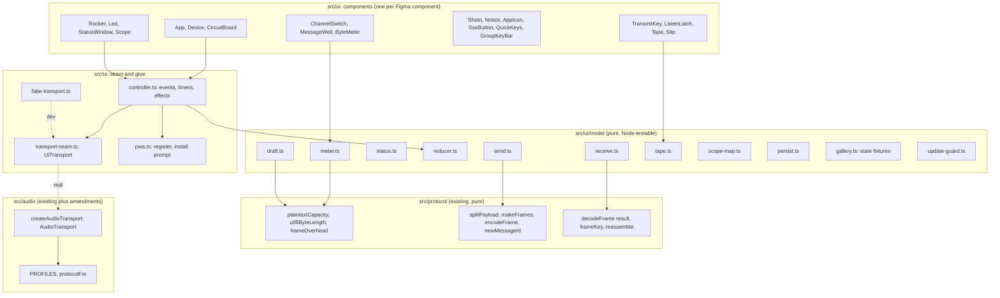
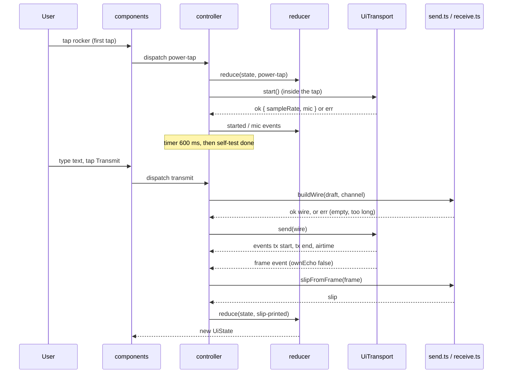
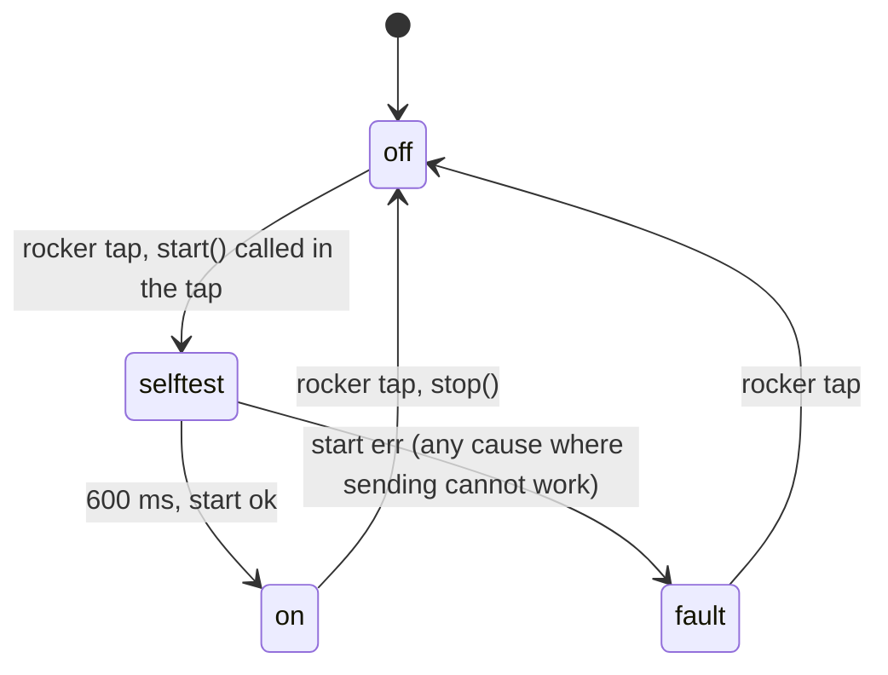
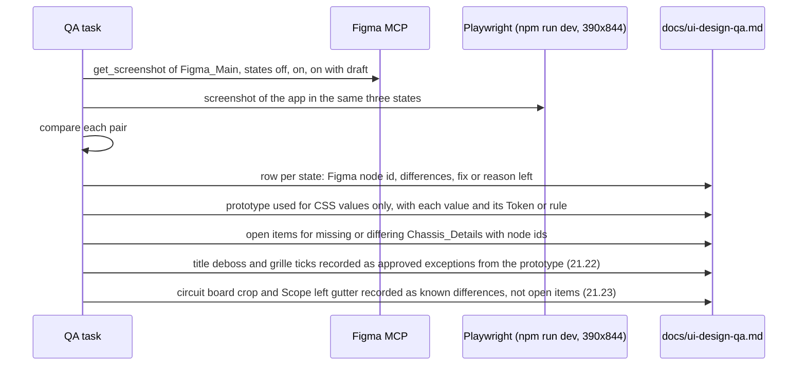

# Design Document: ui-shell

## Overview

The ui-shell is the installable app shell and the main device screen of Dial Tone. It scaffolds the project (Vite, TypeScript, Preact, `vite-plugin-pwa`), builds the device from the Figma file `VDyiOLNBAavxsBHP15j1Sj`, and wires it to `src/protocol` and `src/audio`. It covers plain, unencrypted text messages only. SOS, quick keys, the group key bar and everything cryptographic or relay-related come later. Until a feature is mounted its slot collapses to zero size, and when the feature lands the slot takes the height of its Figma frame (see "Visual fidelity").

The device screen has these parts, each one Preact component in `src/ui/`: rocker power switch, status window (six LEDs and a result-code readout), scope (a live spectrogram on a canvas), channel switch (Room, Call, Quiet), message well with a 24-segment byte meter and real airtime, Transmit key, Listen latch, and the Tape of thermal slips with "See more". Around the device sit the sheets: onboarding, microphone denied or reset, and install. A state gallery at `?state=<name>` makes every state on the Figma States page reachable.

Six decisions shape the design.

1. **One pure model, thin components.** Everything that decides what the screen shows (byte meter, status window, reducer, tape, send path, receive path, persistence format) is a pure TypeScript module in `src/ui/model/` with no DOM and no Preact import. It runs in Node under Vitest with fast-check. Components only render model output and forward events.
2. **The AudioTransport seam.** The UI talks to audio only through the `AudioTransport` interface from `src/audio`. `vite dev` uses a `FakeTransport` so the whole screen works without a microphone, a worklet or WASM. Real audio is verified on `npm run build` plus `npm run preview`, because the decode worker must be a classic worker and `vite dev` serves it differently (see `tech.md`).
3. **The byte meter follows Figma exactly.** The limit is `plaintextCapacity({ encrypted: false, multi: false })` (128), never a literal. The lit segment count is `ceil(bytes * 24 / limit)` capped at 24 (State 03, 41 of 128 bytes, lights 8). Colour is positional: lit segments 1 to 19 use `--meter-ok`, lit segments 20 to 24 use `--meter-warn`, and over the limit all 24 use `--amber` with a glow. Never red.
4. **Tokens only.** Colours, type and shadows come from `src/ui/styles/tokens.css`, whose names match the Figma variables (`design-system.md`). A test fails on any hex literal in `src/ui` except `#040504`.
5. **Offline first.** Fonts and ggwave are bundled. The service worker precaches the app shell, the classic decode worker, the capture worklet and `vendor/ggwave.js`. Updates use `registerType: 'prompt'` and surface as a printed "Update ready" slip that never restarts the app by itself.
6. **Audio-transport is finished here.** The browser glue, the Playwright fake-microphone test, the denied-microphone test, the offline test and the CPU measurement (audio-transport tasks 11 to 13) are delivered by this spec, together with four small amendments to the transport interface that the screen needs (see "Audio-transport amendments").

Assumptions, each open to correction:
- The spec uses TypeScript and Preact because `tech.md` and the request say so.
- Strings that Figma shows verbatim are copied from Figma into `src/ui/copy.ts` when each component is built. Strings Figma does not show (for example the first line of the non-denied microphone errors) are written by the implementer and listed in the task result for review.
- Design parameters that are not measurements are marked "design parameter". A constant may change with the test that pins it.

## Architecture



Dependency rules (extending `structure.md`):
- `src/ui/model` imports from `src/protocol` and `src/audio` only through each `index.ts`, and imports no DOM global and no Preact. It may import only types from `src/audio`.
- Components import from `src/ui/model` and the seam, never from `src/audio` directly.
- Only `src/ui/transport-seam.ts` and `src/ui/main.ts` import the runtime `createAudioTransport` from `src/audio`.
- `src/protocol` and `src/audio` never import from `src/ui`.
- `src/ui/main.ts` chooses the transport: `FakeTransport` when `import.meta.env.DEV` and the URL has no `?transport=real`, otherwise the real one.

### Runtime flow



### Power and microphone state



Inside `on`, three things vary independently: the microphone state (`MicState` from the transport), whether the Listen latch is pressed, and the transient activity (sending, carrier, connect). The status window is derived from all of them by one pure function.

## Figma source map

Figma file `VDyiOLNBAavxsBHP15j1Sj`. The map lives in `docs/figma-source-map.md` (task 1.5) and is the index for the Design QA task. Node ids below were read through the Figma MCP. Each component records the variants it must implement.

### States page (`191:2`), one frame per state, 390 px wide

| # | Frame | Node id | Gallery name |
|---|---|---|---|
| 01 | Off | `271:2` | `off` |
| 02 | Self-test | `272:2` | `selftest` |
| 03 | Ready (empty tape) | `273:2` | `ready` |
| 04 | Sending | `274:2` | `sending` |
| 05 | Hearing a signal | `275:2` | `hearing` |
| 06 | Message received | `276:2` | `received` |
| 07 | SOS being held | `277:2` | `sos-held` |
| 08 | SOS received | `278:2` | `sos-received` |
| 09 | Call mode | `279:2` | `call` |
| 10 | Quiet mode | `280:2` | `quiet` |
| 11 | Message too long | `281:2` | `too-long` |
| 12 | Microphone off | `282:2` | `mic-off` |
| 13 | Not listening | `283:2` | `not-listening` |
| 14 | Tape expanded | `284:2` | `tape-expanded` |
| 15 | Light legend open | `285:2` | `legend` |
| 16 | Beige case | `286:2` | `beige` |

Each state frame holds `Page > Device > (Circuit board, Shell (frosted), Faceplate)`. Faceplate is 340 px wide inside a 370 px device.

### Components page (`191:3`)

| Component | Node id | Variants (node id) |
|---|---|---|
| Rocker | `213:13` | On `213:7`, Off `213:12` |
| LED | `213:40` | On/Green `213:21`, Off/Green `213:27`, On/Amber `213:33`, Off/Amber `213:39` |
| Status window | `213:195` | Off `213:80`, Ready `213:118`, Sending `213:156`, Received `213:194` |
| Channel switch | `213:252` | Room `213:215`, Call `213:233`, Quiet `213:251` |
| Message well | `213:319` | Normal `213:286`, Over `213:318` |
| Transmit key | `213:343` | Default `213:327`, Sending `213:334`, Disabled `213:342` |
| SOS button | `213:377` | Default `213:355`, Holding `213:366`, Disabled `213:376` |
| Listen latch | `213:413` | Listening `213:388`, Off `213:396`, No mic `213:404`, Disabled `213:412` |
| Slip | `213:481` | Sent `213:428`, Heard `213:444`, Relayed `213:459`, SOS `213:480`, System notice `270:444`, Update ready `270:462`, Locked `270:477`, Locked no key `270:540` (named `Type=Type=Locked, no key`), Location `270:569`, I'm safe `270:589` |
| Sheet | `270:345` | Onboarding 1 `270:41`, 2 `270:79`, 3 `270:127`, Microphone `270:155`, Key open `270:179`, Key create `270:205`, Key share `270:244`, Key join `270:269`, Key offer `270:302`, Install `270:344` |
| Group key bar | `270:376` | Open `270:361`, Locked `270:375` |
| Quick keys | `270:389` | none |
| Notice | `270:401` | Install `270:400` |
| Check words | `270:413` | none |
| Group code card | `270:421` | none |
| App icon | `270:433` | none |

### New screens page (`219:2`)

| Screen | Node id | Gallery name | In this spec |
|---|---|---|---|
| 01 Onboarding 1, Sound | `242:2` | `onboarding-1` | yes |
| 02 Onboarding 2, Listens while open | `244:2` | `onboarding-2` | yes |
| 03 Onboarding 3, Install | `245:2` | `onboarding-3` | yes |
| 04 First power-on notice | `246:2` | `first-power` | yes |
| 05 Microphone denied | `247:2` | `mic-denied` | yes |
| 06 Microphone reset | `248:2` | `mic-reset` | yes |
| 07 to 13 Group key, locked messages | `249:2` to `255:2` | not built | deferred to the crypto spec |
| 14 I'm safe and Location | `256:2` | not built | deferred (quick keys) |
| 15 Install sheet | `257:2` | `install-sheet` | yes |
| 16 Install notice | `258:2` | `install-notice` | yes |
| 17 Update ready slip | `259:2` | `update-ready` | yes |

The `Sheet` variants Key open to Key offer, `Group key bar`, `Quick keys`, `Check words` and `Group code card` are not built here. The `Slip` variants Relayed, SOS, Locked, Locked no key, Location and I'm safe are built as components (one component per Figma component) so that the gallery can show State 08, but the live app never prints them in this spec.

## Components and Interfaces

### model/meter.ts

**Purpose**: The byte meter arithmetic and colours. This module is the single place that knows the formula.

```ts
export const METER_SEGMENTS = 24;
/** Lit segments 1..METER_OK_SEGMENTS use --meter-ok, the rest --meter-warn (80% of 24, rounded up: segment 20 is the first at or above 80%). */
export const METER_OK_SEGMENTS = 19;

export type MeterColor = "off" | "ok" | "warn" | "over";

export interface MeterView {
  readonly bytes: number;
  readonly limit: number;
  readonly lit: number;               // 0..24
  readonly over: boolean;             // bytes > limit
  readonly segments: readonly MeterColor[];  // length 24, index 0 is segment 1
}

/** limit is plaintextCapacity for the current mode. Never a literal. */
export function meterView(bytes: number, limit: number): MeterView;
/** The one open-channel single-frame limit the well uses: plaintextCapacity({ encrypted: false, multi: false }). */
export function wellLimit(): number;
```

Rules (see the pseudocode below): `lit = min(24, ceil(bytes * 24 / limit))`, `lit = 0` at 0 bytes. Segment `i` (1-based) is `off` when `i > lit`. When `over`, every segment is `over`. Otherwise segment `i <= lit` is `ok` when `i <= 19` and `warn` when `i >= 20`. The `over` colour maps to `--amber` with the 4 px glow `0 0 4px` of `--amber` at 55%. `ok` maps to `--meter-ok`, `warn` to `--meter-warn`. Unlit segments are `rgba(0,0,0,.09)` (a token alias, see `tokens.css`). There is no red anywhere in this module.

### model/draft.ts

**Purpose**: Turn the text in the well into the numbers the screen needs.

```ts
export interface DraftView {
  readonly text: string;
  readonly bytes: number;             // utf8ByteLength(text), never text.length
  readonly limit: number;             // wellLimit()
  readonly meter: MeterView;
  readonly status: "empty" | "ok" | "too-long";
  readonly wireLength: number | null; // bytes + frameOverhead(1) for airtime, null when empty or too long
}
export function draftView(text: string): DraftView;
```

`status` is `empty` at 0 bytes, `too-long` when `bytes > limit`, else `ok`. `wireLength` is the frame length used to ask the transport for airtime.

### model/status.ts

**Purpose**: Derive the status window (LEDs, result code, hint), the Transmit key state, the Listen latch state and the signal line direction from `UiState`. One pure function per output.

```ts
export type LedId = "MR" | "AA" | "CD" | "OH" | "RD" | "SD";
export type ResultCode = "— — —" | "ATZ" | "OK" | "ATDT" | "CARRIER" | "CONNECT" | "NO CARRIER" | "ERROR";
export interface StatusView {
  readonly leds: Readonly<Record<LedId, boolean>>;
  readonly code: ResultCode;
  readonly hintKey: HintKey;          // looked up in copy.ts
  readonly airtimeMs: number | null;  // shown beside ATDT while sending
}
export type TransmitState = "default" | "sending" | "disabled";
export type ListenState = "listening" | "off" | "no-mic" | "disabled";
export type SignalDirection = "idle" | "up" | "down";

export function statusView(s: UiState, now: number): StatusView;
export function transmitState(s: UiState): TransmitState;
export function listenState(s: UiState): ListenState;
export function signalDirection(s: UiState, now: number): SignalDirection;
```

LED and readout table (derived from the States page notes):

| Condition (first match wins) | LEDs lit | Readout |
|---|---|---|
| `power = off` | none | `— — —` |
| `power = selftest` | all six | `ATZ` |
| `fault` set | MR | `ERROR` |
| sending | MR, SD | `ATDT` plus airtime |
| connect hold active (a frame was just received) | MR, RD | `CONNECT` |
| carrier shown | MR, CD (amber) | `CARRIER` |
| listening (latch pressed, mic `live`, page visible) | MR | `OK` |
| mic unavailable (denied, lost and so on) | MR | `OK`, hint "Ready to send. Microphone is off, so you can’t hear messages." (State 12) |
| otherwise (latch released, mic not live, or page hidden) | MR | `NO CARRIER` |
AA (green) is added in every powered-on row while listening is active (latch pressed, mic `live`, page visible), as in Figma (user decision). State 12 reads `OK` as in Figma, because sending works. When the draft is over the limit, the `OK` row shows the hint "Message is too long to send. Shorten it." (State 11).

OH (amber) is added whenever `channel = call`, in any row except off and self-test. The off row wins outright: with the power off no LED is lit, OH included, even on the Call channel.

### model/reducer.ts

**Purpose**: The whole screen state as one pure reducer. Time comes in with each event, so tests need no fake clock.

```ts
export type SheetId =
  | "onboarding-1" | "onboarding-2" | "onboarding-3"
  | "mic-denied" | "mic-reset" | "mic-error"
  | "install";

export interface UiState {
  readonly power: "off" | "selftest" | "on";
  readonly fault: "modem" | "no-audio" | "send-unavailable" | null;
  readonly busyUntil: number;               // Transmit key flash after a BUSY send (BUSY_FLASH_MS = 600, design parameter)
  readonly channel: ProfileId;
  readonly draft: string;
  readonly latchPressed: boolean;           // the user's Listen choice
  readonly mic: MicState;                   // from the transport, "idle" before start
  readonly tx: { readonly phase: "idle" | "sending"; readonly startedAt: number; readonly airtimeMs: number | null };
  readonly carrier: { readonly active: boolean; readonly shownUntil: number; readonly lastOffAt: number | null };
  readonly connectUntil: number;            // RD and CONNECT hold
  readonly airtimeByWire: Readonly<Record<number, number>>;  // wire length to ms, for the current channel
  readonly tape: readonly Slip[];
  readonly tapeExpanded: boolean;
  readonly legendOpen: boolean;
  readonly sheet: SheetId | null;
  readonly theme: "ghost" | "beige";
  readonly flags: { readonly onboarded: boolean; readonly micWasGranted: boolean; readonly firstPowerShown: boolean; readonly rockerHint: boolean };
  readonly install: { readonly available: boolean; readonly dismissed: boolean; readonly standalone: boolean };
  readonly update: { readonly ready: boolean };
  readonly foreground: boolean;
}

export type UiEvent =
  | { type: "power-tap"; now: number }
  | { type: "started"; now: number; mic: MicState }
  | { type: "start-failed"; code: "MODEM_LOAD_FAILED" | "NO_AUDIO_CONTEXT" | "SEND_UNAVAILABLE" }
  | { type: "send-busy"; now: number }
  | { type: "self-test-done"; now: number }
  | { type: "mic"; mic: MicState }
  | { type: "latch-tap" }
  | { type: "channel"; channel: ProfileId }
  | { type: "draft"; text: string }
  | { type: "transmit"; now: number }
  | { type: "tx-start"; now: number; airtimeMs: number }
  | { type: "tx-end"; now: number; ok: boolean; slip: Slip | null }
  | { type: "airtime"; wireLength: number; ms: number; channel: ProfileId }
  | { type: "carrier"; active: boolean; now: number }
  | { type: "slip"; slip: Slip; now: number }
  | { type: "tape-toggle" }
  | { type: "legend-toggle" }
  | { type: "sheet-open"; sheet: SheetId }
  | { type: "sheet-close" }
  | { type: "onboarding-next" } | { type: "onboarding-skip" } | { type: "onboarding-done" }
  | { type: "foreground"; visible: boolean }
  | { type: "install-available"; available: boolean }
  | { type: "update-ready" }
  | { type: "hydrate"; saved: SavedState };

export function initialState(saved: SavedState | null): UiState;
export function reduce(s: UiState, e: UiEvent): UiState;
```

Invariants: `reduce` is total (every state and event pair returns a state), never throws, and never mutates its input. `power = on` is reachable only from `selftest` by `self-test-done`. `tx.phase = sending` requires `power = on`. `latch-tap` while `power != on` or the mic is not `live` changes nothing. `channel` is ignored while `tx.phase = sending`. `listenState` does not depend on `foreground`: a hidden page with a live mic still reads `listening`. A `fault` forces the Transmit key to `disabled`.

### model/send.ts

**Purpose**: Build the wire bytes of a plain text message through `src/protocol`.

```ts
export const SEND_TTL = 3;   // design parameter, 4 bits allow 0..15. The relay spec owns the real rule.
export type BuildError = "EMPTY" | "TOO_LONG" | "ID_FAILED" | "FRAME_FAILED";
export function buildWire(text: string, rng?: Rng): Result<{ wire: Uint8Array; messageId: Uint8Array; bytes: number }, { code: BuildError }>;
```

Algorithm: encode the text to UTF-8; reject 0 bytes (`EMPTY`) and more than `wellLimit()` bytes (`TOO_LONG`) before any protocol call; `splitPayload(bytes, { encrypted: false, utf8Boundaries: true })`; require exactly one chunk; `newMessageId()`; `makeFrames({ type: 0, encrypted: false, hop: 0, ttl: SEND_TTL, messageId }, chunks)`; `encodeFrame(frames[0])`. The result length never exceeds `GGWAVE_MAX_PAYLOAD`.

### model/receive.ts

**Purpose**: Turn a transport `frame` event into at most one slip, with a small dedupe set and multi-frame reassembly.

```ts
export interface ReceiveState {
  readonly seen: readonly string[];               // frameKey values, newest last, capped at SEEN_MAX
  readonly partial: Readonly<Record<string, readonly Frame[]>>;  // by hex message id, capped at PARTIAL_MAX
}
export const SEEN_MAX = 256;       // design parameter
export const PARTIAL_MAX = 8;      // design parameter
export function receiveFrame(rs: ReceiveState, ev: { frame: Frame; ownEcho: boolean; atMs: number }): { next: ReceiveState; slip: Slip | null };
```

Rules: `ownEcho` gives no slip. A `frameKey` already in `seen` gives no slip. Type TEXT (0), unencrypted, single frame gives a `heard` slip with the text decoded as UTF-8 (the protocol checked the bytes at send, and `receive.ts` decodes with `fatal: false` and replaces bad sequences). A TEXT frame with `total > 1` is collected in `partial` and printed through `reassemble` when complete. Any other type, or `encrypted`, gives a `system` slip saying the message is of a kind this version cannot show. Rejected frames never reach this module.

### model/tape.ts

**Purpose**: Slips and the collapsed or expanded Tape.

```ts
export type Slip =
  | { kind: "sent"; id: string; at: number; text: string; bytes: number; mode: ProfileId; airtimeMs: number }
  | { kind: "heard"; id: string; at: number; text: string; bytes: number; hop: number }
  | { kind: "system"; id: string; at: number; noticeKey: NoticeKey }
  | { kind: "update-ready"; id: string; at: number };
/** Gallery-only slip kinds, rendered by the Slip component but never created by the live app. */
export type GallerySlip = { kind: "relayed" | "sos" | "locked" | "locked-no-key" | "location" | "safe"; id: string; at: number; /* fixture fields */ };

export const TAPE_COLLAPSED = 3;
export const TAPE_MAX = 50;   // design parameter, oldest dropped first
export function pushSlip(tape: readonly Slip[], slip: Slip): readonly Slip[];
export function visibleSlips(tape: readonly Slip[], expanded: boolean): { slips: readonly Slip[]; hidden: number };
```

The tape is stored oldest first and shown newest first. Collapsed shows the latest 3, expanded all, and the button reads "See more" or "Show less" (State 14). With 0 slips the Tape shows the Figma sentence that starts "No paper yet." (`copy.tape.empty`). With 3 or fewer slips no button is shown (open question 4).

### model/scope-map.ts

**Purpose**: Map a profile and an analyser to the scope's frequency window and band overlay.

```ts
export interface ScopeWindow { readonly loHz: number; readonly hiHz: number; readonly bandHz: readonly [number, number] | null; }
export function scopeWindow(channel: ProfileId): ScopeWindow;
/** FFT bin range for a window. Always inside 0..binCount-1 and lo <= hi. */
export function binRange(sampleRate: number, fftSize: number, loHz: number, hiHz: number): { lo: number; hi: number };
export function formatKHz(hz: number): string;
/** Self-test warm-up geometry. One bright line that widens from one row to the full height. */
export function warmUpFrame(progress: number, height: number): { readonly centerRow: number; readonly halfHeight: number; readonly top: number; readonly bottom: number };
```

`warmUpFrame` clamps `progress` to 0..1 and `height` to at least 1. It describes exactly one contiguous region, `top..bottom`, inside `0..height-1`. At progress 0 the region is one row, at progress 1 it is the full height, and its height never shrinks as progress grows. `Scope.tsx` only paints the region it returns.

`bandHz` comes from `PROFILES[channel].carrierBandHz`, so the overlay follows the measured band. The windows are: Room 0 to 8 kHz (axis label "8k" in State 03), Call as drawn in State 09, Quiet 12 to 20 kHz (State 10). The Call range is read from Figma State 09 when the component is built. Figma's Quiet caption says 15 to 19.5 kHz while the measured band is 15,000 to 19,400 Hz. The overlay uses the measured band and the caption uses `formatKHz` of it (open question 5).

### model/persist.ts

**Purpose**: What survives a reload, with defensive loading.

```ts
export const PERSIST_ENABLED = true;           // one constant turns tape and draft persistence off
export const STORAGE_PREFIX = "dialtone.v1.";
export interface SavedState {
  readonly tape: readonly Slip[];
  readonly draft: string;
  readonly channel: ProfileId;
  readonly flags: { onboarded: boolean; micWasGranted: boolean; firstPowerShown: boolean };
}
export function serialize(s: SavedState): string;
export function parseSaved(raw: string | null): SavedState | null;   // never throws, drops invalid entries
```

Keys: `dialtone.v1.tape`, `.draft`, `.channel`, `.flags`. With `PERSIST_ENABLED = false` nothing is read or written for tape and draft, and the flags (onboarded, mic permission seen, first power-on shown) still persist because the app needs them to avoid repeating onboarding. `parseSaved` validates every field: unknown `kind` is dropped, `text` is a string capped at 1,024 characters, `bytes` is recomputed, the tape is cut to `TAPE_MAX`. A storage exception (private mode, quota) is swallowed and the app runs without persistence. `Uint8Array`s are never stored. Gallery state never reads or writes storage.

### model/update-guard.ts

```ts
/** false while a transmission is in flight, a carrier is active, or a connect hold is running. */
export function canRestartNow(s: UiState, now: number): boolean;
```

The "Restart now" button on the Update ready slip calls `canRestartNow`. When it is false the slip shows a short "Not now, a message is on the line" line and does nothing else.

### model/gallery.ts

**Purpose**: One fixture per gallery name, built from `UiState` plus a few component-only props (SOS held ring progress, SOS slip). Each fixture is a complete `UiState` and a clock value, so the gallery renders through the same components as the live app.

```ts
export type GalleryName = "off" | "selftest" | "ready" | "sending" | "hearing" | "received" | "sos-held" | "sos-received"
  | "call" | "quiet" | "too-long" | "mic-off" | "not-listening" | "tape-expanded" | "legend" | "beige"
  | "onboarding-1" | "onboarding-2" | "onboarding-3" | "first-power" | "mic-denied" | "mic-reset"
  | "install-sheet" | "install-notice" | "update-ready";
export interface GalleryFixture { readonly state: UiState; readonly now: number; readonly extras: GalleryExtras; }
export function isGalleryName(s: string): s is GalleryName;
export function galleryFixture(name: GalleryName): GalleryFixture;
export const SOS_GALLERY_ONLY: readonly GalleryName[];   // ["sos-held", "sos-received"]
```

`GalleryExtras` carries what the live app does not have yet: `sosRing: number` (0 to 1), `passOn: boolean` (State 06 shows "Pass it on → hop N"), `showSosSlot`, `showQuickKeys`, `showGroupKeyBar` booleans for States 07 and 08, and a fixed set of demo slips. The States that the live app can reach by interaction (01 to 06, 09 to 16) are also checked by the e2e test against the FakeTransport (Property 11).

### Seam: transport-seam.ts and fake-transport.ts

```ts
/** What the UI needs from src/audio. The real AudioTransport satisfies it structurally. */
export type UiTransport = Pick<AudioTransport,
  "start" | "restartMic" | "stop" | "setProfile" | "send" | "airtimeMs" | "setListening" | "subscribe" | "analyser" | "profile">;
export function createFakeTransport(opts?: FakeTransportOptions): UiTransport & FakeControls;
```

`FakeControls` (dev panel and tests only): `injectFrame(frame, ownEcho)`, `injectCarrier(active)`, `setMic(state)`, `failStart(code)`, `holdSend(ms)`. The fake:
- `start()` resolves after a short delay with `ok({ sampleRate: 48000, mic: "live" })`, or the injected mic state, or an `err`. It does not call `getUserMedia`.
- `send(wire)` validates length like the real one (`EMPTY`, `TOO_LONG` before anything else), emits `tx` start and end with an airtime from a simple linear model (`wire.length * 0.1 s`, a stand-in, never shown as measured), and resolves `ok`. It then loops the frame back as an `ownEcho: true` event so the own-echo path is exercised.
- `analyser` returns a synthetic spectrum source (a moving band inside the active profile's band while sending or after `injectCarrier(true)`, low noise otherwise).
- `airtimeMs(len)` answers from the model and emits the `airtime` event, like the real one.
- A shared conformance test runs against the fake and, in the slow suite, against the real transport with the fake modem (Property 12).

### Audio-transport amendments

Four additions to `src/audio` that the screen needs. Task 3.1 folds them into the audio-transport spec documents without renumbering anything (appended notes and new sub-bullets under existing tasks, plus a short "Amendments from ui-shell" section). They are implemented inside audio-transport tasks 11.1 and 11.2 when task 3.2 and 3.3 of this spec run.

1. **Analyser.** `readonly analyser: SpectrumSource | null`. `SpectrumSource` is `{ readonly fftSize: number; readonly frequencyBinCount: number; readonly sampleRate: number; getByteFrequencyData(out: Uint8Array): void }`, so `src/ui` needs no DOM `AnalyserNode` type. It is the main-thread `AnalyserNode` fed from the same source as the worklet, independent of decoding (already in the audio-transport design). `null` before `start()` or after `stop()`.
2. **Airtime event.** `airtimeMs(byteLength, attempt?)` cannot answer synchronously, because modulation runs in the worker. It returns the cached value or `null`, and on a miss asks the worker. The worker's answer arrives as `{ kind: "airtime"; profile: ProfileId; byteLength: number; attempt: number; ms: number }`. The cache is per profile and byte length.
3. **`setListening(on: boolean): Result<void, { code: "NOT_STARTED" | "NO_MIC" }>`.** `false` makes the worker stop feeding chunks to the pipeline and stops forwarding `frame`, `rejected` and `carrier` events. The mic stream stays open, so `true` resumes at once with no new permission prompt. Emits `{ kind: "listening"; on: boolean }`. Sending is unaffected.
4. **`start()` resolves ok when sending works, including when only the microphone failed.** Its value becomes `{ sampleRate: number; mic: MicState }`. `start()` returns `err` whenever sending cannot work, whatever the cause: `MODEM_LOAD_FAILED`, `NO_AUDIO_CONTEXT`, a worker crash or a codec initialisation failure (the last two map to a new `SEND_UNAVAILABLE` code in `StartError`). A denied, busy or missing microphone gives `ok` with `mic` set to that state, and the Transport stays usable for sending (audio-transport requirement 6.10).

`src/audio/index.ts` also exports `createAudioTransport` and the types `AudioTransport`, `TransportEvent`, `SendReport`, `SpectrumSource`, `MicState`, `StartError` and `SendErrorCode`.

### Controller (controller.ts)

**Purpose**: The only stateful glue between components, model and transport. It holds the `UiState` in a Preact signal-like store (a tiny `subscribe` and `getState`), runs the effects that events imply, and owns the timers. It holds no decision logic.

Effects:
- `power-tap` on `off`: call `transport.start()` synchronously in the tap handler (the browser gesture), then dispatch `started` or `start-failed`. After 600 ms (`SELF_TEST_MS`, from the Figma note) dispatch `self-test-done`. On `started` with a mic that is not `live`, open the matching microphone sheet (see "Microphone sheets").
- `power-tap` on `on`: `transport.stop()`.
- `latch-tap`: `transport.setListening(!pressed)`.
- `channel`: `transport.setProfile(id)`.
- `transmit`: `buildWire`, then `transport.send(wire)`. On `ok` push a `sent` slip, clear the draft, and ask for airtime of the next draft.
- Every draft change with a `wireLength` not yet in `airtimeByWire` for the current channel: one `transport.airtimeMs(wireLength)` call (answer comes back as an event and is cached in `airtimeByWire`). A length already cached is reused with no request.
- `send` returning `BUSY`: dispatch `send-busy` (Transmit key flash for `BUSY_FLASH_MS`), no `ERROR` readout, draft kept.
- Transport events map to reducer events: `mic` to `mic`, `tx` to `tx-start` and `tx-end`, `carrier` to `carrier` (with the 2.5 s quiet rule below), `frame` through `receiveFrame` to `slip`, `foreground` to `foreground`, `airtime` to `airtime`.
- A timer tick (every 250 ms while `connectUntil` or `carrier.shownUntil` is in the future) advances `now` so holds expire.
- Persistence: debounced (300 ms) write of tape, draft and channel after each change, through `persist.ts`.

**Carrier rule.** The Figma note for State 05 says CARRIER is "shown after 2.5 s of quiet when energy enters the band". The reducer keeps `lastOffAt`. A `carrier active` event shows CD and CARRIER when `lastOffAt` is null or at least `QUIET_REARM_MS = 2500` before `now`. A burst that starts sooner after the previous one ended is not shown again (it is the same transmission seen through a gap). The CD light holds for `CARRIER_HOLD_MS = 1500` (design parameter) after the last active event. Carrier events name a band and not the sender's mode, so no copy says "modem detected".

### Microphone sheets

One `Sheet` of type Microphone, three first lines:

| Condition | Sheet | First line |
|---|---|---|
| `mic = denied` and `flags.micWasGranted = false` | `mic-denied` (Screen 05) | From Figma |
| `mic = denied` and `flags.micWasGranted = true` | `mic-reset` (Screen 06, "iPhone forgot the permission") | From Figma |
| `mic` in `busy`, `no_device`, `insecure`, `error`, `lost` | `mic-error` (Microphone layout) | One line per state, in `copy.ts` |

The body keeps the iPhone and Android steps. The primary button "Try again" calls `transport.restartMic()` from the tap. The secondary button closes the sheet. Sending keeps working in every case, and the sheet says so. When `mic` becomes `live`, `flags.micWasGranted` is set and saved. A microphone problem opens the sheet once per power-on, not on every state change. The Controller remembers that the sheet opened in this power-on. A later microphone failure in the same power-on does not reopen it and prints a `system` slip with `noticeKey: "mic-again"` instead.

### Components

One file per Figma component in `src/ui/components/`, each with props that are plain data from the model. Variant props use the Figma variant names.

| Component | Props | Notes |
|---|---|---|
| `Rocker` | `on`, `pulseAmber`, `onTap` | The tap that starts audio. `pulseAmber` is the post-onboarding hint. Space and Enter work. |
| `Led` | `color`, `on`, `label` | Label lights with the lens. |
| `StatusWindow` | `StatusView`, `onLedTap` | Tapping the LEDs toggles the legend (State 15). |
| `Scope` | `source`, `window`, `power`, `reducedMotion` | Canvas. See "Scope drawing". Draws the band lines while off. Its darker left gutter differs from Figma_Main and is intentionally left unchanged for now (requirement 21.23). |
| `ChannelSwitch` | `value`, `disabled`, `onChange` | Grille ticks on the selected key only (see "Visual fidelity"). `role="radiogroup"`, arrow keys move it, thumb springs (not under reduced motion). While sending (`disabled` prop true) it uses `aria-disabled="true"` with the dimmed style, stays focusable (no `disabled` attribute, no `tabindex="-1"`), ignores pointer and keyboard changes, and its accessible name reads "Channel switch, Room, unavailable while sending" (current channel in place of Room). |
| `MessageWell` | `DraftView`, `airtimeMs`, `disabled`, `onInput` | Textarea plus `ByteMeter`. |
| `ByteMeter` | `MeterView` | 24 `<i>` segments with `data-color`. Count label "41 / 128 B", "Too long" when over. |
| `TransmitKey` | `state`, `airtimeMs`, `progress`, `onTap` | Strip fills for the airtime while sending. |
| `ListenLatch` | `state`, `onTap` | Four states. |
| `Tape`, `Slip` | `visibleSlips`, `expanded`, `onToggle` | Slip implements all ten Figma types. Torn bottom edge by CSS mask (10 px teeth, 5 px deep). System paper is `--paper-system` plus grain, with no stripe layer. |
| `Chassis` | none (parts: `CornerScrews`, `PowerLabel`, `SideRail`, `BottomGrille`, `GrilleTicks`, `Screw`) | Decorative parts of Figma_Main. Static, Tokens only. See "Visual fidelity". |
| `Sheet` | `type`, `onPrimary`, `onSecondary` | Grip, two screws (13 px, rotated, slotted, from the `Chassis` screw part), kicker, title, body, two buttons. Focus trap, Escape closes, scrim at 45% with 3 px blur. |
| `Notice` | `type`, `onKey` | Install plate with an amber LED. |
| `AppIcon` | none | 92 px, radius 24. Also exported as PNG for the manifest. |
| `SosButton`, `QuickKeys`, `GroupKeyBar` | gallery props | Built to the Figma variants. In the live app their slots stay empty. |
| `CircuitBoard` | none | SVG drawn in code under the frosted shell. Its crop differs from Figma_Main and is intentionally left unchanged for now (requirement 21.23). |
| `Device`, `App` | | Layout (370 device, 340 faceplate) and the Sheet host. |

**Reserved slots.** The live `Device` renders three containers with no content: the group key bar slot under the status window, the quick keys slot under the message well, and the SOS slot beside Listen. While empty they collapse to a computed 0 x 0 px with no margin, padding or layout gap, so each contributes 0 px of size and spacing, and the visible neighbours keep their Figma spacing (requirement 21.1). They are not hidden with `display: none`, so a later spec can mount into them. Mounting content sets a modifier class that restores the slot to the width and height of its Figma frame from `docs/figma-source-map.md` (21.3). The gallery mounts all three only for `sos-held` and `sos-received`. Details are in "Visual fidelity".

**Pass it on.** State 06's Heard slip shows "Pass it on → hop N". Relay is a later spec, so the live app renders the Heard slip without that button, and the gallery fixture for `received` turns it on (`extras.passOn`). The model carries `hop` already.

### Scope drawing

```
ALGORITHM drawScopeFrame(ctx, source, window, state)
  IF state.power = off THEN
    drawStatic(ctx, faint)
    drawBandLines(ctx, window.bandHz, --scope-band)         // band lines stay visible while off, as in Figma_Main
    RETURN                                                  // power-off wins: the warm-up is suppressed
  END IF
  IF state.power = selftest THEN
    f ← warmUpFrame(progress, height)       // pure, in scope-map.ts
    fill only rows f.top..f.bottom with one bright line colour, no other region, no stripes
    RETURN
  END IF
  range ← binRange(source.sampleRate, source.fftSize, window.loHz, window.hiHz)
  source.getByteFrequencyData(buf)
  shift the existing image left by 1 column
  FOR row IN 0 .. height-1 DO
    bin ← range.lo + floor((height-1-row) * (range.hi-range.lo) / (height-1))
    ctx.fillStyle ← ramp(buf[bin])          // from --screen to --phosphor, colours read once from computed style
    fill the newest column at row
  END FOR
  draw axis ticks (--scope-axis) and the band overlay lines (--scope-band) at window.bandHz
END
```

The band lines use `--scope-band`, whose value is the amber of Figma_Main. They are drawn in every power state in which the Scope shows static or live data, including `off` (requirement 21.20), and are not drawn during the self-test warm-up line. The loop uses `requestAnimationFrame`, pauses when the document is hidden, and reads CSS colours once at mount through `getComputedStyle`, so there is no literal colour in the code. Under reduced motion the warm-up is skipped and the spectrogram still draws (it is data, not decoration).

### Visual fidelity (requirement 21)

Figma_Main (node `0:1`) is the source of truth. Every measurement is read through the Figma MCP and recorded in `docs/figma-source-map.md` under "Chassis details (Figma_Main)". The Prototype_Reference (`../dial-tone/prototype/index.html`, relative to the repository root) is read for CSS values only, never copied as code. Where it disagrees with Figma, Figma wins, except for two approved exceptions: the faceplate title deboss and the channel key grille ticks (requirements 21.6, 21.7 and 21.22). Two known differences are left unchanged on purpose: the circuit board crop and the darker left gutter of the Scope (requirement 21.23).

**Collapsed slots and full-width Transmit (21.1 to 21.3, 15).** Each Reserved_Slot has two states, set by whether its feature is mounted:

| State | Slot size | Transmit |
|---|---|---|
| Empty (live app today) | computed 0 x 0 px, margin, padding and gap 0, so it adds 0 px of size and spacing | The SOS slot is collapsed, so the Transmit key fills 100% of its row (1 px tolerance). No fixed Transmit width remains. |
| Mounted (gallery `sos-held`, `sos-received`, later specs) | Figma frame width and height from the Source_Map (1 px tolerance) | Returns to its Figma frame width (1 px tolerance) |

The row uses flex, with Transmit as `flex: 1 1 auto` and the SOS slot sized only by its modifier class. The collapse is a size rule, not `display: none`.

**Neighbour spacing (21.1, 21.24).** The vertical spacing between visible elements is carried by the visible elements themselves (a margin on the element below, valued from the Source_Map), never by a flex or grid `gap` on a container that holds a Reserved_Slot, because such a gap would add spacing around a collapsed slot. A collapsed slot therefore removes only itself, and the visible neighbours keep their Figma spacing. With the Reserved_Slots collapsed, the gap between the message well and the Transmit key is greater than 0 px and equals the Figma_Main gap (1 px tolerance), and the gap between the Transmit key and the Tape equals the Figma_Main gap (1 px tolerance). The well therefore does not end where Transmit starts. The Source_Map records both Figma gaps. The Source_Map gains the slot and Transmit widths if they are missing. Checked by `e2e/slots.spec.ts` through `getBoundingClientRect`.

**Chassis details (21.4 to 21.11).** Each part is code (CSS, inline SVG or a small component) in `src/ui/components/Chassis.tsx` and `chassis.css`, one clearly named block per part. Positions and sizes come from the Source_Map. All colours are Tokens, with `#040504` the only literal. They are static, so reduced motion needs no handling. A part that needs an image goes to `public/art` and into the precache globs.

| Part | Behaviour |
|---|---|
| Corner screws | Four, one per corner of the chassis, at the Figma position and size (1 px) |
| POWER label | The text "POWER" under the rocker, in the Figma position and type style |
| Title deboss | Approved exception to Figma_Main (requirement 21.6). The faceplate title uses the two-line debossed `text-shadow` of the Prototype_Reference, one light line below and one dark line above, with every colour mapped to a Token. Figma_Main has no such shadow, and Design QA does not report the difference. |
| Grille ticks | Approved addition from the Prototype_Reference (requirement 21.7). Figma_Main has no grille ticks. Count, spacing and position are read from the Prototype_Reference. Drawn on the selected channel key only, none on the other two keys. They follow the selection for Room, Call and Quiet. Design QA does not report them. |
| Message well count and divider | Byte count placement and the divider line at the positions and sizes of their Figma_Main nodes in the Source_Map, 1 px tolerance (requirement 21.21). |
| Side rail | Rail with dimple and slot at the Figma position and size (1 px) |
| Bottom grille | Slot count, spacing and position from Figma |
| Sheet screws | 13 px diameter, rotated and slotted, on every Sheet. Replace the earlier 10 px screws. |

The Sheet screw nodes are `270:3` (left) and `270:6` (right) in Onboarding 1 `270:41`. The other Sheets carry the same screws: Onboarding 2 `270:43` and `270:46`, Onboarding 3 `270:81` and `270:84`, Microphone `270:129` and `270:132`, Install `270:304` and `270:307`. Node `270:136` is a kicker container, not a screw. Requirement 21.10 cites these nodes, and the Source_Map records them.

**Scope band and warm-up (21.12, 21.13).** `--scope-band` takes the amber of the Figma Scope node (an existing amber Token value when it matches). The warm-up is `warmUpFrame` (see `scope-map.ts`), one widening line and no stripes. `Scope.tsx` holds no warm-up arithmetic.

**System slip paper and ink (21.14, 21.15).** The system paper layers are `--paper-system` and the paper grain texture only. The earlier stripe layer, and any stripe Token or alias it added, is removed. The ink Token (or alias) used by system and update-ready slip text and meta is darkened to the nearest value with Contrast_Ratio of at least 4.5:1 against `--paper-system`, in both Ghost and Beige 96. `src/ui/styles/contrast.test.ts` runs in Node, parses `tokens.css` for both themes, computes the WCAG 2.x ratio (relative luminance `0.2126 R + 0.7152 G + 0.0722 B` after sRGB linearisation, ratio `(L1 + 0.05) / (L2 + 0.05)`), fails below 4.5, and fails with a clear message for a missing Token or an unsupported colour format. A second check renders a `system` and an `update-ready` slip with `preact-render-to-string` and finds no stripe class.

**Design QA flow (21.16 to 21.19).**



Screenshots go under `test-results` or `docs/qa-shots` and are not committed. Differences under requirement 21 are fixed in `src/ui`. The document also updates Decision 7 (stripe removed, ratios recorded) and the 10 px screw note (now 13 px).

### Pure-module and glue file list

```
src/ui/
├── main.tsx  controller.ts  transport-seam.ts  fake-transport.ts  pwa.ts  copy.ts
├── model/    meter.ts draft.ts status.ts reducer.ts send.ts receive.ts tape.ts
│             scope-map.ts persist.ts update-guard.ts gallery.ts   (+ *.test.ts, *.prop.test.ts)
├── components/  Rocker.tsx Led.tsx StatusWindow.tsx Scope.tsx ChannelSwitch.tsx MessageWell.tsx
│                ByteMeter.tsx TransmitKey.tsx ListenLatch.tsx Tape.tsx Slip.tsx Sheet.tsx Notice.tsx
│                AppIcon.tsx SosButton.tsx QuickKeys.tsx GroupKeyBar.tsx CircuitBoard.tsx Chassis.tsx Device.tsx App.tsx
├── styles/   tokens.css fonts.css base.css contrast.test.ts (one .css per component)
└── fonts/    woff2 files and OFL license files
public/art/   assets downloaded from Figma
docs/figma-source-map.md
```

## Data Models

### Slip (persisted shape)

```ts
{ v: 1, kind: "sent" | "heard" | "system" | "update-ready", id: string, at: number /* ms epoch */,
  text?: string /* <= 1024 chars */, mode?: "room" | "call" | "quiet", airtimeMs?: number, hop?: number, noticeKey?: string }
```

Validation: `kind` in the closed set, `id` a non-empty string, `at` a finite number, `text` a string for `sent` and `heard`, `hop` an integer 0 to 15, `mode` a profile id. Anything else drops that slip, not the whole tape.

### Result of `buildWire`

`wire.length <= 140` always, and `decodeFrame(wire)` returns a frame whose body decodes to the draft text.

### Manifest and PWA settings

| Field | Value |
|---|---|
| `name`, `short_name` | "Dial Tone" |
| `display` | `standalone` |
| `start_url`, `scope`, Vite `base` | `/dial-tone/` for the build, `/` for `vite dev` |
| `theme_color`, `background_color` | The `--bg` token value, defined once in `vite.config.ts` and pinned to `tokens.css` by a test |
| icons | 192, 512 and a maskable 512 PNG from the App icon, plus an apple-touch-icon of 180 px |
| `registerType` | `prompt` |
| precache | all built assets, fonts, the decode worker, the capture worklet, `vendor/ggwave.js` |

## Algorithmic Pseudocode

### Byte meter

```ts
function meterView(bytes: number, limit: number): MeterView {
  // preconditions: bytes is an integer >= 0, limit is an integer >= 1
  const over = bytes > limit;
  const lit = bytes === 0 ? 0 : Math.min(METER_SEGMENTS, Math.ceil((bytes * METER_SEGMENTS) / limit));
  const segments: MeterColor[] = [];
  for (let i = 1; i <= METER_SEGMENTS; i++) {
    // invariant: segments[0..i-2] already follow the colour rule
    if (over) segments.push("over");
    else if (i > lit) segments.push("off");
    else segments.push(i <= METER_OK_SEGMENTS ? "ok" : "warn");
  }
  return { bytes, limit, lit, over, segments };
}
```

**Preconditions:** `bytes` and `limit` are finite integers, `bytes >= 0`, `limit >= 1`. The caller passes `utf8ByteLength(text)` and `plaintextCapacity(...)`.
**Postconditions:** `lit` is 0 when `bytes` is 0 and at most 24 always. `lit` never decreases as `bytes` grows with `limit` fixed. For State 03 (41 bytes, limit 128) `lit = 8`. `segments.length = 24`. When `over`, every entry is `over`. When not over, entries `1..lit` are `ok` up to 19 and `warn` from 20, and the rest are `off`. No entry is a red colour, and there is no such value in `MeterColor`.
**Loop invariant:** after iteration `i`, `segments` holds exactly `i` entries, each following the colour rule for its own index.

### Draft view

```ts
function draftView(text: string): DraftView {
  const bytes = utf8ByteLength(text);                       // bytes, not characters
  const limit = plaintextCapacity({ encrypted: false, multi: false });
  const status = bytes === 0 ? "empty" : bytes > limit ? "too-long" : "ok";
  return { text, bytes, limit, meter: meterView(bytes, limit), status,
           wireLength: status === "ok" ? bytes + frameOverhead(1) : null };
}
```

**Postconditions:** `limit` equals `plaintextCapacity({ encrypted: false, multi: false })` for every input. `status = too-long` if and only if `bytes > limit`. A text with multi-byte characters has `bytes > text.length`.

### Build wire

```ts
function buildWire(text, rng) {
  const payload = new TextEncoder().encode(text);
  if (payload.length === 0)             return err("EMPTY");
  if (payload.length > wellLimit())     return err("TOO_LONG");     // before any protocol call
  const parts = splitPayload(payload, { encrypted: false, utf8Boundaries: true });
  if (!parts.ok || parts.value.length !== 1) return err("TOO_LONG");
  const id = newMessageId(rng);          if (!id.ok) return err("ID_FAILED");
  const frames = makeFrames({ type: 0, encrypted: false, hop: 0, ttl: SEND_TTL, messageId: id.value }, parts.value);
  if (!frames.ok) return err("FRAME_FAILED");
  const wire = encodeFrame(frames.value[0]);
  if (!wire.ok) return err("FRAME_FAILED");
  return ok({ wire: wire.value, messageId: id.value, bytes: payload.length });
}
```

**Postconditions:** on `ok`, `wire.length <= GGWAVE_MAX_PAYLOAD` and `decodeFrame(wire)` gives type 0, `encrypted` false, `hop` 0, `ttl` `SEND_TTL`, and a body equal to the UTF-8 of `text`. On `EMPTY` or `TOO_LONG` no function of `src/protocol` other than `utf8ByteLength` and `plaintextCapacity` ran.

### Receive

```ts
function receiveFrame(rs, { frame, ownEcho, atMs }) {
  if (ownEcho) return { next: rs, slip: null };
  const key = frameKey(frame);
  if (rs.seen.includes(key)) return { next: rs, slip: null };
  const seen = capPush(rs.seen, key, SEEN_MAX);
  const h = frame.header;
  if (h.type !== 0 || h.encrypted) return { next: { ...rs, seen }, slip: systemSlip("unsupported", atMs) };
  if (h.total === 1) return { next: { ...rs, seen }, slip: heardSlip(frame.body, h.hop, atMs) };
  // multi-frame: collect, then reassemble when complete
  const group = [...(rs.partial[hex(h.messageId)] ?? []), frame];
  const r = reassemble(group);
  if (r.ok && r.value.complete) return { next: dropPartial(...), slip: heardSlip(r.value.payload, h.hop, atMs) };
  return { next: withPartial(rs, seen, hex(h.messageId), group), slip: null };
}
```

**Postconditions:** at most one slip per call. The same `frameKey` never produces two slips. `ownEcho: true` never produces a slip and never changes `seen`. `partial` has at most `PARTIAL_MAX` messages, oldest dropped first. The function never throws.

### Status window

```ts
function statusView(s, now): StatusView {
  if (s.power === "off")      return view(none, "— — —");
  if (s.power === "selftest") return view(all, "ATZ");
  const oh = s.channel === "call";
  if (s.fault)                return view({ MR, OH: oh }, "ERROR");
  if (s.tx.phase === "sending")  return view({ MR, SD, OH: oh }, "ATDT", s.tx.airtimeMs);
  if (now < s.connectUntil)      return view({ MR, RD, OH: oh }, "CONNECT");
  if (now < s.carrier.shownUntil) return view({ MR, CD, OH: oh }, "CARRIER");
  const hearing = s.latchPressed && s.mic === "live" && s.foreground;
  // AA = hearing is added to every row above as well.
  if (hearing) return view({ MR, AA, OH: oh }, "OK");
  return noMic(s.mic) ? view({ MR, OH: oh }, "OK") : view({ MR, OH: oh }, "NO CARRIER");
}
```

**Postconditions:** total over `UiState` and `now`. In `off` no LED is lit. In `selftest` all six are lit. `AA` is lit exactly when the latch is pressed, the mic is `live` and the page is visible, in every powered-on row, so a released latch, a mic that is not `live`, or a hidden page never shows AA. No output refers to a red token.

### Update guard

`canRestartNow(s, now) = s.tx.phase === "idle" AND now >= s.connectUntil AND NOT s.carrier.active`.

### Persistence

```ts
function parseSaved(raw) {
  if (raw === null) return null;
  let data; try { data = JSON.parse(raw) } catch { return null }
  if (!isObject(data) || data.v !== 1) return null;
  const tape = (Array.isArray(data.tape) ? data.tape : []).map(validSlip).filter(notNull).slice(-TAPE_MAX);
  return { tape, draft: str(data.draft, 1024), channel: isProfileId(data.channel) ? data.channel : "room", flags: validFlags(data.flags) };
}
```

**Postconditions:** never throws for any string. `serialize` then `parseSaved` returns an equal `SavedState` for every valid state.

## Example Usage

```ts
// State 03 and State 11 from the Figma notes
const a = draftView("x".repeat(41));
// a.limit === 128, a.meter.lit === 8, segments 1..8 are "ok", 9..24 are "off"

const b = draftView("é".repeat(70));          // 70 characters, 140 bytes
// b.bytes === 140, b.status === "too-long", every segment is "over"

const c = draftView("a".repeat(128));         // exactly the limit
// c.meter.lit === 24, c.meter.over === false, segments 1..19 "ok", 20..24 "warn"

// Send path
const built = buildWire("Water truck to Shelter B at 4 pm");
if (built.ok) await transport.send(built.value.wire);
```

## Error Handling

### Start and microphone

| Condition | Response | Recovery |
|---|---|---|
| `start()` returns `err` (any cause where sending cannot work: `MODEM_LOAD_FAILED`, `NO_AUDIO_CONTEXT`, `SEND_UNAVAILABLE`) | `fault` set, readout `ERROR`, Transmit disabled, a system slip with a plain reason | Rocker tap to power off and on again |
| `start()` ok, mic `denied` | Listen shows "No mic", AA dark, Microphone sheet (denied or reset). Sending works. | "Try again" calls `restartMic()` from a tap |
| mic `busy`, `no_device`, `insecure`, `error`, `lost` | Same sheet layout, a different first line | Same |
| Page hidden | `foreground` false, AA dark, the hint says listening stopped. The Listen latch keeps showing Listening while the mic is live. | Visible again; the transport resumes on its own or asks for a tap |
| `setListening` returns `NO_MIC` | Latch stays released | Fix the microphone first |

### Send

| Condition | Response |
|---|---|
| Empty or too long | Transmit disabled, so `send` is never called. `buildWire` still checks as a second guard. |
| `send` returns `BUSY` | Transmit key flashes for `BUSY_FLASH_MS` (600 ms, design parameter), no `ERROR` readout, draft kept for retry |
| `send` returns `MODEM_FAILED`, `NOT_RUNNING` | Readout `ERROR` for 3 s (design parameter) and a system slip. The draft is kept. |

### Persistence and storage

A read or write exception turns persistence off for the session. Invalid saved data loads as an empty state.

### Gallery

An unknown `?state=` value is ignored and the live app loads. `sos-held` and `sos-received` work only through `?state=`.

## Correctness Properties

Fast pure properties live in `*.prop.test.ts` next to the code and run in Node. Each prints the fast-check seed on failure.

### Property 1: Byte meter
For every integer `bytes` from 0 up to 4 times the limit and every integer `limit` from 1 to 256 (and the actual `plaintextCapacity` values):
- `lit = min(24, ceil(bytes * 24 / limit))`, with `lit = 0` when `bytes = 0`, and `lit <= 24`.
- `lit` is non-decreasing as `bytes` grows with `limit` fixed.
- For `limit = 128`, 41 bytes gives `lit = 8` (State 03).
- When `bytes <= limit`, the lit segments are positional: segments 1 to 19 are `ok`, 20 to 24 are `warn`, the rest are `off`.
- When `bytes > limit`, all 24 segments are `over` (amber with glow). At `bytes = limit` the meter is not over.
- No segment colour value outside `off`, `ok`, `warn`, `over` exists. The rendered `ByteMeter` maps these to `--meter-ok`, `--meter-warn`, `--amber`, never a red token (checked on the server-rendered markup).
**Validates: Requirements 4.1, 4.2, 4.3, 4.4, 4.5, 4.6**

### Property 2: Draft limit follows the protocol
For every string (including multi-byte characters and emoji), `draftView(text).bytes = utf8ByteLength(text)`, `limit = plaintextCapacity({ encrypted: false, multi: false })`, and `status = too-long` if and only if `bytes > limit`. The limit is the same value `src/protocol` returns, whatever that value is (checked by spying on `plaintextCapacity`).
**Validates: Requirements 4.1, 4.2, 5.3**

### Property 3: Send path
For every text of 1 to 128 UTF-8 bytes, `buildWire` returns `ok`, `wire.length <= 140`, and `decodeFrame(wire)` gives a TEXT, unencrypted, hop 0 frame whose body equals the UTF-8 bytes of the text. For every text over 128 bytes, `buildWire` returns `TOO_LONG` and the `splitPayload`, `newMessageId`, `makeFrames` and `encodeFrame` spies are not called. The empty string returns `EMPTY`.
**Validates: Requirements 6.2, 6.3, 6.7**

### Property 4: Reducer invariants
For every event sequence from `initialState`, `reduce` never throws and never mutates its input. `power = on` is reached only from `selftest` by `self-test-done`. `tx.phase = sending` implies `power = on`. `latch-tap` changes nothing unless `power = on` and `mic = live`. `channel` events do not change the channel while sending.
**Validates: Requirements 8.1, 8.2, 10.4, 11.1**

### Property 5: Status window
For every `UiState` and `now`, `statusView` returns exactly the LEDs and code in the table: none lit and `— — —` when off, all six and `ATZ` in self-test, SD only while sending, RD only during a connect hold, CD only while the carrier hold is active, AA exactly when the latch is pressed, the mic is `live` and the page is visible, OH if and only if the channel is `call` (when powered on). `transmitState` is `disabled` when off, when the draft is empty or too long, on a fault, and `sending` while `tx.phase = sending`. `listenState` is `disabled` when off and `no-mic` when the mic is denied, and a hidden page with a live mic and a pressed latch still gives `listening`. With the power off no LED is lit and OH is dark on every channel.
**Validates: Requirements 8.3, 8.5, 8.9, 6.1, 11.1, 11.3, 11.7**

### Property 6: Receive path
For every sequence of frame events: an `ownEcho: true` event never produces a slip, a repeated `frameKey` never produces a second slip, each TEXT unencrypted single frame produces exactly one `heard` slip whose text equals the frame body decoded as UTF-8, a non-TEXT or encrypted frame produces a `system` slip, and multi-frame TEXT messages produce one slip, after the last missing frame arrives, in any arrival order. Independently, for every proper subset of the frames of a multi-frame message, no slip is produced.
**Validates: Requirements 7.1, 7.2, 7.3, 7.5, 7.6, 7.13**

### Property 7: Tape
For every sequence of pushed slips, the tape holds at most `TAPE_MAX` slips with the newest kept. `visibleSlips(tape, false)` returns the latest 3 and `hidden = max(0, n - 3)`. `visibleSlips(tape, true)` returns all and `hidden = 0`. Order is stable.
**Validates: Requirements 7.10, 7.11**

### Property 8: Persistence
`parseSaved(serialize(s))` equals `s` for every valid `SavedState`. For every arbitrary string, `parseSaved` does not throw and returns `null` or a state whose tape has at most `TAPE_MAX` valid slips and whose text fields are within their caps. With `PERSIST_ENABLED = false` the storage writer is never called for tape or draft.
**Validates: Requirements 16.1, 16.2, 16.3**

### Property 9: Scope mapping
For every profile, sample rate in 8,000 to 96,000 and `fftSize` in {256, 512, 1024, 2048, 4096}, `binRange` returns `0 <= lo <= hi < fftSize / 2`, and the band of every profile lies inside its own window.
**Validates: Requirements 9.2, 9.3**

### Property 10: Tokens and red
No file under `src/ui` (CSS, TSX or TS, except `tokens.css`) contains a hex colour, an `rgb(` or an `hsl(` literal, apart from `#040504` and the `rgba(...)` shadow recipes defined as tokens. The tokens `--sos`, `--sos-hi`, `--sos-lo`, `--sos-edge`, `--print-sos` and `--ink-on-sos` appear only in the SOS button, SOS ring and SOS slip files. The manifest colours equal the `--bg` token.
**Validates: Requirements 3.2, 3.3, 3.4, 2.3**

### Property 11: Gallery and reachability
Every name in `GalleryName` resolves to a fixture, and every state on the Figma States page has a name. For each of States 01 to 06 and 09 to 16, an event sequence from `initialState` on the FakeTransport reaches a `UiState` whose `statusView`, `transmitState`, `listenState`, tape and sheet fields equal those of the gallery fixture (Playwright runs the DOM-level check). States 07 and 08 are produced only by `galleryFixture`.
**Validates: Requirements 14.1, 14.2, 14.3**

### Property 12: Transport conformance
For every wire length, the fake transport and the real transport with the fake modem return `EMPTY` for 0, `TOO_LONG` for over 140, and ok in between. `airtimeMs` returns `null` or a positive number. `send` while another send is in flight returns `BUSY`. After `setListening(false)` no `frame` or `carrier` event is emitted. `start()` returns `ok` with `mic` not `live` when only the microphone failed, and returns an error for every injected cause that stops sending (modem load, no audio context, worker crash, codec init).
**Validates: Requirements 13.1, 13.4, 13.5, 17.1, 17.2, 17.3, 17.4, 17.9**

### Property 13: Update guard
For every `UiState` and `now`, `canRestartNow` is false when a transmission is in flight, a connect hold is running or a carrier is active, and true otherwise. The app never calls the service worker update function without a user tap and a true guard.
**Validates: Requirements 2.7**

### Property 14: Warm-up frame
For every `progress` in 0..1 and `height` in 1..400, `warmUpFrame` returns one region inside `0..height-1`, its height is at most one row at progress 0, equals `height` at progress 1, and never decreases as progress grows.
**Validates: Requirements 21.13**

### Property 15: System slip contrast
The Contrast_Ratio between the system slip ink and `--paper-system` is at least 4.5 in Ghost and in Beige 96, and the system slip markup has no stripe class.
**Validates: Requirements 21.14, 21.15**

### Property 16: Slots and chassis geometry (DOM level)
In the live app each Reserved_Slot measures 0 x 0 px and Transmit equals its row width within 1 px. The well-to-Transmit gap is greater than 0 px and equals the Source_Map gap within 1 px, and the Transmit-to-Tape gap equals the Source_Map gap within 1 px. In `sos-held` and `sos-received` each slot and Transmit match the Source_Map within 1 px. Chassis parts match their Source_Map positions and sizes within 1 px, the selected channel key alone has grille ticks, and the Sheet screw is 13 px.
**Validates: Requirements 21.1, 21.2, 21.3, 21.4, 21.7, 21.8, 21.10, 21.21, 21.24, 15.1, 15.2**

## Testing Strategy

### Unit and property tests (Node, Vitest, fast-check)

All of `src/ui/model` and `src/ui/fake-transport.ts`. `*.test.ts` for fixed cases (State 03 gives 8 lit, State 11 gives 24 amber, every readout row), `*.prop.test.ts` for Properties 1 to 9, 12 and 13. A source-scan test implements Property 10 (like `layering.test.ts`). Components are checked in two ways without adding a DOM test environment: `preact-render-to-string` snapshots for `ByteMeter` and `Slip` markup (segment colours, no red token), and Playwright for the rest.

### Playwright (Chromium)

- Gallery: every `?state=` name loads, shows the expected LEDs and readout, and matches the Figma description (Property 11, DOM level).
- Reachability: on the FakeTransport, drive states 01 to 06 and 09 to 16 through the real controls.
- Fake microphone: `--use-fake-device-for-media-stream --use-file-for-fake-audio-capture` with `tests/fixtures/call-known-frame.wav` against the built app: the known frame prints a Heard slip (audio-transport 12.2).
- Denied microphone: send still works, Listen shows "No mic", the Microphone sheet opens (12.3).
- Offline: load once, go offline, reload, power on, decode the fixture (13.1).
- Real audio is verified on `npm run build` plus `npm run preview`, never `vite dev`.
- WebKit and iOS cannot be tested this way. They are checked on two real phones over the GitHub Pages URL (manual, listed in the tasks).

### Design QA against Figma

A task compares each gallery state with its Figma screenshot (`get_screenshot`) and records differences. A second pass compares the main screen with Figma_Main in three states (see "Visual fidelity"). `e2e/slots.spec.ts` and `e2e/chassis.spec.ts` check geometry, `Chassis.test.ts` checks the markup, and `contrast.test.ts` checks the system slip ink. State 03 must show 8 lit segments and State 11 all 24 amber with the glow.

## Performance Considerations

- The scope draws one canvas column per frame from `getByteFrequencyData`, which costs a few microseconds. It stops when the page is hidden.
- Typing re-renders the well and the meter only. `draftView` is a handful of arithmetic operations. The airtime request is debounced to one per draft change that alters `wireLength`.
- Persistence writes are debounced (300 ms) and the tape is capped at 50 slips, so a write is a few kilobytes.
- Decoder CPU on a mid-range phone is measured by audio-transport task 13.2, delivered by task 7.2 here. The result may change `RX_LISTEN_SCOPE`.

## Security Considerations

- No network call at runtime. The only network activity is the service worker's own update check. The offline-guard test scans `src/ui` for `fetch`, `XMLHttpRequest`, `WebSocket`, `EventSource`, `sendBeacon` and remote URLs in CSS.
- Slip text comes from sound. It is untrusted. Components render it as text (Preact escapes it), never as HTML, and never use `innerHTML` or `dangerouslySetInnerHTML`. Control characters are stripped when a slip is created and the length is capped.
- localStorage holds the tape and the draft in plain text on the device. There is no encryption and no group key in this spec, so nothing secret is stored. Figma has no "clear tape" control, so none is built (open question 6). The persistence constant turns it off.
- The microphone is requested only from a tap, with echo cancellation, noise suppression and auto gain off. Audio is never stored.
- The GitHub Pages workflow uses the minimum permissions (`contents: read`, `pages: write`, `id-token: write`) and pinned action versions.
- Vite `base` and the manifest scope are `/dial-tone/`, so the service worker cannot control other paths of the `blueskiez-dev.github.io` origin.

## Dependencies

Versions are pinned exactly from `npm view <pkg> version` at install time, never guessed. Before installing, check which Vite major the chosen `vite-plugin-pwa` supports (its `peerDependencies`) and pick that Vite major.

| Package | Use | Type |
|---|---|---|
| `vite` | build and dev server (major chosen from `vite-plugin-pwa` peers) | dev |
| `@preact/preset-vite` | Preact transform | dev |
| `preact` | UI | runtime |
| `vite-plugin-pwa` | manifest, service worker | dev |
| `workbox-window` | only if `vite-plugin-pwa` needs it for `virtual:pwa-register` | dev |
| `preact-render-to-string` | markup snapshots of the meter and slips | dev |
| `@playwright/test` | e2e (audio-transport 12.1) | dev |
| `@fontsource/barlow-condensed`, `@fontsource/ibm-plex-sans`, `@fontsource/ibm-plex-mono` | source of the latin woff2 files, copied once into `src/ui/fonts` with their OFL license files | dev |

Existing: `vendor/ggwave.js` 0.4.0, Biome, Vitest, fast-check, TypeScript. Playwright browsers are installed with `npx.cmd playwright install chromium`. On this Windows machine use `npm.cmd` and `npx.cmd`.

## Hosting

- `.github/workflows/pages.yml` runs on push to `main` and on manual dispatch: `npm ci`, `typecheck`, `lint`, `test`, `build`, upload the `dist` folder, deploy with the official Pages actions (versions pinned by tag from the actions' release pages at that time).
- The URL is `https://blueskiez-dev.github.io/dial-tone/`. Vite `base` is `/dial-tone/` for `build`.
- Manual steps for the user (listed in the final task): set Pages source to GitHub Actions in the repository settings, make the repository public, open the URL on two phones over HTTPS, and run the CPU measurement on a real phone (audio-transport 13.2 stays unticked until the user does it).

## Open questions

1. Strings that Figma does not show (non-denied microphone first lines, the "unsupported message" system slip, the "Not now" restart line, hint lines for fault and hidden page) are written by the implementer. The user reviews them in the Design QA task.
2. A successful send clears the draft. Figma does not say. Easy to flip in the controller.
3. Resolved: State 12 (Microphone off) reads `OK` as in Figma. State 13 (Not listening) reads `NO CARRIER`.
4. The Tape button is hidden when there are 3 or fewer slips. Figma shows it only on the expanded frame.
5. Figma's Quiet caption says 15 to 19.5 kHz and the measured band is 15,000 to 19,400 Hz. The app follows the measurement.
6. Heard slips show no mode, because decoders do not report which protocol they heard (audio-transport design). If Figma's Heard slip shows a mode, the value would have to come from the last carrier band, which is not reliable.
7. There is no "clear tape" control in Figma. Persisted slips stay until the tape cap pushes them out or the user clears site data.
